# Database Schema — Approved Step 1 Design

**Status:** Approved design for Step 1 (owner, 2026-11-03). Exact columns, types and constraints are finalised and reviewed in each migration PR; no migration without explicit approval.

**Sources:** D33–D51 in `docs/decisions.md` (they win on any difference) and the approved Step 1 plan (version 6). Security rules: `docs/security.md`. Step 1 creates nothing in Supabase Storage.

## 1. Conventions
- **Keys:** `uuid` primary keys; `bigint` identity keys for the high-volume history tables (`audit_logs`, `entity_changes`, `visit_time_reports`, `visit_events`); `offline_operations` is keyed by the device's operation UUID. Business identifiers (`request_number`, `task_number`, `customer_number`, `sku_normalized`, `visit_number`) are stored separately from keys.
- **Time:** `timestamptz` in UTC, displayed in `Asia/Jerusalem`. Server times are authoritative for receipt, sync and audit; device times are reported values (D45, section 7).
- **Value sets:** `text` columns with explicit `CHECK` constraints (roles, statuses, kinds, sources, request and review types). No Postgres enums. The codes are English; their Hebrew display labels belong to the UI.
- **Concurrency:** `version` (`int`) on every editable row, raised by trigger. Edit RPCs take `expected_version` and per-field `{base, new}` changes (D44): same version → applied; different version but every `base` equals the current value → automatic merge, recorded as `merge`; otherwise → conflict, both versions are returned and the rejected submission is stored as a `review_items` row (`edit_conflict`). Nothing is lost.
- **`visits.field_version`:** raised by trigger only by the changes that matter to a device: status, assignment, cancellation and the critical fields of D39 (customer, address, SKU). Non-critical changes do not raise it (tested). Offline operations carry the `expected_field_version` they were based on. *Migration 4 (PR 1.6):* the trigger `t13_field_version` starts it at 1 and raises it by one for a change of status, technician, city, street, building, floor or apartment; the call-level customer and SKU changes raise it in their Step 6 writer (exactly one step; TEMPORARY, PR 1.6 OQ-14).
- **Foreign keys:** every foreign key is `ON DELETE RESTRICT`, including `profiles.id` → `auth.users.id`. No cascades anywhere.
- **No DELETE of business or history records** (customers, products, service calls, visits, reports, signatures, time reports, events, corrections, review items, offline operations, account requests, audit). No DELETE grant exists for them. Accounts are deactivated (`profiles.is_active`), never deleted.
- **Reference data** (`brands`, `suppliers`, `call_types`, `followup_reasons`, `collection_locations`) is deactivated with `is_active`. The only deletes are those SE-06 and SE-07 in `docs/demo-deviations.md` allow: a pickup place that nothing references, and an unused follow-up reason (as in the demo, only a user-added one, `is_user_added`). `ON DELETE RESTRICT` makes any delete of a referenced row fail.
- **Append-only tables:** `audit_logs`, `entity_changes`, `visit_time_reports`, `visit_events`, `visit_corrections` (and `ack_text_versions` from Step 4). Row-level triggers reject UPDATE and DELETE, `TRUNCATE` is revoked and a statement-level trigger rejects it. Triggers apply to every role, **including `service_role`**, which bypasses RLS but not triggers. `visit_signatures` rows are immutable after insert.
- **Immutability boundary:** these protections hold against the app, the secret key and `service_role`, not against owner-level access (SQL editor, migrations, any member of the Supabase organization with SQL access). The `audit_logs` hash chain makes such a change detectable. Organization membership is the department's responsibility (D50, a planning assumption, not a verified control).
- **Validation:** allowed values and outcome-specific required fields are enforced in the database where practical, plus Zod on the server.

## 2. Test data (D47)
Every data table carries a test marker that the server sets and nobody can change. Test data is labelled in the app ("🧪 זימון בדיקה" per visit, SIM-14; 🧪 badges, SIM-15 to SIM-19; "נתוני בדיקה" on dashboards, reports and Excel files) and can never be confused with real data.

**`data_source` on root tables** (`customers`, `products`, `service_calls`):

| Value | When | `is_test` |
|---|---|---|
| `simulator` | All development and demonstration data in the remote project. It is created only through the Outlook invitation simulator, that is, through the single ingestion path (D24) | true |
| `automated_test` | Local CI only | true |
| `microsoft_graph` | Real data. **Not allowed yet:** the `CHECK` accepts only `simulator` and `automated_test` (fail closed) until an approved Step 11 migration adds `microsoft_graph`, so no "real" record can exist before Microsoft 365 is connected (D23) | false |

There is no `seed` value: it would contradict D19, SIM-14 and the single ingestion path.

**`is_test` on every data table:**

| Table kind | How `is_test` is set |
|---|---|
| Root tables | Generated from `data_source` |
| Child tables (`visits`, every `visit_*` table, `review_items`, `offline_operations`) | Composite foreign key `(parent_id, is_test)` to an explicit `UNIQUE (id, is_test)` on the parent. `visits.is_test` is copied from the service call by trigger; the client never sends it |
| Polymorphic tables (`entity_changes`, `audit_logs.target_is_test`) | Derived from the target row by trigger |
| `technicians` | Equals its profile |
| `account_requests` | Set by the server (until go-live every new user is a test user) |
| `profiles` (users) | Set by the server: `true` for every new user until go-live, except the first Creator (D49). A test user's Outlook email must be in the `example.test` domain |
| Reference data (`brands`, `suppliers`, `followup_reasons`, `collection_locations`) | `is_test` column plus the one-way rule below |

**Rules:**
- **Immutable markers:** `data_source` and `is_test` never change after insert (trigger, every role).
- **One-way rule** (trigger) for people and reference data (technician, handling representative, actor, pickup place, brand, supplier, follow-up reason): a test record may reference a real record; a real record never references a test record.
- **Test users** manage only test targets. There is no test Creator in the remote project.
- **Traceability:** `source_ref` (simulator event id or test-run id) and `created_by` on root rows; ingestion passes `source_ref` to child rows (for example `visits.source_ref`). The census groups by source.
- **Census:** `test_data_census()` counts test-marked rows per table and source and returns the list of tables and buckets it covers. It is callable by the Creator through the API, or by the owner's database role without a JWT (MCP or SQL editor, only with the owner's approval). A CI check reads the catalogue: every table has `is_test` (or `target_is_test`) or appears on a justified exemption list, so a forgotten table cannot pass silently. The configuration tables drawn without `is_test` (`permissions`, `role_permissions`, `call_types`) must be on that list with a reason or gain `is_test`; this is settled in their migration PR.
- **Migrations never contain fictitious data:** only schema and real reference values the owner approved (D48: call types and follow-up reasons). There is no local seed file: seeding is disabled in `supabase/config.toml` (`[db.seed] enabled = false`) and `supabase/seed.sql` does not exist; any future local CI fixtures are marked `automated_test` and never placed in migrations; remote development data is created only through the simulator; pickup places get real values before go-live and until then are added only through the development path, never in migrations. CI fails if a migration inserts test rows, and a fresh database built from migrations alone must return a census of 0.
- **No automatic deletion** of test data during development.
- **Storage (Step 4):** `test/` and `live/` prefixes in every bucket, including quarantine; the census also checks prefixes and orphaned files.
- **Before go-live:** an explicitly approved cleanup or environment-separation plan and the pre-launch acceptance checklist (go-live gate in `docs/deployment.md`). The real app starts with no fictional content.

## 3. ER diagram (Step 1)
`entity_changes` and `audit_logs` are polymorphic (target table and id, no foreign key to the target). Tables reserved for later steps (section 5) are not drawn.

```mermaid
erDiagram
  profiles ||--o| technicians : "technician"
  permissions ||--o{ role_permissions : "matrix"
  profiles |o--o{ audit_logs : "actor"
  profiles ||--o{ account_requests : "requested by"
  profiles |o--o{ account_requests : "target"
  profiles |o--o{ entity_changes : "actor"
  customers ||--o{ service_calls : "calls"
  products ||--o{ service_calls : "product"
  brands |o--o{ products : "brand"
  suppliers |o--o{ products : "supplier"
  call_types ||--o{ service_calls : "type"
  profiles |o--o{ service_calls : "handling rep"
  service_calls ||--|{ visits : "visits"
  technicians ||--o{ visits : "assigned"
  collection_locations |o--o{ visits : "pickup"
  followup_reasons |o--o{ visits : "follow-up reason"
  visits ||--o| visit_reports : "summary (card)"
  visits ||--o| visit_signatures : "signature (card)"
  visits ||--o{ visit_time_reports : "field times"
  profiles ||--o{ visit_time_reports : "reporter"
  visits ||--o{ visit_events : "status history"
  visits ||--o{ visit_corrections : "corrections"
  service_calls ||--o{ review_items : "review"
  visits |o--o{ review_items : "review"
  profiles |o--o{ review_items : "submitted by"
  visits |o--o{ offline_operations : "operations"
  profiles ||--o{ offline_operations : "actor"

  profiles {
    uuid id PK "FK auth.users, RESTRICT"
    text role "CHECK"
    text full_name
    text work_phone "D40"
    text invitation_rep_name UK
    bool is_active "access and sign-in"
    bool is_test "immutable"
    int version
  }
  technicians {
    uuid id PK
    uuid profile_id FK "UK"
    text display_name
    text color
    text outlook_email UK "test users: example.test"
    text device_label
    bool accepts_invitations "SE-05"
    bool is_test "equals the profile"
    int version
  }
  permissions {
    text key PK
    text label_he
    text enforcement "data or screen"
  }
  role_permissions {
    text role PK "CHECK manager or customer_service"
    text permission_key PK
    bool allowed
    text value_status "temporary or approved D51"
    uuid approved_by FK
    timestamptz approved_at
    uuid updated_by FK
    int version
  }
  account_requests {
    uuid id PK
    text request_type "create, activate, reactivate, role change"
    uuid target_profile_id FK "empty on create"
    text requested_role
    text email "create only"
    text full_name "create only"
    uuid requested_by FK
    timestamptz created_at
    text status "pending, approved, rejected, cancelled"
    uuid decided_by FK "Creator"
    timestamptz decided_at
    text rejection_reason
    bool is_test
  }
  audit_logs {
    bigint id PK
    timestamptz occurred_at
    uuid actor_profile_id FK
    text action
    text target_table
    uuid target_id
    bool target_is_test "trigger"
    jsonb details
    text prev_hash
    text row_hash "hash chain"
  }
  entity_changes {
    bigint id PK "append-only"
    text entity_table "customers, products, service_calls, visits"
    uuid entity_id
    text field
    jsonb old_value
    jsonb new_value
    text source "invitation, edit, correction, system, merge, rejected_submission"
    text source_ref
    uuid actor_profile_id FK
    timestamptz changed_at
    bool is_test "trigger"
  }
  customers {
    uuid id PK
    text customer_number UK "D17"
    text name
    text phone
    text phone_alt
    text data_source "immutable"
    text source_ref "event or test run"
    uuid created_by FK
    bool is_test "generated"
    int version
  }
  products {
    uuid id PK
    text sku_display
    text sku_normalized UK
    text name "RPC only"
    uuid brand_id FK
    uuid supplier_id FK
    text data_source
    text source_ref
    bool is_test "generated"
    int version
  }
  brands {
    uuid id PK
    text name UK
    bool is_active
    bool is_test
  }
  suppliers {
    uuid id PK
    text name UK
    bool is_active
    bool is_test
  }
  call_types {
    uuid id PK
    text label_he UK
    bool is_active
  }
  followup_reasons {
    uuid id PK
    text label_he UK
    int sort_order
    bool is_user_added
    bool is_active
    bool is_test
  }
  collection_locations {
    uuid id PK
    text name UK
    text address
    text phone
    text opening_hours
    bool is_active
    bool is_test
  }
  service_calls {
    uuid id PK
    text request_number UK
    uuid customer_id FK "(id, is_test)"
    uuid product_id FK "(id, is_test)"
    uuid call_type_id FK
    text fault_description
    text warranty_status
    date warranty_until "D42"
    text warranty_raw
    text handling_rep_name
    uuid handling_rep_profile_id FK
    text status "D38"
    int next_visit_number
    timestamptz opened_at
    timestamptz resolved_at
    text data_source
    text source_ref
    bool is_test "generated"
    int version
  }
  visits {
    uuid id PK
    uuid service_call_id FK "(id, is_test)"
    uuid technician_id FK
    int visit_number "UK with the call"
    text task_number "D41, not unique"
    timestamptz scheduled_start
    timestamptz scheduled_end
    text status
    text city "address per visit"
    text street
    text building
    text floor
    text apartment
    text arrival_notes
    text tech_notes
    text pickup_item
    uuid pickup_location_id FK
    uuid followup_reason_id FK "not card"
    text next_visit_notes "not card"
    timestamptz assigned_at "server"
    timestamptz closed_at "server"
    timestamptz cancelled_at
    uuid cancelled_by FK
    text source_ref "invitation event"
    bool is_test "from the call"
    int field_version
    int version
  }
  visit_reports {
    uuid visit_id PK "card"
    text summary_text
    text summary_source
    bool is_test
    int version
  }
  visit_signatures {
    uuid visit_id PK "card, immutable"
    text signer_name
    text signed_ack_text "D43"
    uuid ack_text_version_id "FK from Step 4"
    text ack_text_sha256 "NFC UTF-8"
    uuid signature_media_id "Step 4"
    uuid operation_id
    bool is_test
  }
  visit_time_reports {
    bigint id PK "append-only"
    uuid visit_id FK
    uuid reported_by_profile_id FK
    uuid technician_id FK
    text kind "departed, arrived, ended, signed"
    timestamptz reported_at "device"
    text device_tz "IANA"
    int device_utc_offset_min
    timestamptz device_sent_at
    timestamptz received_at "server"
    bigint clock_skew_ms
    text source "device or correction"
    uuid operation_id
    uuid correction_id FK
    uuid accepted_review_id FK
    text[] row_flags "row level"
    bool is_test
  }
  visit_events {
    bigint id PK
    uuid visit_id FK
    int version_after
    text event_type
    text from_status
    text to_status
    timestamptz recorded_at
    uuid actor_profile_id FK
    uuid operation_id
    bool is_test
  }
  visit_corrections {
    uuid id PK
    uuid visit_id FK "(id, is_test)"
    text field "one field per row"
    jsonb old_value
    jsonb new_value
    text reason
    int version_before
    int version_after "UK with the visit"
    uuid corrected_by FK
    timestamptz recorded_at "server"
    bool is_test
  }
  review_items {
    uuid id PK
    text review_type
    text dedupe_key UK
    uuid service_call_id FK "(id, is_test)"
    uuid visit_id FK "(id, service_call_id)"
    text source "invitation or device"
    text source_ref "invitation"
    uuid submitted_by_profile_id FK "device"
    uuid operation_id "device"
    jsonb submitted_version "version A"
    jsonb current_version "version B"
    jsonb base_version "D44 base"
    text status
    timestamptz created_at "server receipt"
    timestamptz resolved_at
    uuid resolved_by FK
    text resolution
    jsonb resolution_choices
    text resolution_note "D14"
    bool is_test
    int version
  }
  offline_operations {
    uuid operation_id PK
    uuid actor_profile_id FK
    uuid visit_id FK "(id, is_test)"
    text op_type
    text payload_sha256
    int expected_field_version
    timestamptz device_sent_at
    text device_tz
    int device_utc_offset_min
    timestamptz received_at
    text result "applied or review"
    int resulting_field_version
    uuid review_item_id FK
    bool is_test
  }
```

## 4. Tables in Step 1
Every table has RLS enabled, explicit grants and the test marker of section 2 (or a justified census exemption). Who reads and writes what: section 8.

**Migration 1 — access and permissions (PR 1.3)**

| Table | Responsibility | Key constraints and rules |
|---|---|---|
| `profiles` | Account: role, name, work phone (D40), invitation alias, active state | `id` = `auth.users.id` (FK, RESTRICT). `role` `CHECK` (Technician, Customer Service, Manager, Creator). `invitation_rep_name` unique. `is_active` controls sign-in and data access. No direct INSERT, UPDATE or DELETE for any user; changes only through RPCs. The role never comes from `user_metadata` or `app_metadata`. *Migration 5 (D60 (7), Option A):* `deleted_at`, `deleted_by` (set together by the Creator's `admin_delete_user`, only on an inactive row; a deleted row never changes again and is never removed) |
| `technicians` | Technician field profile: display name, colour, Outlook email, device, eligibility for new invitations | `profile_id` unique and linked only to a profile with the Technician role. `outlook_email` unique (matches invitation attendees; test users use `example.test`). `accepts_invitations` is the SE-05 "פעיל" toggle (new invitations only), never access. Every `outlook_email` change notifies the Creator in the app (D34 f). No direct writes |
| `permissions` | Closed catalogue of matrix keys and how each is enforced (data or screen) | `key` primary key; exactly 16 keys: the 13 of D33 and, since Migration 5, the narrow keys `reasons`, `callTypes`, `ackText` (D60 (8)). No direct writes |
| `role_permissions` | Editable matrix values (D33) | Primary key `(role, permission_key)`. `role` `CHECK`: `manager` or `customer_service` only; the Creator is never in the matrix. Written only by `admin_set_role_permission` (Creator), effective immediately, audited in the same transaction. Every value carries `value_status`: `temporary` for the seeded defaults until the owner approves the final values in Step 10 (D51), then `approved` with `approved_by` and `approved_at`; a key introduced later is seeded denied unless approved; temporary values never override hard restrictions |
| `account_requests` | Manager-initiated Customer Service creation, activation, reactivation and role changes awaiting the Creator (D34 a) | `status` `CHECK`: `pending`, `approved`, `rejected`, `cancelled`. While pending nothing changes: no Auth user on creation, reactivation keeps the account inactive, a role change keeps the current role. Decision by the Creator only (RPC); the requester may cancel a pending request; rejection stores a reason; every step is audited; no automatic expiry (D25). *Migration 5 (D60 (7), C-02):* the request types are retired (no new row, no request or decision function for any role); the rows stay as history; the phase-1 creation intents (`direct_create`) are the only new rows |
| `audit_logs` | Sensitive and administrative actions | Append-only, hash chain (`prev_hash` → `row_hash`), written in the same transaction as the action. `target_is_test` by trigger. Minimal metadata, no raw customer data |

**Migration 2 — reference data, customers and products (PR 1.4)**

| Table | Responsibility | Key constraints and rules |
|---|---|---|
| `brands`, `suppliers` | Optional product reference data (D19) | `name` unique; `is_active`; written through RPC with `products` |
| `products` | Built from invitations (D19) | `sku_normalized` unique (trimmed, upper-case); `sku_display`. Ingestion inserts with `ON CONFLICT DO NOTHING` and never updates `name`; `name` changes only through `update_product` (matrix key `products`), which writes `entity_changes` and `audit_logs` in the same transaction. `brand_id` and `supplier_id` nullable |
| `customers` | Customer registry and current contact details | **`customer_number` required and unique** (D17). Contact fields are updated field by field from the latest valid invitation (D39), with history in `entity_changes`; a different customer name for the same customer number goes to review |
| `call_types` | Call types; initial values "תיקון" and "התקנה" (D48) | `label_he` unique; `is_active`; written with `settings` (D35). Test marker or justified census exemption: settled in this PR (section 2) |
| `followup_reasons` | Continuation reasons; the demo's five are the initial values (D48) | `label_he` unique; `sort_order`; `is_user_added`; `is_active`. Deactivate when used; delete only per SE-07. Written with `settings` (D35) |
| `collection_locations` | Pickup places | `name` unique; `is_active`. Deactivate when referenced; delete only per SE-06. Written with `settings` (D35). Real values before go-live; not in migrations until then |

**Migration 3 — service calls and visits (PR 1.5)**

| Table | Responsibility | Key constraints and rules |
|---|---|---|
| `service_calls` | A business service request; one call has many visits | `request_number` unique. Composite FKs `(customer_id, is_test)` and `(product_id, is_test)`. `status` written only by `recalc_call_status` (D38, section 6). Warranty optional (D17); `warranty_until` stored when the invitation provides it (D42), with the raw text. `handling_rep_name` from the invitation, optional link to the representative's profile. `next_visit_number` allocates visit numbers |
| `visits` | One technician appointment | Unique `(service_call_id, visit_number)`. `task_number` has a plain index, **no uniqueness** (D41). `status` `CHECK` over the demo's six visit statuses ("שובצה", "בדרך", "בטיפול", "טופל", "המשך טיפול", "בוטלה"); open = scheduled, en route or in progress (D36). **Address per visit** (D39). Pickup item and pickup place. Follow-up reason and next-visit notes live on the visit, not under `card`; `next_visit_notes` is required when the outcome is follow-up. `assigned_at` and `closed_at` are server times. `is_test` from the call; `field_version` and `version` |
| `visit_reports` | Treatment summary (`card` content) | One row per visit; `summary_source` (written or approved transcription) |
| `visit_signatures` | Customer signature and the exact approval text shown at signing (D43) | One row per visit, immutable. The server copies `signed_ack_text` from the stored version after checking the version id and `ack_text_sha256` (NFC, UTF-8) sent by the device; an unknown version or a hash mismatch goes to review and is never replaced by the current text. `ack_text_version_id` becomes a foreign key and `signature_media_id` is used from Step 4 |
| `visit_time_reports` | Device-reported field times and their corrections (D45, section 7) | Append-only. At most one device report per visit and kind (partial unique index); corrections are new rows. `correction_id` and `accepted_review_id` reference tables created in PR 1.6 |
| `visit_events` | Visit status history | Append-only; `version_after`, `operation_id` |
| `entity_changes` | Field-level history of `customers`, `products`, `service_calls` and `visits` | Append-only. `source` `CHECK`: `invitation`, `edit`, `correction`, `system`, `merge`, `rejected_submission`. `is_test` from the target by trigger |

**Migration 4 — integrity and offline (PR 1.6)**

| Table | Responsibility | Key constraints and rules |
|---|---|---|
| `offline_operations` | Server-side idempotency record for device sync | Primary key = the device's operation UUID; `payload_sha256`; `expected_field_version` and `resulting_field_version`; device and server times (D45). A replay of the same id returns the stored result. *As built (PR 1.6):* one immutable row per operation with its final result (`applied` or `review`, with `review_item_id`); a refused operation is not stored, so the device may retry it (TEMPORARY OQ-10). The Step 4 writers call `private.offline_operation_replay` (the stored result, or NULL; the same id with another payload or user is refused) and `private.record_offline_operation` (the actor is `auth.uid()`) |
| `review_items` | Everything that needs review; both versions preserved (D44) | `dedupe_key` unique. Composite FK `(visit_id, service_call_id)` so the visit belongs to the call. `review_type` includes `sku_change`, `customer_change` and `edit_conflict`, plus the other review cases of D39, D43, D44 and D45; the exact value set is fixed in this PR. Who resolves: section 8. *As built (PR 1.6):* `reassignment`, `cancellation`, `address_change`, `customer_change`, `sku_change` (invitations), `edit_conflict`, `closure_of_cancelled_visit`, `approval_text_mismatch`, `duplicate_time_report` (devices); created open through `private.create_review_item` (one item per dedupe key; only an exact replay returns the stored item), decided once through `resolve_review_item`; both versions and the base are frozen. PR 1.6 applies `keep_current` for every type and `apply_incoming` for `duplicate_time_report` only (TEMPORARY OQ-4) |
| `visit_corrections` | Audited Manager/Creator corrections of server-closed visits (D14) | Append-only. Reason, change set, `version_before` and `version_after`; original values are never overwritten. *As built (PR 1.6):* one field per row (summary, continuation reason, next-visit notes, departed, arrived, ended; TEMPORARY OQ-5) with old and new value; `visit_reports` and `visits` keep the as-closed values and the newest correction is current (OQ-7; enforced by triggers: a summary never changes after insert, a closed visit keeps its continuation reason and next-visit notes); a corrected field time is also a `visit_time_reports` row (`source = 'correction'`, `correction_id`); written only by `correct_visit` (Manager and Creator) |

Migration 4 also adds `correction_id` and `accepted_review_id` to `visit_time_reports` (a second device report accepted in review is a `correction` row that keeps its original receipt time), `UNIQUE (id, service_call_id)` and the `field_version` trigger to `visits`, two audit actions (`visit.corrected`, `review_item.resolved`) and two audit targets (`visits`, `review_items`). Details, deviations (DEV-1 to DEV-12) and TEMPORARY behaviours (OQ-1 to OQ-14): `docs/review/step1-pr16/README.md`.

**Not in the Step 1 design:** the TE-03 "נאסף" state (persisted per technician per day, `docs/demo-deviations.md`). Where it is stored is settled with the Step 3 plan.

## 5. Tables reserved for later steps
All of them carry `is_test` (section 2) and follow the same conventions.

| Table | Step | Notes |
|---|---|---|
| `visit_media` | 4 | `kind` (photo, video, audio, signature), `created_by`, processing `state` (including quarantine), sha256, capture time with the D45 time columns. Private buckets and a separate `visit-audio` bucket for original recordings, with **no direct client Storage policies**: short-lived signed links only after `authorize_media_read` / `authorize_media_upload` succeed in the database under the user's session. Every access to an original recording is audited (D37). Quarantined files are never deleted automatically |
| `visit_transcripts` | 4 | Processing state, draft and approved text, reviewer, version (D12) |
| `visit_parts` | 4 | Free text and optional `product_id` |
| `ack_text_versions` | 4 | Append-only, immutable versions of the "טופל" approval text (D43); target of `visit_signatures.ack_text_version_id` |
| `app_settings` | 4 / 10 | Operational settings such as invitation template labels (D35); the D17-required labels stay required |
| `notifications` | 3 / 7 | In-app notifications created by events only (D10, D25) |
| `email_outbox` | 7 | Unique `(visit_id, event_type)`; recipients resolved on the server; never delivered for test data; written in the same transaction as the visit completion |
| `email_delivery_attempts` | 7 | Delivery attempts, provider status and errors per outbox row (`outbox_id`) |
| `external_calendar_events` | 6 | Event identity, unique `(source, calendar_id, event_id)`; a snapshot per invitation and the source of each contact field (D39). *Built in Migration 6 (Step 6, local only, not applied):* unique `(data_source, calendar_id, event_id)`, the visit it created (set once, one event per visit), `status` and the newest processed change; the snapshot and the field sources live in `calendar_event_changes` (below) |
| `calendar_event_changes` | 6 | *Added in Migration 6 (not in the Step 1 plan):* the append-only ingestion log, one row per `(event, change key)` (replays are idempotent), with the change time, the caller, the outcome, the fields applied (the D39 source of a field = the newest change that applied it) and the parsed fields of a processed version |
| `calendar_ingestion_errors` | 6 | Invitations not ingested: missing or invalid fields, sanitized details, resolved flag; feeds the "זימונים שלא נקלטו" screen. *Built in Migration 6:* structured problems (S-05), one open row per event, resolved once (`ingested`, `superseded`, `deleted`). Details: `docs/review/step6-ingestion/README.md` |

## 6. Service-call status (D38)
One function, `recalc_call_status`, is the only writer of `service_calls.status`. It locks the call (`FOR UPDATE`) and runs in the same transaction as every path that changes a visit: closure, cancellation, ingestion, conflict resolution, correction and re-assignment.

| # | Condition | Status | Label |
|---|---|---|---|
| 1 | Any visit is open (scheduled, en route or in progress) | `open` | "פתוחה" |
| 2 | Otherwise, the latest closed visit **by visit number** (not by sync time) decides | `resolved` or `awaiting_followup` | "טופלה" / "המשך טיפול" |
| 3 | Otherwise (every visit was cancelled) | `awaiting_scheduling` | "ממתינה לשיבוץ" |

- Cancelling a visit never erases history and never cancels the call automatically. There is no cancelled call status: whether and how a whole call can be cancelled is open decision 5 (d08).
- A new invitation on a resolved call reopens it: `resolved_at` is cleared and the history stays in `entity_changes`.
- Call status, visit status and device sync state stay separate; the office display is OF-17 in `docs/demo-deviations.md`.

## 7. Timestamps (D45)
- **Server times are authoritative** for receipt, sync and audit: `assigned_at`, `closed_at`, `cancelled_at`, `received_at`, `recorded_at`, `occurred_at`. `assigned_at` is the server's assignment time, not the time the device learned of it.
- **Device-reported times** live in `visit_time_reports` (kinds `departed`, `arrived`, `ended`, `signed`; media capture times use the same columns in `visit_media` from Step 4). Each row stores `reported_at` (device), `device_tz` (IANA), `device_utc_offset_min`, `device_sent_at`, `received_at` (server), `clock_skew_ms` (`bigint`), `operation_id`, `reported_by_profile_id` and `technician_id`, so after a re-assignment each report stays credited to the technician who made it.
- **Current value:** the latest correction; otherwise the single device report. A second device report (double tap or a second device) goes to review; a late device report never overrides a correction.
- **Flags, never rejection:** row-level `row_flags` (`future_time`, `large_skew`, `before_assignment`, the last computed on the skew-corrected time against the reporter's assignment window). Impossible sequences are computed in a view, not stored, so a correction clears them.
- **Originals are never overwritten;** a correction adds an audited new row (`source` = `correction`, `correction_id`).
- **KPIs** distinguish reported work time (`reported_at`) from sync time (`received_at`). KPI definitions: open decision 20. Test data at the Production address during the testing period: open decision 21.

## 8. Roles, permission matrix and RLS (D33–D37)

### 8.1 Fixed capabilities (never matrix keys)
- Editing the matrix: Creator only (D33).
- Creator and Manager account administration: Creator only (D34).
- Customer Service and Technician account administration: Manager and Creator. *Migration 5 (D60 (7), superseding D34 a and c):* the Manager creates, edits, activates and deactivates these accounts directly, with no Creator approval; he never deletes, never changes a role, never sets or resets passwords and never changes emails.
- Role changes: Creator only (D60 (7)); nobody becomes Creator (D49); the last active Creator is never demoted or deactivated.
- Deletion (D60 (7), Option A): Creator only, never a Creator account (TEMPORARY, PR 1.8 OQ-1).
- Usage analytics (`usage`): Creator only (D60 (9)); the matrix never grants it to the Manager or Customer Service.
- D14 audited corrections and any conflict resolution that changes a server-closed or cancelled visit (status, report, signature, times, media): Manager and Creator only; `conflicts` alone is not enough.
- Simulator access (D24): Manager, Creator and Customer Service, test environments only.
- Security settings: Creator.
- Technician field capabilities.
- The D17-required template labels (request number, customer number) stay required whatever `settings` allows (D35).

### 8.2 Matrix keys
The Creator always has every capability and is not in the matrix. Defaults follow the demo (D33, D37) and are **temporary** until the owner approves the final values in Step 10 (D51; `role_permissions.value_status`).

| Key | Opens | Enforced on | Manager | Customer Service |
|---|---|---|---|---|
| `cal` | Technician calendar | Screen (same rows as `calls`) | ✓ | ✓ |
| `calls` | Calls, search, customers | Data (rows readable with `cal` or `calls`) | ✓ | ✓ |
| `card` | Summary, approved transcription, signatures, photos and videos; not original recordings | Data | ✓ | ✓ |
| `cancel` | In-app cancellation, if d08 approves it | Data (RPC) | ✓ | ✗ until d08 |
| `dashGen`, `dashTech`, `dashProd` | Dashboard tabs | Screen | ✓ | ✗ |
| `export` | Excel export | Screen; every export is authorized on the server | ✓ | ✗ |
| `settings` | Operational settings (D35). *Since Migration 5 (D60 (8)):* pickup places, email, notifications and template labels; continuation reasons, call types and the "טופל" text have their own keys below | Data | ✗ | ✗ |
| `usage` | Usage metrics. *Since Migration 5 (D60 (9)):* a Creator-only fixed capability; the matrix never grants it (CHECK and `has_permission`) | Screen | ✗ (never) | ✗ (never) |
| `products` | Product, brand and supplier editing | Data (RPC) | ✓ | ✗ |
| `conflicts` | Resolving review items that are not D14 cases (SKU or customer change, edit conflict) | Data (RPC) | ✓ | ✗ |
| `recordings` | Original recordings (D37) | Data (database and Storage authorization; every access audited) | ✓ | ✗ |
| `reasons` | Continuation reasons (Migration 5, D60 (8)) | Data (RPC) | ✓ | ✗ |
| `callTypes` | Call types (Migration 5, D60 (8)) | Data (RPC) | ✓ | ✗ |
| `ackText` | The "טופל" approval text (Migration 5, D60 (8); no table until Step 4, D43) | Data | ✓ | ✗ |

**Accepted limitation (D33):** screen keys hide screens, not data. A user with `calls` can read the same rows through the API with his own account, so turning off `export` is not a data-exfiltration control. Screen keys never bypass database and server-side authorization.

### 8.3 Who reads and writes what
Base rules: every policy requires an active profile (`profiles.is_active`). `hp(x)` = `has_permission(x)`, always true for the Creator. Writes go through RPCs unless stated otherwise.

| Table | Technician | Office (Manager, Customer Service by matrix key; Creator always) |
|---|---|---|
| `service_calls`, `customers`, `products`, `brands`, `suppliers` | Calls on which he has a visit, and their customer and product | Read with `hp(cal)` or `hp(calls)`. Product, brand and supplier writes: `hp(products)` |
| `visits` | His own, plus the **earlier closed visits** of the same call while he has an open assignment on it (D36) | Read with `hp(cal)` or `hp(calls)` |
| `visit_reports` | His own, plus the earlier closed visits (D36) | Read with `hp(card)` |
| `visit_signatures` | **His own only** (D36) | Read with `hp(card)` |
| `visit_time_reports` | Only rows he reported himself; whether he sees his own times at all is open decision 2 (d05, Step 3) | Read with `hp(cal)` or `hp(calls)` |
| `visit_events` | Not directly; through a function if needed | Read with `hp(calls)` |
| `entity_changes` | — | Read with `hp(calls)`; changes to `card` content only with `hp(card)` |
| `visit_corrections` | — | Read with `hp(card)` (technical recommendation). Write: Manager and Creator (D14). *PR 1.6, TEMPORARY OQ-1, OQ-2:* read with `hp(card)` and (`hp(cal)` or `hp(calls)`); `correct_visit` also needs those keys |
| `review_items` | Only through a function: the status and what he submitted himself, never the current server version | Read with `hp(card)`. Resolution: D14 cases Manager and Creator only; others `hp(conflicts)`. *PR 1.6, TEMPORARY OQ-1 to OQ-3, OQ-11:* read with `hp(card)` and (`hp(cal)` or `hp(calls)`); a D14 item also needs `hp(conflicts)` and a note; no Technician function yet |
| `offline_operations` | His own | Read with `hp(conflicts)` |
| `followup_reasons`, `collection_locations`, `call_types` | Active rows | Read. Write: `hp(settings)` (D35). *Since Migration 5 (D60 (8)):* `followup_reasons` with `hp(reasons)`, `call_types` with `hp(callTypes)`, `collection_locations` still with `hp(settings)` |
| `technicians` | His own | Read for Manager and Creator, or with `hp(cal)` or `hp(calls)`. Write: Manager and Creator |
| `profiles` | His own | Creator: all. Manager: Customer Service, Technicians and himself. Customer Service: a narrow function. A deleted account stays readable like a deactivated one (attribution; PR 1.8 OQ-3) and reads nothing itself |
| `permissions`, `role_permissions` | — | Write: Creator only, through `admin_set_role_permission`. `has_permission()` reads them for every policy; the direct read policy is fixed in PR 1.3 |
| `account_requests` | — | Manager: his own requests. Creator: all. Decision: Creator only. *Since Migration 5:* no decision for anyone (C-02); history and creation intents |
| `audit_logs` | — | Creator: all. Manager: the accounts he manages and operational actions. No direct writes for anyone |
| `visit_media` photos and videos (Step 4) | His own, plus the earlier closed visits (D36) | Read with `hp(card)` |
| `visit_media` original recordings (Step 4) | **Only a recording he created**, only to review and correct its transcription, while his visit is not server-closed or the transcript awaits his approval (D36) | Creator always; Manager and Customer Service with `hp(recordings)` (D37). **Every access audited.** Never exported (D11) |
| `visit_transcripts` (Step 4) | Approved transcription: his own and the earlier closed visits. Draft: his own only | Read with `hp(card)` |

- **Names and labels of others** (the technician of a previous visit, the label of a deactivated reason) come from functions limited by `can_read_visit`; the underlying tables stay closed.
- **Representative contact (D40):** the Technician sees only the handling representative's name and authorized work phone, through a narrow function limited to his own visits.
- **Open decision 2 (d05, Step 3):** the Technician will see `closed_at` of his own visits; if d05 decides otherwise, a column-limited function replaces direct reads.
- **Earlier visits of other Technicians (D36):** whether their server times (`assigned_at`, `closed_at`, `cancelled_at`) count as field times is settled in PR 1.5; if they do, those rows are served through a column-limited function instead of direct reads.
- **Revocation (D36):** access ends immediately on the server when the assignment ends (re-assignment, cancellation, closure), the account is deactivated or the role changes. Signed links already issued expire after their short lifetime and uploads are re-authorized on completion (Step 4). The device purges its read-only cache at the next sync (`docs/architecture.md`).

### 8.4 Escalation controls
1. No direct INSERT, UPDATE or DELETE on `profiles`, `technicians`, `permissions`, `role_permissions` and `audit_logs` for any user; every change goes through an RPC. Roles never come from `user_metadata` or `app_metadata`.
2. No matrix key for any fixed capability; closed key catalogue; `CHECK` on `role_permissions.role`; the Creator is not in the matrix.
3. `admin_set_role_permission(role, key, allowed, expected_version, reason)` checks `is_creator()` from `profiles` (never from the matrix), takes effect immediately and writes the audit row in the same transaction. When MFA is enforced it requires `aal2`.
4. A Manager never touches Managers, Creators or his own account, and never grants `manager` or `creator`. The last Creator is protected by a lock.
5. `technicians.profile_id` links only to a Technician profile.
6. No escalation through a Customer Service account (D34): Manager-initiated Customer Service creation, activation, reactivation and role changes wait for the Creator; Managers never set or reset passwords for others or change emails; Customer Service permissions need not be a subset of the Manager's. *Since Migration 5 (D60 (7)):* the Manager creates and activates Customer Service accounts directly, but never changes a role (so never turns one into a Manager), never deletes, and never sets passwords or emails; the Creator alone changes roles.
7. Conflict resolution that changes a server-closed or cancelled visit: Manager and Creator only (D14).
8. MFA (Step 2, open decision 19), technical recommendation: once enforced, a restrictive policy requires `aal2` for all data access by Creator and Manager, not only for admin actions.
9. Test users: `is_test` set by the server and immutable; a test user manages only test targets; no test Creator in the remote project.

### 8.5 Account functions (D34, D49)
- `request_account_change`, `decide_account_request` (Creator only), `cancel_account_request`. *Migration 5 (C-02):* the first two are executable by no role; `cancel_account_request` stays (creation intents and history).
- `assert_can_manage(target_role)`, `admin_create_profile(uid, role)`, `admin_set_user_role`, `admin_set_user_active` (immediate deactivation, audited, Creator notified). Like `update_product`, they write `entity_changes` and `audit_logs` in the same transaction.
- *Migration 5 (D60 (7)):* `authorize_account_creation` and `admin_create_profile` accept the Manager's Customer Service accounts; `admin_set_user_active` activates them without approval and refuses a deleted account; `admin_delete_user(profile, expected_version, reason)` is the Creator's deletion (Option A, audited `profile.deleted`; it also turns a deleted Technician's `accepts_invitations` off, audited `technician.updated`); `assert_can_change_credentials` refuses a deleted account. The Auth side of a deletion (ban or soft-delete, sessions ended) is the Step 2 server's, after the database call commits.
- `assert_can_change_credentials` (Creator only) runs before any Auth Admin API call that sets a password or changes an email.
- **User creation (Step 2) is always two-phase:** first an authorization RPC under the caller's own JWT (D34 rules, approval workflow, audit); only then the Auth Admin API call with the secret key. A profile is never inserted through `service_role`.
- **First Creator (D49):** `private.bootstrap_first_creator(uid)` is created in PR 1.3 but not run. It runs once in Step 2, only with the owner's separate explicit approval and only by the owner's database role; it fails if a Creator exists or the user does not exist, and writes an audit row. MFA follows immediately. A future production project repeats this with its own approval.
- The Creator's in-app notices required by D34 (approval inbox, immediate deactivations, Technician Outlook-email changes) are built in Step 2. The plan derives the approval inbox and deactivation feed from `account_requests` and `audit_logs`; the general `notifications` table comes later (section 5).

## 9. Grants, SECURITY DEFINER and helper functions
- **Default deny:** the four DML privileges are revoked and Supabase's permissive default privileges in `public` are revoked globally; every grant is explicit per table and command. RLS on every exposed table. `TRUNCATE` revoked.
- **Schemas:** `private` is never exposed through the Data API (exposed schemas: `public` and the default `graphql_public` only, D50).
- **SECURITY DEFINER helpers only when** they return a boolean or the caller's own id, use no dynamic SQL, set `search_path = pg_catalog, pg_temp` (`pg_temp` last; an empty `search_path` still searches the session's temporary schema first for types, PR 1.3 review SEC-1), live in `private` and are reached through a SECURITY INVOKER wrapper in `public` (`docs/security.md` §5). Admin RPC bodies live in `private` behind thin SECURITY INVOKER wrappers; their exact privilege model is reviewed in PR 1.3 against `docs/security.md` §5. Constraint-trigger functions: next bullet.
- **Deferred constraint triggers** (for example "טופל" requires a signature) use SECURITY DEFINER functions owned by a dedicated role that cannot log in, attached to every table the rule involves. They run at commit with the caller's privileges, so without this a Manager with `card` off would fail by mistake. Tested as a Technician, as a Manager with `card` off and as `service_role`.
- **No views or functions that bypass authorization;** views run with the caller's rights.
- **Helpers:** `has_permission(key)`, `is_creator()` (from `profiles`), `my_technician_id()` (from `profiles.is_active` and the Technician role, never from `accepts_invitations`), `can_read_visit(visit_id)`, `test_data_census()`. From Step 4: `authorize_media_read`, `authorize_media_upload`.
- The secret key is used only for Auth Admin API calls after a database authorization check, never for ordinary CRUD. Details in `docs/security.md` §5.

## 10. Integrity and performance
- Product upsert by `sku_normalized` uses `INSERT … ON CONFLICT DO NOTHING`, so concurrent or repeated invitations cannot create duplicates; an existing `name` is never updated by ingestion (D19).
- Unique event identifiers (Step 6) and offline operation ids make replays idempotent.
- Concurrent edits: row locks in transactions (`recalc_call_status` locks the call) and `version` / `field_version` checks.
- Candidate indexes: `visits(technician_id, scheduled_start)`, unique `visits(service_call_id, visit_number)`, `visits(task_number)` (not unique, D41), unique `service_calls(request_number)`, unique `customers(customer_number)`, unique `products(sku_normalized)`, unique `review_items(dedupe_key)`, `audit_logs(occurred_at)`; from Step 7 `email_outbox(status, next_attempt_at)`.
- Retention of database records, media, transcripts, signatures and device cache: open decision 12. No automatic purge until approved.
- The Step 1 schema stores the raw data any dashboard KPI needs (open decision 20).
- From Step 7, visit completion and its outbox event are written in one transaction.

## 11. Changes from the previous proposal (2026-10-26)

| Previous proposal | Approved Step 1 design | Reason |
|---|---|---|
| `roles` table | `profiles.role` (`CHECK`) plus the `permissions` and `role_permissions` matrix tables | Editable matrix for Manager and Customer Service only; Technician and Creator are fixed (D33) |
| `visit_collections` (item, place, collected flag) | `pickup_item` and `pickup_location_id` on `visits` | The demo has one pickup item and place per visit. The TE-03 "נאסף" state: section 4 |
| Departed, arrived and ended timestamps on `visits` | `visit_time_reports` | Device and server times, reporter, corrections without overwriting (D45) |
| No address location defined | Address per visit (`visits.city` … `apartment`) | D39 |
| `technicians` active flag | `accepts_invitations`; access by `profiles.is_active` | SE-05 "פעיל" means new invitations only |
| Test marker on five tables (`data_source` with `microsoft_graph`, or `is_test`) | `data_source` failing closed, `is_test` on every data table, composite foreign keys, one-way rule, census | D47 |
| `visit_media`, `visit_transcripts`, `visit_parts`, `notifications`, `email_outbox`, `email_delivery_attempts`, `external_calendar_events`, `calendar_ingestion_errors` in the first schema | Reserved for the steps that build them (section 5) | Built with the feature that uses them (Step 1 plan, version 6) |
| — | New: `account_requests`, `visit_reports`, `visit_signatures`, `visit_time_reports`, `visit_events`, `review_items`, `entity_changes`, `call_types` | D34, D36, D38, D39, D43, D44, D45, D48 |
| `audit_logs` with basic fields | Append-only with a hash chain | Evidence of tampering even with owner-level access |
| Permission matrix fixed or editable: OPEN | Editable, Creator only | D33 |

## Explicitly prohibited
No ONE-related table, column, status, flag, export or adapter.

## Migration order and approval checklist
| PR | Content |
|---|---|
| 1.3 | Hardening, `private` schema, shared triggers (`version`, `is_test`, `data_source`, append-only, truncate), `profiles`, `technicians`, matrix and its RPC, `account_requests` and its RPCs, user RPCs, `audit_logs` with hash chain, helpers, census, `bootstrap_first_creator` (not run) |
| 1.4 | `brands`, `suppliers`, `products` and RPC, `customers`, `call_types`, `followup_reasons` (initial values per D48), `collection_locations` |
| 1.5 | `service_calls` and `recalc_call_status`, `visits`, `visit_reports`, `visit_signatures`, `visit_time_reports` and its view, `visit_events`, `entity_changes`, constraint triggers, D36 and D40 functions |
| 1.6 | `offline_operations`, `review_items`, `visit_corrections`, `field_version` (prepared and tested locally, not applied: `docs/review/step1-pr16/README.md`) |
| Step 6 | Migration 6 `20261109120000_calendar_ingestion.sql`: `external_calendar_events`, `calendar_event_changes`, `calendar_ingestion_errors`, the ingestion writer `ingest_calendar_event` (SECURITY DEFINER, with its wrapper) and its helpers, the census extension (prepared and tested locally, **not applied**; its writer needs the owner's migration-guard entry: `docs/review/step6-ingestion/README.md`) |

**Before PR 1.3 is applied:** the owner sets the invitation-only Supabase Auth settings himself (D50: "Allow new users to sign up" off, "Allow anonymous sign-ins" off, Email provider on, exposed schemas `public` and `graphql_public` only) and gives a separate explicit approval to apply.

**Checklist for every migration PR** — ask for approval **before executing**:
1. ER diagram and the tables, columns and types it adds or changes.
2. Primary and foreign keys, `ON DELETE RESTRICT` everywhere, unique constraints, `CHECK` value sets and indexes.
3. Test marker: `data_source` / `is_test`, composite foreign keys, one-way rule, immutability triggers, census coverage (or a justified exemption).
4. Grants, RLS by role and matrix key (data vs screen), SECURITY DEFINER review against section 9, append-only and truncate triggers.
5. Positive and negative tests: cross-technician isolation, role escalation, `calls` without `card` leakage (including through `review_items` and `entity_changes`), `service_role` against append-only tables, test user against real targets. Tests live in `tests/db/` (the Supabase CLI accepts this path, so there is no deviation; decided in PR 1.2).
6. CI: local Supabase, the "no test rows in migrations" check, census = 0 on a fresh database built from migrations, and the rollback (down) script tested.
7. Rollout risks and rollback plan.
8. Applied through MCP only (`apply_migration`, with the file name without its version prefix as `name`; the server assigns the version, which the apply report records, and the down script matches the name: PR 1.3 review OPS-1) with the owner's separate approval before it is applied, for that migration or for an explicitly approved and precisely scoped migration batch (a batch approval covers only the exact reviewed migrations in it; any material change needs renewed approval; D52 rule 4), immediately before the merge. Every other remote Supabase operation, read-only included, needs the owner's approval of that operation (D53). The PR merge follows D53: every mandatory check has passed on the exact approved merge candidate. PR #12, PR #14 and their migrations also need the owner's separate approval before merging (D55 (10)), and no migration PR is merged without the required separate approvals (D55 (11)).

## Planned changes from D60 (QA corrections 01; Migration 5 built in PR 1.8, the rest not implemented)

Migrations 1–4 are not modified (Migration 5 replaces function bodies forward-only). The details are in `docs/qa-corrections-01-integration.md` §5, and each migration needs its own approval (D52 rule 4).

- **Migration 5 (PR 1.8), accounts and permissions: applied to the remote project (version `20261116142838`, owner-approved, 2026-11-16)** (`supabase/migrations/20261108120000_accounts_permissions.sql`; details, deviations DEV-1 to DEV-9 and TEMPORARY behaviours OQ-1 to OQ-10 in `docs/review/step1-pr18/README.md`). As built:
  - Direct Manager administration of Technician and Customer Service accounts: new bodies for `authorize_account_creation`, `admin_create_profile` and `admin_set_user_active`; `assert_can_manage` and `admin_set_user_role` already followed D60 (7) and are unchanged (DEV-1). The Manager never changes a role and never deletes.
  - The account-request path retired: EXECUTE on `request_account_change` and `decide_account_request` revoked from every role, and a trigger refuses new request rows; `account_requests` stays readable as history under the PR 1.3 policies and still stores the creation intents (DEV-2).
  - A read-only pre-apply check (section 0b) refuses the apply while a legacy request would be stranded by the retirement (independent review N-4).
  - Creator-only deletion, Option A: `profiles.deleted_at`, `profiles.deleted_by` (three CHECKs, a foreign key), `admin_delete_user` (a deleted Technician's `accepts_invitations` turned off too), the reactivation guard (CHECK, trigger and the writers' `the account is deleted`), a frozen deleted account and field profile (triggers), the audit action `profile.deleted`. No physical deletion; history and attribution kept.
  - The audit action CHECK extended (the target tables and the audit anchor's functions unchanged).
  - The narrow matrix keys `reasons`, `callTypes`, `ackText` (TEMPORARY, D51; Manager on, Customer Service off), with the five Migration 2 call-type and reason RPCs switched to them; pickup places keep `settings`.
  - `usage` made a Creator-only fixed capability in `has_permission` (the Migration 1 CHECK keeps it off for the matrix roles).
  - A fail-closed hardening check (Migration 4's, byte for byte).
- **Telemetry migration (with Step 3):**
  - `usage_events`: a closed event catalogue with no customer content, recordings or signatures.
  - A rate-limited insert function.
  - Creator-only aggregate functions and a manual purge function. No scheduled jobs (D25).
- **Visit visibility:** `visits.status = 'cancelled'` stays internal (D38). Read functions and screens omit cancelled visits from every user-facing list and counter (D60 (1)).
