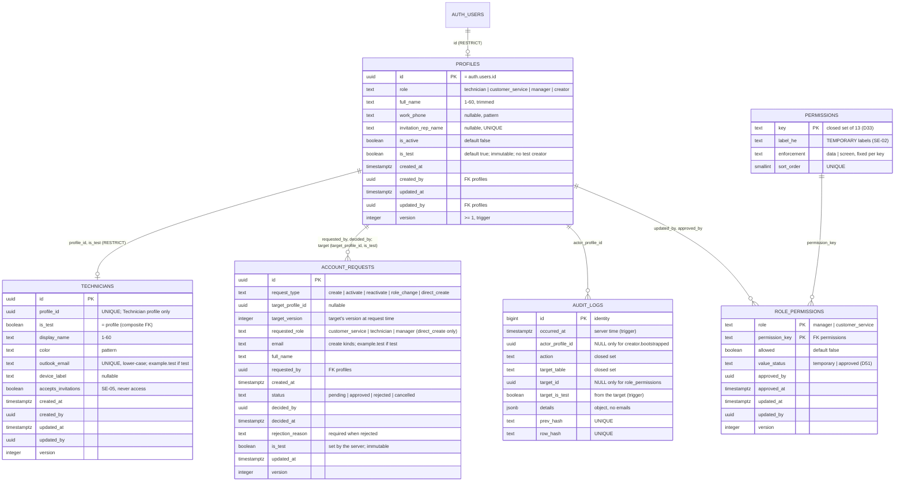

# Step 1 / PR 1.3 — Migration 1 (access and permissions): test report

**Status (2026-11-04): prepared and tested locally only. Not applied to any Supabase project.** Nothing contacted the remote project (no MCP Supabase tool, no `link`, no `--linked`/`--project-ref`); `supabase/config.toml` is unchanged. Two independent reviews (security, and design conformance; D53) were done on the first version; their findings and what the fix pass did with each are in section 12. An independent re-review (security, and the migration guard) of that fix pass (`e843e1e`) found no privilege escalation for an API role but six security findings (R-S1 to R-S6) and eleven guard findings (R-G1 to R-G11); the second fix pass and its disposition of each finding are in section 14. The second fix pass and fix rounds 1–3 (section 14) had their final independent review on 2026-11-05 (security, data integrity, operations and test quality; section 15): no path for an API role through the API, 8 confirmed findings and 7 nits, all handled in the final-review fix round (section 15). **That fix round changes authorization code (the `search_path` of every function, `request_account_change`, `decide_account_request`, `admin_create_technician`), the down script and the anchor files, and has not been reviewed independently yet; D53 requires that before merge.** Applying the migration needs, in this order: the owner's D50 Auth settings change, an owner-approved read-only check of the remote (Q9), then the owner's separate migration approval (D52 rule 4, D53).

**Canary-rows check (added 2026-11-05, after `main` gained PR #13):** `tests/db-canary/20261104120000.sql` gives Migration 1's six tables fictional, test-marked canary rows (49 rows, every column except three). `tests/db-canary/coverage-exceptions.json` exempts `public.role_permissions` `approved_by`, `approved_at` and `updated_by`: the migration's own 26 rows fill every allowed (role, key) pair, a fixture may only add rows, and the one-way rule forbids a real row referencing a test profile. These exceptions narrow a protected check (D54 (4)); the owner approved them on 2026-11-05 (D56 (1)), limited to these three columns and the current migration and test scope, with the D47 and D54 safeguards unchanged, to be reassessed when real approval data exists (Step 10, D51). This PR itself still needs the owner's separate merge approval (D55 (10)), and Migration 1 its separate execution approval.

## 1. Files

| File | Purpose |
|---|---|
| `supabase/migrations/20261104120000_access_and_permissions.sql` | The migration (one file) |
| `supabase/rollback/20261104120000_access_and_permissions.down.sql` | Down script (never applied by the CLI); refuses to run once data exists |
| `tests/db/000_smoke.test.sql` | Edited: census exemptions `permissions`, `role_permissions` |
| `tests/db/010_hardening.test.sql` … `090_helpers_rls.test.sql`, `990_rollback.test.sql` | New pgTAP tests |
| `tests/db/015_pg_temp_shadowing.test.sql` | New (final review SEC-1): a domain the caller creates in `pg_temp` to shadow `text`, `uuid`, `jsonb` or `timestamptz` never runs inside a function body |
| `tests/db/065_audit_anchor.test.sql` | New (re-review R-S4, final review DI-1, DI-2): the self-contained anchor files detect tampering after the in-database verification functions were replaced, the append-only triggers changed or an event trigger installed |
| `scripts/check-migrations.mjs`, `tests/ci/check-migrations.test.mjs` | Migration guard: a tokenizer modelled on the PostgreSQL lexer (not a parser) and rules 0–9 (section 8) |
| `tests/ci/rollback.test.mjs` | Every migration has a down script that is one DO block refusing first; `tests/db` runs byte-identical copies |
| `docs/review/step1-pr13/audit-anchor-record.sql`, `docs/review/step1-pr13/audit-anchor-check.sql`, `tests/ci/audit-anchor-check.test.mjs` | Self-contained audit anchor (section 9): two read-only SELECTs; `065` runs byte-identical copies; the node test proves each is one SELECT with every name qualified that names nothing in `private` |

## 2. Objects the migration creates (for the apply approval)

Applied as `postgres` in one transaction; it refuses any other role. Supported ways to apply it (review OPS-3): the Supabase CLI, MCP `apply_migration` (one query string, name `access_and_permissions`, section 10) or `psql --single-transaction -v ON_ERROR_STOP=1 -f`; plain `psql -f` without those flags would report the role refusal and run the rest. Every function in `public` and `private` pins `search_path = pg_catalog, pg_temp` (final review SEC-1).

- **Privilege changes (first statements, and again at the end):** revoke ALL on all tables, sequences and functions in `public` from `PUBLIC`, `anon`, `authenticated`, `service_role`; revoke `CREATE` on schema `public` from the same; `ALTER DEFAULT PRIVILEGES FOR ROLE postgres IN SCHEMA public` revoke ALL on tables, sequences and functions from the same; `ALTER DEFAULT PRIVILEGES FOR ROLE postgres` (global) revoke EXECUTE on functions from `PUBLIC`. At the end: revoke ALL on all tables, sequences and functions in `public` and `private` again, then the explicit grants below.
- **Schema:** `private` (owner `postgres`; USAGE for `authenticated` only).
- **Tables (6), RLS enabled on each:** `public.profiles`, `public.technicians`, `public.permissions`, `public.role_permissions`, `public.account_requests`, `public.audit_logs` (identity sequence `public.audit_logs_id_seq`). 68 constraints (keys, foreign keys all `ON DELETE RESTRICT`, `CHECK`s) and 21 indexes, among them the partial unique indexes `account_requests_one_pending_per_target` and `account_requests_one_open_create_per_email`.
- **Trigger functions (11, `private`, SECURITY INVOKER, no grants):** `tg_bump_version`, `tg_immutable_markers`, `tg_reject_update_delete`, `tg_reject_delete`, `tg_reject_truncate`, `tg_one_way_people`, `tg_profile_guard`, `tg_technician_guard`, `tg_account_request_guard`, `tg_audit_target`, `tg_audit_chain`; **29 triggers** on the six tables (version, immutable markers, one-way rule, no DELETE, append-only, BEFORE TRUNCATE on all six, guards, audit target and chain).
- **Internal functions (`private`, no grants):** `audit_row_hash`, `write_audit`, `audit_chain_verify(anchor_id, anchor_row_hash)` (owner only), `require_caller`, `bootstrap_first_creator(uid, full_name)` (owner only, never run, D49).
- **Helpers (`private`, SECURITY DEFINER, EXECUTE for `authenticated`):** `is_active_user`, `has_role`, `is_creator`, `is_office_user`, `has_permission`, `my_technician_id`.
- **RPC bodies (`private`, SECURITY DEFINER, 14):** `admin_set_role_permission`, `admin_approve_role_permission` (**no grant**, TEMPORARY, Q6), `assert_can_manage`, `assert_can_change_credentials`, `authorize_account_creation`, `admin_create_profile`, `admin_set_user_role`, `admin_set_user_active`, `admin_update_profile`, `admin_create_technician`, `admin_update_technician`, `request_account_change`, `decide_account_request`, `cancel_account_request`.
- **Public API (`public`, SECURITY INVOKER, 18):** a thin wrapper with the same name and arguments for each of the 14 bodies, `has_permission`, `is_creator`, `my_technician_id`, and `test_data_census()`.
- **RLS policies (12, all SELECT, all `TO authenticated`):** `profiles_select_own`, `profiles_select_creator`, `profiles_select_manager`, `technicians_select_own`, `technicians_select_office`, `permissions_select_office`, `role_permissions_select_creator`, `role_permissions_select_own_role`, `account_requests_select_creator`, `account_requests_select_requester`, `audit_logs_select_creator`, `audit_logs_select_manager`.
- **Grants:** SELECT on the six tables to `authenticated`; EXECUTE to `authenticated` on 36 functions: 17 in `public` (16 wrappers and `test_data_census`) and 19 in `private` (the 6 helpers and 13 RPC bodies); `admin_approve_role_permission` has no grant in either schema (review D2). Nothing for `anon`, `service_role` or `PUBLIC`.
- **Rows:** the 13 D33 permission keys and the 26 D33 default values, all `value_status = 'temporary'` (D51). No other rows: no test data, no user, no Creator.

## 3. ER diagram (actual columns)



## 4. Who can do what (PR 1.3 objects)

"RPC" = only through the named function; there is no direct INSERT, UPDATE or DELETE for any API role. Every row requires an active profile.

| Object / action | Creator | Manager | Customer Service | Technician | anon | service_role |
|---|---|---|---|---|---|---|
| `profiles` read | all | Technician and Customer Service profiles and his own | his own | his own | ✗ (no grant) | ✗ (no grant) |
| `technicians` read | all | all | with `cal` or `calls` | his own row | ✗ | ✗ |
| `permissions` read | ✓ | ✓ | ✓ | ✗ | ✗ | ✗ |
| `role_permissions` read | all | Manager values | Customer Service values | ✗ | ✗ | ✗ |
| `account_requests` read | all | his own requests and creation intents | ✗ | ✗ | ✗ | ✗ |
| `audit_logs` read | all | his own actions; Technician and Customer Service accounts; technicians; his requests; never matrix rows | ✗ | ✗ | ✗ | ✗ |
| Change a matrix value | RPC (real Creator; CS `cancel` and `usage` locked) | ✗ | ✗ | ✗ | ✗ | ✗ |
| Mark a matrix value approved | ✗ through the API (TEMPORARY, Q6). Only the owner's database role, and only with an active real Creator's id in `request.jwt.claims`; the value is then recorded as approved by that Creator (review D1) | ✗ | ✗ | ✗ | ✗ | ✗ |
| `has_permission(key)` | every key except `usage` (TEMPORARY, d13) | matrix | matrix | none | ✗ | ✗ |
| `assert_can_manage(role)` (pre-check, no audit) | any role | Technician, Customer Service | ✗ | ✗ | ✗ | ✗ |
| Authorize a creation (phase 1, audited) | Technician, Customer Service, Manager; never Creator | Technician only | ✗ | ✗ | ✗ | ✗ |
| Create the profile (phase 3) | against his own intent, or an approved Customer Service request | against his own intent | ✗ | ✗ | ✗ | ✗ |
| Change a role | RPC (not his own; never to Creator) | request only (CS ↔ Technician; active accounts only, TEMPORARY, SEC-2, Q19) | ✗ | ✗ | ✗ | ✗ |
| Deactivate | anyone but himself (last Creator locked) | Technician, Customer Service, immediately | ✗ | ✗ | ✗ | ✗ |
| Activate / reactivate | anyone but himself | Technician immediately; Customer Service by request | ✗ | ✗ | ✗ | ✗ |
| Update name, phone, alias | any account | Technician and Customer Service (not himself) | ✗ | ✗ | ✗ | ✗ |
| Create / update technician field profile | ✓ | ✓ | ✗ | ✗ | ✗ | ✗ |
| Request a Customer Service change | ✗ (acts directly) | ✓ | ✗ | ✗ | ✗ | ✗ |
| Decide a request | ✓ (refused when stale, Q17) | ✗ | ✗ | ✗ | ✗ | ✗ |
| Cancel a request | his own pending ones; any approved creation not yet fulfilled | his own pending ones and his unfulfilled creations | his own (none exist) | his own (none exist) | ✗ | ✗ |
| Authorize a password or email change | ✓ (audited) | ✗ | ✗ | ✗ | ✗ | ✗ |
| `test_data_census()` | ✓ | ✗ | ✗ | ✗ | ✗ | ✗ |
| `bootstrap_first_creator`, `audit_chain_verify`, `write_audit` | ✗ (owner's database role only) | ✗ | ✗ | ✗ | ✗ | ✗ |

A test user manages only test targets. Until go-live every new user is a test user (TEMPORARY); the first Creator is the only real-marked account.

**Supabase-managed readers (re-review R-S6).** Outside the API roles in this table, the Supabase-managed login roles `supabase_read_only_user` and `supabase_etl_admin` have `BYPASSRLS` and are members of `pg_read_all_data`: they can read all six tables, including `profiles` and `audit_logs`. They belong to the platform (read-only replicas, ETL) and sit inside the accepted owner-level boundary, like `postgres` and `supabase_admin`; nobody in the app can use them. `pg_write_all_data` has no members locally.

## 5. Two-phase account creation (§8.5, security.md §5, D34)

1. **Phase 1, under the caller's session, before any Auth Admin call, audited:**
   - Manager → Technician, Creator → Technician, Customer Service or Manager: `authorize_account_creation(role, email, full_name)` stores an approved `direct_create` row in `account_requests` (requested and decided by the caller) and writes `account_creation.authorized`.
   - Manager → Customer Service: `request_account_change('create', …)`, then the Creator's `decide_account_request(…, 'approve', …)` (both audited).
2. **Phase 2 (Step 2 server):** the Auth Admin API creates the Auth user with the secret key. It never inserts a profile.
2a. **The binding nonce (re-review R-S1):** the Step 2 server creates the Auth user with `app_metadata.account_request_id` set to the intent id that phase 1 returned (lower-case canonical UUID). Only the secret key can write `app_metadata`; a sign-up, another intent's Auth user or an Auth user made for a cancelled intent never carries the right value. **This is a Step 2 server requirement.**
3. **Phase 3, under the caller's session:** `admin_create_profile(uid, role, full_name, phone, alias, request_id)` binds the Auth user to the open intent: approved, not fulfilled, same role, same email, the same caller for a `direct_create` (the Creator for a Customer Service request, Q14), the Auth user's `app_metadata.account_request_id` equal to the intent id, the Auth user created after the authorization (no clock tolerance: a false refusal fails closed, and the intent is cancelled and authorized again), and the Auth user neither anonymous, SSO nor soft-deleted. Every binding failure returns the same `42501 not authorized`, so the call reveals nothing about Auth users or profiles.

An Auth user can be bound only through the intent it was created for: cancelling that intent and authorizing a new one for the same email (by anyone, the requester included) does not make it bindable (`040` and `050` test both orders the re-review found, R-S1 a and b). Only one creation per email can be open at a time (partial unique index; `020` proves the index alone refuses a second one, R-S5). An unfulfilled approved creation can be cancelled by its requester or the Creator, never by another Manager (`050`), so a failed Auth call never blocks the email for good. The binding no longer depends on D50 sign-up being off. No upper time limit on an intent is enforced (an Auth user still needs the nonce, which only the server sets); an intent lifetime would be a product rule (owner question Q16).

## 6. Hardening evidence (local database built from the migration)

Catalog queries run as `postgres` on the local stack after `supabase db reset --local --no-seed`:

```
-- Q1 relations in public and private: owner, ACL, RLS
public | account_requests  | r | postgres | {postgres=arwdDxtm/postgres,authenticated=r/postgres} | t
public | audit_logs        | r | postgres | {postgres=arwdDxtm/postgres,authenticated=r/postgres} | t
public | audit_logs_id_seq | S | postgres | {postgres=rwU/postgres}                               |
public | permissions       | r | postgres | {postgres=arwdDxtm/postgres,authenticated=r/postgres} | t
public | profiles          | r | postgres | {postgres=arwdDxtm/postgres,authenticated=r/postgres} | t
public | role_permissions  | r | postgres | {postgres=arwdDxtm/postgres,authenticated=r/postgres} | t
public | technicians       | r | postgres | {postgres=arwdDxtm/postgres,authenticated=r/postgres} | t

-- Q2 default privileges of postgres (pg_default_acl)
(global) | f | {postgres=X/postgres}
public   | f | {postgres=X/postgres}
public   | r | {postgres=arwdDxtm/postgres}
public   | S | {postgres=rwU/postgres}
storage  | f, r, S | unchanged Supabase defaults (Supabase-managed; Storage is Step 4, review S10)

-- Q3 schema ACLs
public  | owner pg_database_owner | USAGE for PUBLIC, anon, authenticated, service_role (kept for PostgREST); CREATE for the owner only
private | owner postgres          | {postgres=UC/postgres,authenticated=U/postgres}

-- Q4 functions in public and private (54: 18 public, 36 private) that each role can execute
anon 0 | authenticated 36 | service_role 0

-- Q5 SECURITY DEFINER functions: 20, all in private, owner postgres, search_path=pg_catalog, pg_temp
--    (every one of the 54 functions in public and private; final review SEC-1)
-- Q6 policies: 12, all SELECT, all TO authenticated
-- Q7 test_data_census() on the fresh database: every count 0
profiles 0 | technicians 0 | account_requests 0 | audit_logs 0 | permissions exempt | role_permissions exempt | storage none
```

Before this migration the local database showed the PR 1.2 finding: `postgres` default privileges in `public` granted `anon`, `authenticated` and `service_role` full access to new tables (`arwdDxtm`), sequences (`rwU`) and functions (`X`). Q2 shows them revoked; `tests/db/010` creates a probe table, sequence, view and function in `public` and `private` and proves no API role gets any privilege. The default privileges of `supabase_admin` in `public` are still permissive; `postgres` cannot change them (section 10).

## 7. Tests (local, 2026-11-05, after the final-review fix round)

Commands: `node scripts/check-migrations.mjs`, `npm run test:ci`, `npm run lint`, `supabase db reset --local --no-seed`, `supabase test db tests/db`.

| File | Tests | Covers |
|---|---|---|
| `000_smoke` | 7 | PR 1.2 catalog checks (two census exemptions added) |
| `010_hardening` | 31 | Exact table grants, no write/TRUNCATE/REFERENCES/TRIGGER/MAINTAIN grants, no column grants, sequences, exact EXECUTE list for `authenticated`, nothing for `anon`/`service_role`/`PUBLIC`, approval function not executable (Q6), SECURITY DEFINER rules, `search_path = pg_catalog, pg_temp` everywhere (SEC-1), no dynamic SQL, ownership, default privileges, schema USAGE/CREATE, policies, `ON DELETE RESTRICT`, no views, probe objects |
| `015_pg_temp_shadowing` | 17 | Final review SEC-1: as `authenticated`, domains in `pg_temp` shadow `text`, `uuid`, `jsonb` and `timestamptz` with a CHECK that refuses to run as anyone else; fixtures (bootstrap, profiles, field profile), Manager and Creator RPCs, a caller without a profile, helpers, policies and the census all behave as without them and nothing runs as `postgres`; positive controls: an unpinned SECURITY DEFINER function runs the CHECK as `postgres`, a pinned one does not |
| `020_markers` | 48 | Defaults, immutable markers (also as `postgres`), composite foreign keys, `example.test`, no test Creator, the manager-role and direct-creation `CHECK`s, technician link, immutable creation fields, no promotion to Creator, last Creator, one-way rule (profiles, requests, matrix, technicians, audit), audit actor `CHECK`, request transitions (no cancel after an approved reactivation, cancel of an unfulfilled creation, no re-link, no cancel or unlink of a fulfilled one), the two partial unique indexes alone refuse a second open creation per email and a second pending request per account (R-S5), no deletes, Auth user delete restricted |
| `030_matrix` | 60 | Catalogue (the key CHECK by name and its exact key list, the exact labels), 26 defaults all temporary, role `CHECK`, pending-decision locks, `has_permission` per role / deactivated / no profile / anon, Creator-only change with audit and immediate effect (real-marked Manager, Customer Service and Technician callers refused by the role check itself, T1), version conflict, approval not executable through the API (Q6) and its rules as the owner's role (refused without a Creator's claims, D1; for real-marked callers; stale version; approval CHECK), reset to temporary, a later key is denied, direct writes denied for authenticated, `service_role`, anon |
| `040_accounts` | 142 | `assert_can_manage` matrix; two-phase creation (audited intent before the Auth user, one open intent per email, generic errors, other caller's intent, role must match, nothing creates a Creator); the binding nonce (R-S1: missing, naming another intent, right nonce but wrong email, anonymous, SSO, soft-deleted, created an hour or 30 seconds before the authorization, an Auth user of a cancelled intent through a new intent and through the cancelled one); Customer Service and Technician callers of every account RPC (a test-marked Customer Service caller of `admin_update_technician` and a Technician caller of `admin_create_technician`, T2; real-marked Manager and Technician callers of the Creator-only credential and role functions, T1); the audit rows of phase 3 and of a new field profile (T3); role change; (de)activation rules of D34 b/c; immediate revocation; credentials; direct writes denied for every role; profile and technician updates (stale versions, `updated_at` advancing, unique Outlook email, T5); a Manager gets the generic error for a profile he cannot read (SEC-3) and does not read the Creator's audit rows about his own account (T4); generic duplicate-alias error; test Manager vs real Technician targets; Outlook-email audit (D34 f) |
| `050_account_requests` | 98 | Nothing changes while pending, forbidden requests, request stores the target version, RLS per role, Creator-only decisions, rejection reason, fulfilment of an approved create (nonce, email, role, request kind, once), pending create not fulfillable, stale approvals refused (account changed, requester left) but rejectable, cancellation by the requester, cancellation of an approved unfulfilled creation by the Creator, re-request afterwards; another Manager cannot cancel a Manager's or the Creator's approved creation (R-S5); an Auth user created for an approved request that the requester cancelled is not bound through his new intent (R-S1 b); the fulfilment's audit row (T3); a deactivated Manager reads none of his requests (T4); no role change request for an inactive account (SEC-2); real-marked Manager, Customer Service and Technician callers cannot decide, and a request takes its marker from its target (T1, T2); stale cancellation; the decision and rejection CHECKs (T5) |
| `060_audit` | 43 | Hash chain verifies; UPDATE/DELETE/TRUNCATE denied for authenticated and `service_role`, rejected by trigger even with grants and for `postgres`; truncate triggers on all six tables; naive tamper detected and restored; forged server fields overwritten; ids follow the chain; fork refused by `UNIQUE (prev_hash)`; anchoring: recomputed rewrite and deleted newest rows undetected without an anchor, detected with one; deleted middle row detected; who reads the audit; a matrix audit row has no target id (CHECK, T5) |
| `065_audit_anchor` | 19 | The self-contained anchor (section 9), both files run as views with the anchor in psql variables: it records the anchor and fingerprint; accepts the intact chain and a later row; after `private.audit_row_hash` is replaced and the chain rewritten, and after `private.audit_chain_verify` is replaced and every row deleted (R-S4), the in-database function is fooled and the self-contained check is not; a disabled append-only trigger, a trigger recreated under its name with another function or a WHEN clause, every trigger dropped (false, not NULL) and forced RLS are reported (DI-2); an owner-level event trigger (DI-1) and a switched session role are reported; positive controls |
| `070_census` | 16 | Census 0; on the fresh database no rows in any table of `public`/`private` except 13 keys and 26 values, no rows in any view (fix round 3, V2-7; approved reference views: none) with its own positive control, no Auth user, no Storage bucket; coverage equals the catalogue; exemptions; positive control; who may run it |
| `080_bootstrap` | 16 | Not run by the migration; no EXECUTE for API roles; refuses JWT claims; unknown user; existing profile; one real active Creator with audit; second run fails |
| `090_helpers_rls` | 42 | Helpers and reads per role (Creator, Manager, Customer Service, Technician A and B, inactive, no profile), forged JWT and metadata claims ignored, anon and `service_role`, data key enforcement on `technicians`, role change revokes immediately; an inactive Creator reads nothing and cannot run the census (T4) |
| `990_rollback` | 15 | The down script refuses to run with a profile present, and without a migration history row (OPS-1), and drops nothing; then runs on the empty tables with a CLI and an MCP-style history row and leaves a clean catalogue with the hardening kept and no history row |
| **Total pgTAP** | **554** | All pass |
| `tests/ci` (node) | 78 | Migration guard 64 (4 added in fix round 1: N1 twice, N2, N3; 16 in fix round 2: V1-1 to V1-9, every verification input, rule 9, and three for the kill-check gaps and the paths found while completing the round; 10 in fix round 3: V2-1 three times, V2-2 to V2-6, V2-8, V2-9), rollback copies and structure 4, audit anchor files 10 (five per file: copy, one SELECT, qualified names and operators, what it reads, psql variables; final review DI-1) |

**Negative controls.** First version: granting `anon` SELECT on `profiles`, re-adding an `anon` default privilege on sequences, replacing `has_permission` with `true` and disabling the audit append-only trigger made 32 tests fail across 7 files. First fix pass: a committed one-row table in `public` made `070` fail; the first reviews' guard bypasses fail the guard (node tests). Second fix pass, each change applied inside the test file's transaction (pgTAP) or to a copy of the guard (node):
- R-S1: removing the nonce condition made 5 tests in `040` and 1 in `050` fail; restoring the one-minute tolerance made 1 fail (`040`); removing the anonymous, SSO and deleted checks made 3 fail (`040`).
- R-S5: dropping both partial unique indexes made 3 tests in `020` fail; letting anyone cancel an approved request made 4 fail in `050`; letting the request guard cancel or unlink a fulfilled creation made 2 or 3 fail in `020`. The fourth control the review named (the Creator-only condition for binding a `create` request) cannot be reached: the earlier `p_role` check already refuses a Manager; it stays as defense in depth, as S7 item 1 did.
- Guard: 22 mutants, one per control (EXECUTE, COPY, U&, RENAME, UPDATE forms, marker defaults, dollar quotes only as bodies, nested DO/definitions, string continuation, `\r` line ends, `b''`/`x''` strings, PostgreSQL whitespace, table pinning, signature pinning, BEFORE INSERT triggers, identifier truncation, header references, writer-body markers, bare-name references, ALLOWED_WRITERS names as writers, plain VALUES, `pg_temp`): each makes at least one node test fail.
- Fix round 1 (guard only, the database is unchanged): 21 mutants, one per new control (each rewrite kind on an existing table: DROP COLUMN, TYPE, SET EXPRESSION, ADD COLUMN with a DEFAULT, `default null::int`, GENERATED, serial; CREATE CAST; ALTER/DROP ATTRIBUTE; RENAME TO only; the `*` in a rule's UPDATE; ALTER TABLE only at the start of a statement; the new-table rules: INSERT, IF NOT EXISTS, top level only, per file, unqualified ALTER, unqualified CREATE, function bodies), each fail a node test. On the local database (rolled back) a bare `rename x to y`, drop and re-add with a default (every row became `manager`), a built-in `numeric(10,2)` → `numeric(10,0)` type change (rounded every row) and a rule `do update t * set` all ran, so each is a real path.
- Fix round 2 (guard only, the database is unchanged): 69 mutants, one per new control (three-part names and each fail-closed name reader; UPDATE after `DO` and after `FOR`, the locking-word list and the target read after it; the trigger allowlist, its pinning, `INSTEAD OF`, the rule in bodies and in statements that run, the body rules for every NEW form including a declared `new`, block-label `new`, target lists, the return rule, no nested definitions, PL/pgSQL only; each denied schema and function, quoted, unqualified and in `search_path`; `E''` strings in a `search_path`; the pg_graphql string; `CONSTRAINT <name> DEFAULT`, `SET DEFAULT`/`DROP DEFAULT` forms; `LIKE`; typed tables; column types on ADD COLUMN and in reference tables, domain base types, unquoted and `pg_catalog`-only built-ins, types named like built-ins, top-level and earlier-statement creation; the DO-block CREATE; rule 9, its writer-body and top-level limits, its blanking and main's markers). Each fails a node test. The first run of this kill check left 4 survivors (the INSERT reader's own fail-closed message, the target read after a locking-clause word, a type created inside a DO block, the `pg_catalog`-only built-in schema); a node test was added for each. On the local database (rolled back) six paths found in this round were real: a trigger function that declares a variable named `new` stored `is_test = t`, `data_source = 'simulator'` through a plain INSERT; a column whose domain is a domain over `information_schema.time_stamp` filled every existing row; a typed table's column took the default of its attribute's domain; `open c for update nowait set …` through a view named `nowait` rewrote all 13 labels (the guard already rejected it; now a node test); `set local search_path = e'\x76ault', public` made `create_secret` reachable unqualified and stored a secret (the guard rejected that input only by the function's name; `cron.schedule` or `pgmq.send` would have passed); and `create domain public.date as information_schema.time_stamp` with `search_path = public, pg_catalog` filled all 13 rows of `add column c date`. All six now fail the guard. All 24 inputs of verification round 1 (E1–E17, E5b, E8b, NEWV and the four NEW forms) are rejected (a node test covers each kind).
- Fix round 3 (guard and `070_census`; the migration is unchanged): 26 mutants, one per new control (`client_encoding`, `SET NAMES` and its `LOCAL`/`SESSION` forms, non-ASCII in `E''`; lower-cased writer names when added, looked up and taken from `ALLOWED_WRITERS`; the option-string rule, its plain-string limit, `TEXT SEARCH`, `ALTER`, `OPERATOR`, `TYPE`, the lower-cased key; `EXCLUDE` as a column in ALTER TABLE and CREATE TABLE, with `USING` or `(` as a constraint; the MERGE INSERT action, its target in bodies, `MERGE INTO ONLY`, the MERGE INSERT in a statement that runs; the SQL-text functions; ALTER TABLE … OF; ADD ATTRIBUTE; the top-level reference INSERT). The first run left 3 survivors: two missing tests (a mixed-case `ALLOWED_WRITERS` entry, `MERGE INTO ONLY` into a pinned table), now added, and one equivalent mutant (lower-casing inside the writer lookup: every name it receives is already lower-cased except a definition's own name, which only skips work). With the new tests the other 25 fail a node test. All 22 verification round 2 inputs that write or could write (A1, A1b, A1c, A1f, A1g, A2, A2b–A2e, A3, B1, G1, H1–H4, I1, J2, J5, K2, K3) are rejected; the lexer probes C1, C3, C5, C6 and D1–D5 still pass, because the guard reads them as PostgreSQL does (none hides a statement), and F1 (a view of constant rows) passes the guard and is caught by `070` (and, while no view is approved, `010`). On the local database with F1 applied, the new view check failed and the round 2 `070` passed; `ts_stat('select private.<writer>()')` and `ts_rewrite(…, 'select private.<writer>(), …')` each rewrote all 13 labels (rolled back), so both now fail by name.
- The first fix pass's multi-statement down script fails the new single-DO-block node test; an anchor check that calls a `private` function fails its node test.
- All 65 probe cases of the guard re-review (O1–O17, A1–A27, B1–B4, C1–C17) and the 7 probes g1–g8 of the security re-review are rejected (a scratchpad harness, not committed; each kind is also a node test).
- Final review (section 15): 37 mutants, one per finding's control (SEC-1 to SEC-3, OPS-1, and the mutants T1 to T5 named), applied inside each test file's own transaction on an isolated local project: each makes at least one pgTAP test fail. `015` run against the migration before the fix: 12 of 17 fail. The anchor node test: the previous anchor file and 7 single-change mutants each fail it.

**Rollback round trip (manual, local, second fix pass).** With a committed bootstrapped Creator and its audit row, plain `psql -U postgres -f <down script>` (no `ON_ERROR_STOP`, no `--single-transaction`, the R-S3 case) printed the refusal and dropped nothing (`private` present, 18 functions in `public`, the audit row and the history row present); with the recommended flags it was refused too (exit 3). After `supabase db reset`, plain `psql -f` ran it on the empty tables: no `private` schema, no relation or function in `public`, no history row, the `postgres` default privileges still hardened (`public` r/S/f and global f: owner only). Re-applying the migration with `psql --single-transaction` and restoring the history row: 479/479 pass; a final `supabase db reset` restored the CLI-managed state (0 Auth users, 0 profiles, 0 audit rows).

**Not run:** anything remote; the GitHub Actions workflows (they run on the PR); the HTTP/PostgREST level with the local publishable key (not read, by rule); two-session tests of the locks (`require_caller … FOR SHARE`, the bootstrap `LOCK TABLE`, the audit advisory lock; pgTAP runs one session, the review checks them); an independent review of the final-review fix round (section 15, D53).

## 8. Migration guard change (needs the owner's acceptance, Q1)

`scripts/check-migrations.mjs` was rewritten in the second fix pass (re-review R-S2, R-G1 to R-G11): the first fix pass matched regular expressions over text with the strings blanked out, and both re-reviews showed forms it misread. It now reads SQL with a tokenizer and matches every rule on tokens. The tokenizer is modelled on the PostgreSQL lexer for the forms migrations use; it is not a reimplementation of it, and the guard is not a SQL parser (fix round 3, V2-10, corrects the earlier claim that it "follows the PostgreSQL lexer"). It reads those forms as PostgreSQL reads them with the UTF8 client encoding and `standard_conforming_strings` on, and fails closed on what could make PostgreSQL read a file differently. Rules that read a construct (a target, a column definition, an option list) read the forms listed below and fail on what they cannot read; constructs they do not model are left to the review (the list at the end of this section).
- **Tokenizer (R-G4, R-G7):** nested comments; `--` comments end at a newline or a carriage return (as in PostgreSQL); standard strings, `E''` strings (backslash escapes), `b''`/`x''` strings (no `''` escape), quoted identifiers, dollar quotes with tags of any length; PostgreSQL's whitespace only; unquoted identifiers lower-cased and truncated to 63 bytes. Fails closed on: an unterminated quote or comment, an unexpected character, any non-ASCII character outside a string or comment (identifiers, dollar tags, a no-break space) or inside an `E''` string, `U&''`/`U&""` escapes, a string continued across a newline (PostgreSQL joins it, and an `E''` string keeps its escapes there), any lexer error inside a body, and naming a setting that changes how PostgreSQL reads the rest of the file: `client_encoding` (as a name, quoted or not, in a string, in a function's or role's `SET` clause) and `SET [LOCAL | SESSION] NAMES` (fix round 3, V2-1: after `set client_encoding = 'SJIS'` PostgreSQL read the bytes of `Á\` as two characters, ended `e'Á\', private.w() --'` after the backslash and called the writer the guard had read as part of a string), besides `standard_conforming_strings` and `backslash_quote` (rule 6). Plain `'…'` strings may hold Hebrew; `E''` strings may not hold any non-ASCII character.
- **Code is always read as code:** a function definition or a DO block is recognised wherever it starts in a statement (in PL/pgSQL after `BEGIN`, `THEN`, `LOOP` …), and a dollar quote is allowed only as such a body; dollar-quoted data fails, so nothing can hide in one. Bodies must be dollar-quoted `LANGUAGE sql` or `plpgsql`.
- **Rule 0 (names, fix round 2):** a name with three parts (`postgres.public.permissions`: PostgreSQL accepts the current database's name, which is `postgres` locally and on hosted Supabase; also `record.field.field`) fails anywhere, and every rule that reads a schema-qualified name (an INSERT, ALTER TABLE, CREATE TABLE/VIEW or trigger target, a column type) fails closed when it cannot read one.
- **Rule 1–2 (statements that run):** INSERT only as `insert into public.<reference table> (columns) values (constants), …` with an approved reference table named exactly `public.<name>`, no marker column (`is_test`, `data_source`, `target_is_test`), plain `'…'` strings, numbers, `true`, `false`, `null`, nothing after the VALUES list, no test marker in the strings, and only as a top-level statement of the file, never inside a DO block, where an `IF` decides whether it runs (fix round 3, V2-9). No ALTER may set a marker-column default other than exactly `false`, on any table (`DROP DEFAULT` only as `ALTER [COLUMN] x DROP DEFAULT`), and a reference table may not be created with one (a new business table may default `is_test` to `true`: `profiles` does, as a fail-safe, and the table has no rows when it is created); no generated marker, no domain or base-type default, no `CONSTRAINT <name> DEFAULT` (a constraint named `set` or `drop` hid a default; fix round 2), no `CREATE TABLE … (LIKE …)` and no typed table `CREATE TABLE … OF <type>` (both take columns and defaults from elsewhere), and every column of a reference table has a built-in type or a type the files create (rule 7). **Reference-table triggers (fix round 2):** a BEFORE or INSTEAD OF INSERT trigger on a reference table (or on a table the guard cannot read), wherever it is created, may run only a function in `ALLOWED_REFERENCE_TRIGGERS` (today only `private.tg_one_way_people()`), named schema-qualified and defined in the files; every definition of that function must be a PL/pgSQL body that never changes `NEW` (assignment with `:=` or `=`, `INTO [STRICT]`, `FOR`/`FOREACH`, `ALIAS FOR`, `GET [STACKED] DIAGNOSTICS`, `CALL`, a variable declared as `new`), defines no other function and returns only `NEW` or `NULL` (so `return jsonb_populate_record(new, …)` or a changed copy fails). A string that reads as an INSERT into a business table, or as a pg_graphql mutation, fails anywhere.
- **Rule 3:** no `COPY` anywhere (also in bodies), no `EXPLAIN`, no `LOAD`.
- **Rule 4 (writers):** an INSERT in a function body is allowed only in an `ALLOWED_WRITERS` entry, pinned to its exact signature and its tables (`private.write_audit(text,text,uuid,jsonb)` → `public.audit_logs`, `private.authorize_account_creation(text,text,text)` and `private.request_account_change(text,uuid,text,text,text)` → `public.account_requests`, `private.admin_create_profile(uuid,text,text,text,text,uuid)` and `private.bootstrap_first_creator(uuid,text)` → `public.profiles`, `private.admin_create_technician(uuid,text,text,text,text,boolean)` → `public.technicians`), and its strings carry no test marker. A `MERGE … WHEN NOT MATCHED THEN INSERT` action is an INSERT into the MERGE target and follows the same pinning (fix round 3, V2-5: a writer pinned to `audit_logs` inserted into `technicians` through MERGE). A function whose body or header (parameter defaults, options) inserts, updates, deletes, merges or truncates, or names a writer, is a writer; every `ALLOWED_WRITERS` name is a writer even without a definition in the files. Writer names are compared lower-cased on both sides (fix round 3, V2-2: a writer defined as `private."Wf"()` was invisible to every call form; comparing case-insensitively also treats `"Wf"` and `wf` as one name, which only fails closed). A statement that runs may not name a writer at all, with or without `(` (call, `CALL`, trigger, operator, aggregate, cast, default, policy, view, index); only GRANT, REVOKE, COMMENT ON and DROP FUNCTION/PROCEDURE/ROUTINE may. PostgreSQL also takes a function name as a string in the options of CREATE/ALTER AGGREGATE, OPERATOR, TYPE and TEXT SEARCH (`sfunc = 'w'`, `function = 'w'`, `input = 'w'`, `restrict = 'w'` …), which no name rule reads: there a string value fails, except a plain `'…'` string for `initcond`, `minitcond`, `category` and `delimiter`, which never name a function (fix round 3, V2-3: an aggregate and an operator ran a writer this way).
- **Rule 5 (D49):** `bootstrap_first_creator` only in its own definition header, REVOKE and COMMENT ON FUNCTION.
- **Rule 6:** no `EXECUTE` anywhere, function bodies included (except privilege lists and `EXECUTE FUNCTION/PROCEDURE` in CREATE [EVENT] TRIGGER); no built-in that runs SQL text or writes outside the schema (`query_to_xml` and relatives, `dblink*`, `http*`, `set_config`, `lo_*`, file functions, `create_secret`, `update_secret`, `resolve`), quoted or not; no function that runs SQL text given as an argument, where a writer or an UPDATE is only a string to every other rule (fix round 3, V2-6: pgTAP's `lives_ok`, `throws_*`, `results_eq`/`results_ne`, `set_*`, `bag_*`, `is_empty`, `isnt_empty`, `row_eq`, `performs_*`, `cmp_ok`, `runtests`, `do_tap` and the internal functions they use, checked against the pgTAP functions whose bodies `EXECUTE` caller text; xml2's `xpath_table`; tablefunc's `crosstab*` and `connectby`; and `ts_stat` and `ts_rewrite`, which refuse DML but whose query's SELECT called a writer and rewrote all 13 labels locally, rolled back), quoted or not; the `cron`, `vault`, `net`, `pgsodium`, `realtime`, `supabase_functions`, `dblink`, `graphql`, `graphql_public`, `pgmq` and `pgmq_public` schema names fail as any name (quoted or not, followed by `.` or not, so also in a `search_path` list or a function's `SET search_path`) and inside a `search_path` string (fix round 2: `"vault".create_secret(…)` and `set search_path = vault` stored a secret, and `graphql.resolve('mutation { … }')` rewrote rows); an `E''` string in a `search_path` fails (its escapes spell any name: `e'\x76ault'` is `vault`); CREATE EXTENSION only for `ALLOWED_EXTENSIONS` (empty); no ALTER EXTENSION, subscriptions, foreign servers or tables; `standard_conforming_strings`, `backslash_quote`, `session_replication_role` and `client_encoding` may not be named, and `SET NAMES` fails (fix round 3, V2-1).
- **Rule 7:** no UPDATE in any form (`ONLY`, parentheses, `*`, aliases, in a CTE, after `THEN`; after `DO`, as in a rule action or `ON CONFLICT DO UPDATE`, always, without reading the target; after `FOR`, as in PL/pgSQL `OPEN c FOR UPDATE …`, unless a word of a locking clause or a policy follows and what follows does not read as `<name> [[AS] alias] SET`, fix round 2), DELETE, MERGE, TRUNCATE, CREATE TABLE … AS in any form, SELECT/WITH … INTO, materialized views (create or refresh), ALTER COLUMN … TYPE … USING. **Schema changes that rewrite existing rows (fix round 1, N1):** ALTER TABLE is read wherever it starts (also after `BEGIN`/`THEN` in a DO block and in a function body; before round 1 its marker-default and `TYPE … USING` checks ran only when ALTER TABLE started the statement). On an *existing* table it may not DROP COLUMN, change a type (`TYPE`, `SET DATA TYPE`, even without `USING`: a built-in conversion such as `numeric(10,2)` → `numeric(10,0)` rounds every row), `SET EXPRESSION`, or ADD COLUMN with a `DEFAULT` other than exactly `null` (`SET DEFAULT` is harmless only as `ON DELETE/UPDATE SET DEFAULT`), `GENERATED` (identity or stored), a serial type, or a type that is neither a built-in type written unquoted (optionally `pg_catalog.`) nor a type an *earlier* top-level statement of the files creates schema-qualified, a domain there only over a built-in type (fix round 2: a domain default, also one a domain inherits from its base domain such as `information_schema.time_stamp`, fills every existing row; a type created by a later statement or file may already exist outside the files when the column is added). No type or domain may be named like a built-in type: with `search_path = public, pg_catalog` an unqualified `date` is `public.date`. `EXCLUDE` is not a reserved word: `add exclude text default 'x'` adds a column named `exclude`, so `EXCLUDE` starts a constraint only when `USING` or `(` follows, in ALTER TABLE and in CREATE TABLE (fix round 3, V2-4: every column form of N1 and V1-7 passed behind that name). A table is *new* only when the same file created it earlier with a plain top-level `CREATE [UNLOGGED] TABLE <schema>.<name> (…)` (not `IF NOT EXISTS`, not temporary, not inside a DO block, which may not have run) and no INSERT in the file has targeted it yet; every other table, a table from an earlier file, an unqualified name and every table in a function body is existing. `CREATE CAST` (an assignment cast turns a type change and back into a rewrite), `ALTER TYPE … ADD/ALTER/DROP ATTRIBUTE` (it changes typed tables; `ADD ATTRIBUTE … CASCADE` fills their existing rows with an attribute domain's default) and `ALTER TABLE … OF <type>` (it makes an existing table typed; fix round 3, V2-8: together they filled every row of `permissions` with `now()`) fail everywhere.
- **Rule 8:** no RENAME of any kind (`RENAME TO`, `RENAME COLUMN`, a bare `RENAME x TO y`, `RENAME CONSTRAINT`, `RENAME VALUE`, `RENAME ATTRIBUTE`; fix round 1, N2: a marker column renamed away let a reference INSERT set it, and a renamed enum value changes every row), no SET SCHEMA, no INHERIT/INHERITS, ATTACH PARTITION or PARTITION OF, nothing in `pg_temp`, and a reference table name only as a table in `public` (no view, and no table of that name in another schema or unqualified; with rule 0 no three-part spelling either).
- **Rule 9 (never weaker than `main`, fix round 2):** `main`'s original check runs, unchanged, on every file with only the bodies of the top-level `ALLOWED_WRITERS` definitions (exact signature) blanked out; a file it rejects fails. Their INSERTs are the one relaxation this guard makes on purpose, and rules 1–8 check them.
- **Compensating runtime control:** `070_census` (census 0; no rows in any table except the listed reference data; no rows in any view or materialized view in `public` or `private` except approved reference views, none in PR 1.3, fix round 3, V2-7; no Auth user; no bucket). It and every pgTAP file run on a database built from the migrations alone, which is empty apart from the reference data: a rewrite of *populated* business tables (the drop-and-re-add, three-part-name and named-constraint forms of fix rounds 1 and 2) cannot show there and is caught only by this static guard and the review of every migration. A function that returns constant rows cannot be counted without calling it with arguments; it is checked by the review.

Compared with `main`: every probe the re-review used to show what `main` rejected is still rejected, and so are all the bypasses it found against `main` and the first fix pass; `select $$example.test$$` (which `main` passed) now fails because dollar-quoted data is not allowed. The second fix pass also found and closed a bypass shared by `main` and the first fix pass: a `--` comment ended by a carriage return hid the next statement from the guard while PostgreSQL ran it (confirmed locally). Verification round 1 found two inputs `main` rejected and the token rules passed, both text only (they write nothing): `insert into public.call_types (label_he) values ('is_test')` (a marker column's name as a value) and `select 'insert into call_types (x) values (''seed'')'` (an INSERT spelled in a string). Fix round 2 found more of that kind (an INSERT spelled in a quoted identifier or a nested comment, `copy … from` after a `;` inside a string) and closed the whole class with rule 9: `main`'s own check now runs on every file, so a file `main` rejects is rejected, except an INSERT inside a reviewed `ALLOWED_WRITERS` body. `main`'s eight node tests, run against this guard, give the same pass or fail result for every input; one test fails only because an input with two unqualified reference INSERTs gets two problems instead of one.

**What the guard cannot catch (fix rounds 1–3; the human and independent review of every migration checks these instead).** A static check cannot prove that arbitrary SQL changes no data. The guard is fail-closed: it rejects every construct it knows can insert or rewrite data outside the reviewed allowlist, and anything it cannot read. The runtime tests cannot fill that gap for existing data: `070_census` and every pgTAP file run in CI on a database built from the migrations alone, which holds no business rows, so a migration that rewrites *populated* business tables (the forms of fix rounds 1 and 2: drop and re-add a column with a default, a three-part name, a constraint named `set`) passes them and is caught only by this guard and the review. The guard does not judge:
- **Values the allowlist permits:** the values of an owner-approved reference row (S14: an INSERT into `role_permissions` with `allowed = true` in a later migration is caught only by the exact-defaults test in `030`), the defaults and generated expressions of a reference table's non-marker columns, which fill the columns a reference INSERT leaves out (only marker defaults are limited, to exactly `false`), and what an `ALLOWED_WRITERS` function does with its arguments at run time (it is never called by a migration; the review reads its body).
- **Functions created outside the migrations:** functions of Supabase-managed schemas and of extensions enabled from the dashboard are not known to the guard. The schemas and functions known to run SQL text or write (rule 6) fail by name; any other call into a schema other than `public`, `private`, `pg_catalog` or `auth`, written qualified or reached through `search_path`, is checked by the review, including inside a CHECK constraint added to an existing table (it runs once per existing row). On the local stack (CLI version of this PR) the only such function that writes is `storage.can_insert_object`, which raises in the same call so its insert never survives. `ts_stat` and `ts_rewrite` refuse DML, but fix round 3 found that the SELECT in their query can call any function, a writer included (13 labels rewritten locally, rolled back), so they now fail by name with the other functions that run SQL text (rule 6). A function that runs SQL text and is not on that list (for example from an extension enabled later) would carry a writer or an UPDATE inside a string, which no other rule reads: the review checks every call into a function outside `public`, `private` and the plain built-ins. Newer platform versions may add others (for example Storage prefix helpers), and which extensions are enabled on Technician-Management (pg_graphql included) cannot be checked without an approved remote read; their names fail regardless.
- **Removing data:** `DROP TABLE`, `DROP TYPE/DOMAIN … CASCADE` (which drops dependent columns) and DROP COLUMN on a table created in the same file. They delete data but cannot write new values; re-adding a column with a default to an existing table is rejected. The review checks every DROP; a later migration's DROP of a populated table is a destructive operation that needs the owner's approval anyway.
- **Future rows:** `ALTER COLUMN … SET DEFAULT` on a non-marker column, CHECK constraints, triggers and functions decide what later application writes store; they do not touch existing rows. ALTER keeps marker defaults at exactly `false`; a CREATE TABLE of a business table may choose `is_test default true` (`profiles` does, as a fail-safe until go-live), which can only mark later application rows as test data, never as real.
- **Security weakening that writes no data:** disabling a trigger or RLS, a policy, a grant, a role or database setting. `000_smoke` and `010_hardening` catch the catalogue-wide ones on every database built from the migrations; the review checks the rest.
- **State outside table rows:** sequence values (`setval`, `nextval`) and comments.
- **Views and functions that return constant rows (fix round 3, V2-7):** `create view … as select * from (values (…))` writes no table row. `070_census` now counts the rows of every view on the fresh database (and `010` allows no view at all today), but a view whose constant rows appear only once business tables have rows (a join or `WHERE EXISTS` on them), and any function that returns constant fictitious rows, show nothing on the empty CI database; the review reads every view and function body for constant data.
- **The client encoding outside the files:** the guard reads the files as UTF8 text with `standard_conforming_strings` on. Every way to change either inside the files fails (rule 6, V2-1), and non-ASCII text in `E''` strings fails regardless (the known SJIS, BIG5 and GBK path); an encoding chosen outside the files (the environment of the tool that applies them, a role or database default set by hand) is not visible to the guard.
- **Constructs the guard does not model:** it matches tokens, not a parse tree. A construct no rule reads (an option that takes a function name in another statement, a clause that changes rows in a way not listed here, or a new form a later PostgreSQL version adds; the rules were written against PostgreSQL 17) passes unless a name or token rule catches it. Verification round 2 found five such gaps (a quoted writer name, string options, `ADD exclude`, MERGE's INSERT action, `ALTER TABLE … OF`); a new construct must be reviewed and, if it can write data, added to the guard.

The narrower N1 rule has a cost: a migration cannot add a backfilled column (a `NOT NULL … DEFAULT` column, a generated or serial column, or a column of a type the files do not create) to an existing table, or change a column type, without a reviewed change of this mandatory check (or a new table created in the same file). Fix round 2 adds similar costs: a new BEFORE INSERT trigger on a reference table needs an `ALLOWED_REFERENCE_TRIGGERS` entry; `CREATE TABLE … (LIKE …)`, typed tables, `CONSTRAINT <name> DEFAULT`, three-part names, the `graphql`/`pgmq` names, `E''` strings in a `search_path` and types named like a built-in type are not available, and a column may use a type only after the statement that creates it. Fix round 3 adds: `client_encoding` and `SET NAMES` are not available, a non-ASCII character goes in a plain `'…'` string instead of an `E''` string, function options of CREATE/ALTER AGGREGATE, OPERATOR, TYPE and TEXT SEARCH are written as names (only `initcond`, `minitcond`, `category` and `delimiter` take a plain string), a reference INSERT is a top-level statement, never inside a DO block, a reviewed writer may MERGE … INSERT only into its pinned tables, typed tables cannot be made with ALTER TABLE … OF or extended with ADD ATTRIBUTE, and the names of the SQL-text functions (also as column names: `is_empty`, `set_has`, `runtests` …) and an UPDATE of a column named `names` fail. Such a guard change is itself a reviewed change of this mandatory check (Q1). The guard is stricter than PostgreSQL needs (for example a column named like a writer or named `rename`, or a table partitioned later), which fails closed and needs a reviewed guard change. There is no exemption comment or escape hatch.

## 9. Audit anchoring (review S3, re-review R-S4, final review DI-1, DI-2)

The hash has no secret key. Someone with owner-level access who rewrites a row and recomputes every later hash, or deletes the newest rows, leaves a chain that `private.audit_chain_verify()` accepts (`060` proves both); the same access can also replace `audit_chain_verify` or `audit_row_hash` themselves (R-S4: a replaced `audit_chain_verify` reported an emptied audit as intact), change the append-only triggers, or install an event trigger that acts in the verifier's own session (DI-1: the earlier check defined three functions in `pg_temp`, and an event trigger on `CREATE FUNCTION` replaced them with a body that reported a tampered chain as intact). Detection therefore needs an **anchor recorded outside the database and a check that runs nothing the database can change**: `docs/review/step1-pr13/audit-anchor-record.sql` and `docs/review/step1-pr13/audit-anchor-check.sql`. Each file is **one read-only SELECT** with no DDL and no settings, so it runs in a read-only session (`default_transaction_read_only=on`) and no event trigger fires during it. Every function, type and operator in it is written with `pg_catalog` (operators as `operator(pg_catalog.=)`), the table as `only public.audit_logs`, so neither `search_path` nor an object in `pg_temp` or another schema can stand in for a name; it recomputes every row hash itself and never calls a function of the audited database; the check takes the anchor as psql variables, which nothing in the database or the session can change (`tests/ci/audit-anchor-check.test.mjs` proves all of this statically; `065` runs byte-identical copies against every attack below).
1. At each milestone (end of each Step, before and after every approved remote operation, before go-live), with the owner's approval for that read-only operation, run as the owner's database role, in a new session: `psql -X -v ON_ERROR_STOP=1 -f docs/review/step1-pr13/audit-anchor-record.sql`. It returns `anchor_id` (the newest row), `anchor_row_hash`, `anchor_row_count` (rows with `id <= anchor_id`) and `functions_md5` (a fingerprint of the audit functions' definitions).
2. Run the check with those four values (step 3); keep them outside the database (the Step report or WORKLOG entry, owner-held copy) only if every `ok` is true.
3. To verify later, in a new session: `psql -X -v ON_ERROR_STOP=1 -v anchor_id=<id> -v anchor_row_hash=<hash> -v anchor_row_count=<count> -v functions_md5=<md5> -f docs/review/step1-pr13/audit-anchor-check.sql` (a SQL tool without psql variables, such as the MCP SQL tool: replace each `:'name'` by the value in single quotes). Every `ok` must be true; a check that cannot be evaluated is false, never NULL (DI-2): `chain` (every hash recomputes), `anchor_row` (the anchored row exists unchanged), `anchor_count` (no row up to the anchor was deleted; later rows do not matter), `table` (an ordinary table without forced RLS or rules, with exactly its five triggers: name, enabled state, function, events, arguments, no WHEN clause, no column list; DI-2), `functions` (no audit function was replaced), `event_triggers` (every event trigger and its function belong to a superuser; an owner-level event trigger, a login trigger included, is reported; DI-1), `session` (the session runs as the role it connected as; a login trigger that switched the role is reported).

**Limit:** someone with superuser or platform-level access (who can change `pg_catalog`, load code or write the database files) is outside what this check can detect. On hosted Supabase that is the platform, not the owner's `postgres` role. Locally (2026-11-05) the reviewer's DI-1 attack against these files gave `chain` false and `event_triggers` false, and a login trigger that switched the role to `authenticated` gave `session`, `event_triggers`, `anchor_row` and `anchor_count` false (section 15).

`private.audit_chain_verify(anchor_id, anchor_row_hash)` stays as a convenience for the owner inside the database; the authoritative check is the pair of files. Optionally the Creator could see the latest anchor in the app (Q10).

## 10. Rollout risks and rollback plan

- **Apply role:** the migration must run as `postgres` (it refuses any other role) in one transaction, so a failure leaves nothing behind: through MCP `apply_migration`, the CLI, or `psql --single-transaction -v ON_ERROR_STOP=1 -f`, never plain `psql -f`, which would report the refusal and run the rest (OPS-3). The remote `public` schema must be empty (Q9).
- **Migration history (OPS-1):** MCP `apply_migration` sends only a name and the SQL; the server assigns the version (it cannot be `20261104120000`). The apply must pass the name `access_and_permissions`, and the apply report records the server-assigned version. The down script removes every history row with that name or the CLI's version, and refuses the whole rollback (nothing dropped) when the history table holds neither, so the history never lists the migration as applied once its objects are gone.
- **Global default privilege:** `ALTER DEFAULT PRIVILEGES FOR ROLE postgres REVOKE EXECUTE ON FUNCTIONS FROM PUBLIC` affects every schema, not only `public`; functions `postgres` creates later anywhere need explicit grants. The down script keeps it (Q2).
- **`supabase_admin` default privileges in `public` stay permissive** (`anon`, `authenticated`, `service_role` get full rights on tables, sequences and functions it creates; `postgres` cannot change them). The hardening holds only while every object in `public` is created by `postgres`. Operating rules: never install an extension into `public`; after the apply, run the `010` catalog assertions against the remote (S9). That run is **not read-only** (OPS-2): inside a rolled-back transaction it installs pgTAP if it is missing and creates probe objects in `public` and `private`, so event triggers and Supabase's hooks fire and a read-only session refuses it; it needs a write-capable session as the owner's role, and the owner's approval must describe it as that write operation (Q9). The audit anchor files (section 9) are read-only SELECTs.
- **`storage` defaults are unchanged** (`anon` and `authenticated` get full rights on new objects that `postgres` creates there); Step 4 must harden them before creating anything in Storage (S10).
- **`profiles.id` → `auth.users` ON DELETE RESTRICT:** deleting an Auth user that has a profile fails, from the dashboard or the Admin API. Accounts are deactivated, never deleted.
- **One advisory lock serializes every audited action** (the audit chain). Fine at this scale; noted for later volume.
- **Rollback:** `supabase/rollback/20261104120000_access_and_permissions.down.sql`, as `postgres`, only before Step 2. It is a single DO block (R-S3): it refuses to run once any profile, technician, request or audit row exists, and a refusal or any error cancels every DROP whatever the client flags (plain `psql -f` included). It removes the migration history rows (the CLI's version or the MCP name) and refuses without one (OPS-1); `postgres` needs DELETE on `supabase_migrations.schema_migrations` (locally it owns the table; remotely part of the Q9 check, and without it the whole rollback fails closed). It keeps the privilege hardening. A remote run needs the owner's separate approval.
- **Supabase-managed readers (R-S6):** `supabase_read_only_user` and `supabase_etl_admin` (BYPASSRLS, `pg_read_all_data`) can read every table, including `profiles` and `audit_logs`; they are platform roles inside the owner-level boundary (section 4).

## 11. Deviations from `docs/database-schema.md` and `docs/security.md` (not edited here)

1. §8.5: the user RPCs do not write `entity_changes` (created in PR 1.5, and its `entity_table` CHECK excludes profiles). `audit_logs.details` records the changed field names and, for roles and active state, from/to.
2. §9 helper `can_read_visit` is deferred to PR 1.5 (no `visits` table yet).
3. §8.2 "The Creator always has every capability": `has_permission('usage')` is false for the Creator too until d13 (TEMPORARY, deny by default, as in the UI demo).
4. §8.5 `bootstrap_first_creator(uid)` takes `(uid, full_name)`.
5. Additions: `permissions.sort_order`; `account_requests.version`, `updated_at` and `target_version`; `created_at`, `created_by`, `updated_at`, `updated_by` on `profiles` and `technicians`; `updated_at` on `role_permissions`; `UNIQUE (prev_hash)` on `audit_logs`; helpers `is_active_user`, `has_role`, `is_office_user`; RPCs `authorize_account_creation`, `admin_approve_role_permission` (no grant), `admin_update_profile`, `admin_create_technician`, `admin_update_technician`; `CHECK`s that lock Customer Service `cancel` (d08) and `usage` (d13) and tie a null audit actor to the bootstrap row.
6. §2 "A test user's Outlook email must be in example.test" is also applied to the sign-in email of every test account request and creation intent, so to every new user (TEMPORARY, Q12).
7. §1/D44: edit RPCs compare the whole-row `expected_version` and reject a mismatch with `PT409`; there is no per-field `{base, new}` merge and no stored rejected submission (`review_items` comes in PR 1.6). Deny by default.
8. ERD `account_requests`: `target_profile_id` is filled when an approved create is fulfilled (not "empty on create" forever); `decided_by` stores the requester for a cancelled pending request and the requester for a `direct_create`; a new `request_type` `direct_create` holds the audited phase-1 intent of every direct creation (Q16), and `requested_role` allows `manager` only there.
9. `audit_logs.target_id` is NULL for `role_permissions` rows (composite key; role and key are in `details`); the `action` and `target_table` value sets are closed `CHECK`s.
10. §9 says Supabase's permissive default privileges in `public` are "revoked globally": only those of `postgres` are; `supabase_admin`'s cannot be changed by `postgres` (section 10).
11. security.md §5 / §9: SECURITY DEFINER is described for helpers that return a boolean or the caller's own id. The admin RPC bodies are SECURITY DEFINER in `private` and return row versions and created ids (§9 allows admin bodies there). `authenticated` must hold EXECUTE on the private bodies, so the public SECURITY INVOKER wrappers are not a security boundary; each body checks its caller itself.
12. security.md §8 and database-schema.md §1/§11 ("evidence of tampering even with owner-level access"): the hash chain alone detects naive edits and deletions in the middle, not a recomputed rewrite or deleted newest rows; that needs the external anchor of section 9.
13. §8.5 lists `assert_can_manage(target_role)` as the authorization step; it stays a non-audited pre-check, and the audited phase 1 of a creation is `authorize_account_creation` or an approved request (section 5).

Edited in the final-review fix round (section 15), each a stricter rule: `docs/security.md` §5 and `docs/database-schema.md` §9 now require `search_path = pg_catalog, pg_temp` instead of an empty `search_path` (SEC-1); `docs/database-schema.md` checklist item 8 names the MCP `apply_migration` name and version rule (OPS-1); `docs/testing.md` describes the fixtures' markers as they are (D2).

## 12. Independent review findings and the fix pass

| Finding | Disposition |
|---|---|
| S1 / D1 (must) guard skipped single-quoted and `BEGIN ATOMIC` bodies | **Fixed:** bodies must be dollar-quoted (also `E''` and `RETURN` forms), inserts allowed only in `ALLOWED_WRITERS`, node tests for every form and a later call |
| D2 (must) untracked `node_modules` symlink | **Process:** stage explicit paths only; see the session's return note |
| S2 census covered 4 named tables | **Fixed:** generic check over every table in `public`/`private` with exact reference counts; Auth users and buckets 0; negative control done |
| S3 hash chain vs owner-level rewrite | **Fixed in part:** documented limitation (deviation 12), anchored `audit_chain_verify(id, row_hash)`, anchoring procedure (section 9), tests for recomputed rewrite, newest-row deletion, middle deletion and fork |
| S4 rollback had no precondition | **Fixed:** first statement refuses when data exists; refused-run test and manual check |
| S5 / D3 phase 1 not audited; Auth-user takeover | **Fixed (TEMPORARY design, Q16):** `authorize_account_creation` audited intent; `admin_create_profile` binds caller, role, email, creation order; one open creation per email; generic error |
| S6 stale approvals | **Fixed (TEMPORARY, Q17):** `target_version` check; requester must still be an active Manager; the Creator can still reject |
| S7 missing negative tests | **Fixed:** items 2–8 added. Item 1 ("no longer applies" state re-check) is now preceded by the version check, which any state change trips first; the re-check stays as defense in depth and cannot be reached without disabling the version trigger |
| S8 unqualified policy columns | **Fixed:** `audit_logs.target_id` etc. |
| S9 `supabase_admin` defaults | **Documented** (section 10, deviation 10); remote check needs approval (Q9) |
| S10 `storage` defaults | **Deferred to Step 4** (documented) |
| S11 admin bodies vs §5 wording | **Documented** (deviation 11, SQL comment) |
| S12 information leaks | **Fixed:** one generic error for every binding failure; duplicate alias returns `23505 the value is already in use` without the detail |
| S13 chain trigger ordering | **Fixed:** `t20_audit_target` derives the target marker, `t90_audit_chain` hashes last |
| S14 guard misses other data changes | **Fixed in part:** rule 7 (UPDATE, DELETE, MERGE, TRUNCATE, CTAS, SELECT INTO, materialized views) and rule 6 (dynamic SQL); a later `role_permissions` insert with `allowed = true` is not checked statically (needs an approved value list) |
| S15 owner-level edits not audited | **Deferred** (optional; inside the accepted owner-level boundary) |
| S16 MFA (`aal2`) | **Deferred to Step 2** (Q15) |
| S17 / D5 test sign-in email rule | **Fixed:** every creation now passes through an `account_requests` row, so the `example.test` rule applies to every new user (Q12) |
| D4 approval function live before Q6 | **Fixed:** no grant; TEMPORARY; tests run its rules as the owner's role |
| D6 deviation list incomplete | **Fixed:** section 11 items 5–13 |
| D7 ERD and rollout risks missing | **Fixed:** sections 3 and 10 |
| D8 README wording | **Fixed:** calls that change nothing return without an audit row; `assert_can_manage` is a pre-check |
| D9 Manager audit view by current role | **Documented** in Q8 and the policy comment |
| D10 null actor | **Fixed:** `CHECK ((actor_profile_id is null) = (action = 'creator.bootstrapped'))` |
| D11 labels need a migration to change | **Documented** in Q13 |
| D12 doc accuracy | **Fixed:** PROJECT-MAP guard row; ROADMAP "Smoke test 3" |

Calls that change nothing (same value, same role, same state, no changed field) return the current version without an audit row; every call that changes data writes its audit row in the same transaction.

## 13. Open owner questions

1. **Guard change (section 8):** rewritten in the second fix pass around a tokenizer modelled on PostgreSQL's lexer (not a reimplementation and not a SQL parser: it reads the forms migrations use and fails on what could make PostgreSQL read a file differently), with an allowlist of writer functions pinned to signature and tables (each later migration PR extends it), an extension allowlist (empty), and stricter rules than `main` (for example dollar-quoted data, every `RENAME`, `EXPLAIN` and non-ASCII identifiers fail). Fix round 1 added: no DROP COLUMN, type change, `SET EXPRESSION` or ADD COLUMN with a default on an existing table, no `CREATE CAST`, no RENAME of any kind. Fix round 2 added: no three-part names, every UPDATE after `DO` and in `OPEN … FOR UPDATE`, a reviewed allowlist for BEFORE INSERT triggers on reference tables (only `private.tg_one_way_people()`, which may never change the row), the `graphql`/`pgmq` schemas and quoted or `search_path` spellings of every denied name, no `CONSTRAINT <name> DEFAULT`, `LIKE` or typed tables, built-in or file-created column types only (no domain defaults, also inherited ones; a file-created type only after the statement that creates it; no type named like a built-in), no `E''` strings in a `search_path`, and rule 9: `main`'s original check runs on every file (except the reviewed writer bodies), so the guard is never weaker than `main`. Fix round 3 added: no `client_encoding`, no `SET NAMES` and no non-ASCII character in an `E''` string (another client encoding made PostgreSQL end a string early and run a hidden call), writer names compared case-insensitively, no function named as a string option of an aggregate, operator, type or text search object, `ADD exclude <type>` read as a column, a MERGE's INSERT action pinned like an INSERT, no pgTAP, xml2, tablefunc or `ts_stat`/`ts_rewrite` functions that run SQL text, no `ALTER TABLE … OF` or `ADD ATTRIBUTE`, reference INSERTs only at the top level, and `070_census` counts the rows of views too. A static guard cannot prove that a migration changes no data: section 8 lists what it cannot catch, including views and functions that return constant rows (the census counts views on the empty database only; a function, or a view whose rows appear only once tables are populated, is checked by the review), SQL text run by a function not on the deny list, and constructs the guard does not model; the review of every migration must check those points. The database tests cannot help there for existing data: CI builds an empty database, so a rewrite of populated business tables is caught only by the guard and that review. Costs: adding a backfilled column to an existing table, changing a column type, or a new BEFORE INSERT trigger on a reference table will need a reviewed guard change; the round 3 rules also forbid string-valued function options, `E''` strings with non-ASCII text, `SET NAMES` and column names such as `is_empty` (section 8). It still needs an independent review (D53). Do you accept it as a reviewed change of a mandatory check, with these limits and these costs?
2. **Rollback:** the down script keeps the hardening, is valid only before Step 2 and now refuses to run once data exists. A rollback step in `.github/workflows/db.yml` would be a protected-path change; for now `tests/db/990` plus the byte-identical check cover it in CI. OK?
3. **D49 in local tests:** the tests run `bootstrap_first_creator` and create real-marked fixtures, only inside rolled-back local transactions. We read D49 as "never by a migration and never against the remote project without your approval". Correct?
4. **Field history for accounts:** profiles and technicians changes keep field names in the audit, not old/new values (no `entity_changes` for them). Enough, or add a history table?
5. **Technician role change:** a Technician with a field profile can never change role (technicians rows are never deleted, §8.4 rule 5). Should a future path exist?
6. **Who approves matrix values (D51):** until you decide, no API role can mark a value approved (the function exists without a grant). Today only the owner's database role can run it, and only with an active real Creator's id in `request.jwt.claims` (in the SQL editor); the value is then recorded as approved by that Creator, and the audit row names him as actor, although he did not act in the app (review D1). Should the Creator approve values in the app, and only in Step 10?
7. **Creator `usage`:** denied until d13 (deny by default) although §8.2 says the Creator has every key. Keep?
8. **Read scope:** Manager and Customer Service read only their own role's matrix values; a Technician cannot read the key catalogue; the Manager's audit view is his actions plus the accounts he manages, judged by the account's current role (so it includes rows from before a role change, for example the Creator's earlier credential authorizations for that account). Customer Service reads only its own profile (the "narrow function" comes later). OK?
9. **Remote check before apply:** the migration runs only as `postgres`. Before applying, a read-only check of the remote (the apply role, that `public` is empty, `supabase_admin`'s default privileges in `public`, and that `postgres` can delete from `supabase_migrations.schema_migrations`, which the down script needs, OPS-1) needs your approval for that operation. After the apply, the `010` catalog assertions should run against the remote: that run is not read-only (it installs pgTAP if missing and creates probe objects inside a rolled-back transaction, OPS-2), so it needs your approval as a write operation in a write-capable session. The apply itself goes through MCP `apply_migration` with the name `access_and_permissions`, and its report records the version the server assigns (OPS-1).
10. **Audit chain verification:** `audit_chain_verify()` is owner-only. Should the Creator be able to run it, or see the latest anchor, in the app?
11. **Creating Creators:** nothing creates a Creator (D49; every new user is a test user until go-live and a test Creator is impossible). D34 lets the Creator manage Creator accounts; is "bootstrap only" right until go-live?
12. **Test sign-in emails:** every new user is a test user until go-live, so every sign-in email must be in `example.test` (as test Outlook emails are). OK?
13. **Hebrew labels in the database:** `permissions.label_he` holds the labels (the ERD has it; §1 says labels belong to the UI); the `products`, `conflicts`, `recordings` and `card` labels are TEMPORARY until SE-02 approval, and changing them later needs a migration (no RPC edits them).
14. **Fulfilling an approved Customer Service creation:** only the Creator completes it (after the Auth user is created in Step 2). OK, or may the requesting Manager complete it?
15. **MFA:** no `aal2` check yet (Step 2, open decision 19): add it for Creator and Manager in the shared caller check, plus the restrictive policy of §8.4 rule 8.
16. **Creation intents:** phase 1 of every direct creation is stored as an approved `direct_create` row in `account_requests` (no new table), one open creation per email, cancellable by its requester or the Creator. Since the second fix pass the Auth user must carry the intent id in `app_metadata.account_request_id` (set by the Step 2 server with the secret key) and be created after the authorization, with no clock tolerance. Accept this model, or prefer a separate intents table? Should an intent expire after some time (today it has no lifetime)?
17. **Stale approvals (new):** the Creator cannot approve a request when the account changed after it was made (any profile change, even a name) or the requesting Manager is no longer an active Manager; he can still reject it or act directly. OK?
18. **Audit anchors:** who holds the four anchor values of section 9 (id, row hash, row count, functions fingerprint), and at which milestones? Each record and each check is a read-only SELECT (two files since the final review, DI-1) and still needs your approval per remote run.
19. **Role change of an inactive account (new, final review SEC-2):** until you decide, a Manager cannot request a role change for an inactive account, and the Creator's approval re-checks it (TEMPORARY, deny by default). Otherwise two approved role changes around a Manager's immediate Technician activation could turn an inactive Customer Service account into an active one without an activation request (D34 a). The Creator still changes an inactive account's role directly. OK, or should a Manager be able to ask for it (for example with the account's active state shown to the Creator in the request)?

## 14. Re-review of the fix pass (`e843e1e`) and the second fix pass

An independent security re-review and an independent guard re-review (D53) examined the fix pass on the local stack only. No path gives an API role a privilege escalation. Their findings and what the second fix pass did:

| Finding | Disposition |
|---|---|
| R-S1 (should) an Auth user could be bound through another intent after its own was cancelled; no upper time limit; no confirmed-email check | **Fixed:** binding nonce `app_metadata.account_request_id` (only the secret key writes it; a Step 2 server requirement), `created_at >= decided_at` without tolerance, not anonymous, SSO or soft-deleted; tests for both rebind orders, missing and other nonce, a later or earlier Auth user (section 5). **Not added:** an intent lifetime (a product rule, Q16) and a confirmed-email check (a Step 2 invitation may confirm the email after the profile exists); the nonce makes a later Auth user unbindable unless the server sets it |
| R-S2 (should) guard let `update t *`, `update only (t)`, operators, parameter defaults, renames, body `update … *` and `pg_temp` dynamic SQL through | **Fixed:** guard rewrite (section 8); g1–g8 are node tests |
| R-S3 (should) the rollback refusal worked only with `ON_ERROR_STOP` / `--single-transaction` | **Fixed:** the down script is one DO block (static DDL); the node test requires a single statement with the refusal before the first DROP; manual run with plain `psql -f` and a committed Creator dropped nothing (section 7) |
| R-S4 (should) owner-level access could replace `audit_chain_verify` / `audit_row_hash` | **Fixed:** self-contained check in the repository (`audit-anchor-check.sql`), anchor records rows up to the anchor and a functions fingerprint; `065` proves it against both attacks (section 9). **Superseded by the final review DI-1 (section 15):** its CREATE FUNCTION statements fired event triggers in the verifier's session; it is now two read-only SELECT files |
| R-S5 (should) no failing-path tests for the unique indexes, cancel authorization and the approved → cancelled transition | **Fixed:** `020` (indexes alone refuse 23505; fulfilled creation cannot be cancelled or unlinked, 55000), `050` (another Manager cannot cancel a Manager's or the Creator's approved creation, 42501); negative controls in section 7. **Not testable:** the Creator-only condition for binding a `create` request is unreachable behind the earlier role check (defense in depth) |
| R-S6 (note) Supabase-managed roles read every table | **Documented** in sections 4 and 10 |
| R-G1 (high) allowlist by name; escaped names, rename, operator, aggregate calls | **Fixed:** signature and table pinning, writer named anywhere is a call, `U&` rejected, RENAME/SET SCHEMA rejected, identifier truncation modelled; markers still checked in writer bodies |
| R-G2 (medium) markers inside `$$` values | **Fixed:** reference INSERT values are plain constants only; dollar-quoted data fails |
| R-G3 (high) dynamic SQL in bodies; `execute function` variable | **Fixed:** `EXECUTE` fails anywhere except privilege lists and trigger headers |
| R-G4 (high) dollar tags over 62 characters, non-ASCII tags and names | **Fixed:** exact dollar-tag lexing, non-ASCII outside strings and comments fails, body lexer errors fail |
| R-G5 (medium) schema-blind targets, name prefixes, INHERIT | **Fixed:** only `public.<reference>`; INHERIT/INHERITS, ATTACH PARTITION, PARTITION OF, RENAME TO, SET SCHEMA, views of a reference name rejected |
| R-G6 (medium) markers through SET DEFAULT, positional VALUES, split strings | **Fixed:** explicit column list without markers, plain constants, no marker default other than exactly `false` |
| R-G7 (medium/low) UPDATE and CTAS forms, `with … into`, `explain`, E-string misalignment | **Fixed:** token-based rules for every form listed; `EXPLAIN` fails |
| R-G8 (medium) D49 function through `U&` or `EXECUTE` | **Fixed** by R-G1 and R-G3 |
| R-G9 (low) COPY only at statement start | **Fixed:** `COPY` fails anywhere |
| R-G10 (low) writing built-ins, CREATE EXTENSION | **Fixed:** denylist of schemas and functions; `ALLOWED_EXTENSIONS` (empty) |
| R-G11 (info) `standard_conforming_strings` | **Fixed:** naming it (or `backslash_quote`, `session_replication_role`) fails |
| Found in this pass (beyond the re-review) | **Fixed:** a `--` comment ended by a carriage return hid the next statement from `main` and the first fix pass (PostgreSQL ran it); PostgreSQL whitespace, `b''`/`x''` strings and string continuation are now modelled or fail closed; DO blocks and definitions nested after `BEGIN`/`THEN` are read as code; generated markers, domain defaults and reference-table BEFORE INSERT triggers that change `NEW` fail |

**Fix round 1 (after the final verification of the second fix pass; guard and documentation only, the migration and the database tests are unchanged):**

| Item | Disposition |
|---|---|
| N1 (should) dropping and re-adding a column with a default, or a type change through `CREATE CAST … AS ASSIGNMENT` and back, rewrote every existing row and passed | **Fixed:** on an existing table no DROP COLUMN, `TYPE`/`SET DATA TYPE`, `SET EXPRESSION`, or ADD COLUMN with a non-null default, `GENERATED` or serial; `CREATE CAST` and `ALTER TYPE … ALTER/DROP ATTRIBUTE` fail everywhere; ALTER TABLE is read wherever it starts. Also found and fixed: a marker default or `TYPE … USING` after `BEGIN` in a DO block or in a function body passed. Limits: section 8 and Q1 |
| N2 (medium) only `RENAME TO` was checked; a renamed marker column let a reference INSERT set it | **Fixed:** every `RENAME` fails (column, bare column, constraint, value, attribute, in any context) |
| N3 (low) no node test for `*` in a rule's `DO UPDATE t * SET` | **Fixed:** node test (with `ONLY`, alias and `DO INSTEAD` variants); removing the `*` handling fails it |
| N4 (doc) `065_audit_anchor`, the anchor check file and its node test missing from `PROJECT-MAP.md` and `testing.md` | **Fixed** |

Counts after round 1: guard passes; `npm run test:ci` 45/45; `npm run lint` passes; `supabase db reset --local --no-seed` then `supabase test db tests/db`: 479/479 (section 7).

**Fix round 2 (after verification round 1 of fix round 1; guard and documentation only, the migration and the database tests are unchanged).** Verification round 1 confirmed N1–N4 fixed (19 of 20 mutants killed) and found nine new items; seven of their inputs wrote test or fictitious rows, or rewrote rows, on the local database (rolled back).

| Item | Disposition |
|---|---|
| V1-1 (must) three-part names (`postgres.public.x`) slipped past every name rule: a rule and an `OPEN … FOR UPDATE` cursor rewrote 13 labels, drop and re-add made 26 matrix values allowed, a trigger, a view and a table of a reference name stored test rows | **Fixed:** a three-part name fails anywhere; `qualifiedNameAt` fails closed on a third part and every caller rejects what it cannot read (ALTER TABLE, CREATE TABLE/VIEW, INSERT, trigger table treated as a reference table); after `DO` an `update` is always an UPDATE, after `FOR` only a locking-clause or policy word may follow, so the target is not read |
| V1-2 (must) a BEFORE INSERT trigger on a reference table changed the row without assigning to NEW (`return jsonb_populate_record(new, …)`), and four NEW forms were missed | **Fixed:** such a trigger may run only `ALLOWED_REFERENCE_TRIGGERS` (`private.tg_one_way_people()`), schema-qualified, defined in the files; every definition must never change NEW (also `INTO STRICT`, `GET DIAGNOSTICS`, `FOREACH`, `FOR new IN`), define no function and return only NEW or NULL. Also found and fixed: a variable declared as `new` shadows the row (confirmed locally) |
| V1-3 (must) pg_graphql `graphql.resolve('mutation …')` rewrote or inserted rows | **Fixed:** `graphql`, `graphql_public` (and `pgmq`, `pgmq_public`) denied as schema names, `resolve` denied, mutation strings fail. Whether pg_graphql is enabled remotely is unknown without an approved read; the names fail regardless |
| V1-4 (should) denied names matched only unquoted and before `.` | **Fixed:** quoted or not, followed by `.` or not (a `search_path` list, a function's `SET search_path`), and inside a `search_path` string; `create_secret`/`update_secret` fail unqualified too |
| V1-5 (should) `constraint set default …` / `constraint drop default …` hid a default | **Fixed:** `CONSTRAINT <name> DEFAULT` fails; `SET DEFAULT` is harmless only as `ON DELETE/UPDATE SET DEFAULT`, `DROP DEFAULT` only as `ALTER [COLUMN] x DROP DEFAULT` |
| V1-6 (should) `CREATE TABLE … (LIKE … INCLUDING DEFAULTS)` copied a marker default | **Fixed:** `LIKE` in CREATE TABLE fails; also typed tables (`CREATE TABLE … OF <type>`: found in this round, a column takes the default of its attribute's domain; confirmed locally) |
| V1-7 (low) ADD COLUMN of a domain with a default filled every row | **Fixed:** ADD COLUMN on an existing table only with a built-in type or a type a top-level statement of the files creates, a domain only over a built-in type (a domain over `information_schema.time_stamp` inherits its default; confirmed locally); reference-table columns follow the same rule |
| V1-8 (low) the "CREATE TABLE in a DO block" mutant survived | **Fixed:** node test with the CREATE at a statement start in a DO body |
| V1-9 (doc) section 8, the guard header and `testing.md` claimed more than the guard did; two text-only differences from `main` | **Fixed:** section 8, Q1, the header and `testing.md` rewritten to what the guard does, with the empty-CI-database limit; rule 9 runs `main`'s own check on every file, so neither difference remains (section 8, "Compared with `main`") |

**Round 2 note (completing the round after two container restarts; checkpoints `82ecc52` and `566ae17`).** A kill check of every round 2 control (69 mutants on a scratch copy of the guard) first left 4 survivors, each a missing test, not a missing rule: the INSERT reader's own fail-closed message, the target read after a locking-clause word (`FOR UPDATE nowait SET` through a view named `nowait` rewrote 13 labels locally, rolled back), a type created inside a DO block, and the `pg_catalog`-only built-in schema; node tests now kill all 69. Probing the V1-4 and V1-7 classes found three more gaps, now closed with node tests:

| Found while completing round 2 | Disposition |
|---|---|
| V1-4 class: an `E''` string in a `search_path` spells a denied schema (`e'\x76ault'`); locally it made `create_secret` reachable unqualified and stored a secret (rolled back). The guard caught that input only by the function's name; `cron.schedule` or `pgmq.send` (if those extensions are enabled) would have passed | **Fixed:** an `E''` (or other prefixed) string in a `search_path` list fails, also in a function's or role's `SET search_path` |
| V1-7 class: a domain named like a built-in type (`public.date` over `information_schema.time_stamp`) with `search_path = public, pg_catalog` replaced `date` in an unqualified ADD COLUMN; locally all 13 rows got `now()` (rolled back) | **Fixed:** no type or domain may be named like a built-in type, anywhere |
| V1-7 class: a type counted as created by the files even when a later statement or file created it; such a type may already exist outside the files (with a default) when the column is added, and the later CREATE then fails | **Fixed:** a column may use a file-created type only after the top-level statement that creates it (for a function body: before its definition) |
| Docs: section 8 said marker defaults are always limited to `false`; a CREATE TABLE of a business table may default `is_test` to `true` (`profiles` does, by design) | **Fixed:** section 8 says what the guard does (ALTER on any table, CREATE only for reference tables) |

Counts after round 2: guard passes; `npm run test:ci` 61/61 (guard 54, rollback 4, anchor check 3); `npm run lint` passes; `supabase db reset --local --no-seed` then `supabase test db tests/db`: 479/479 (section 7); `main`'s own guard tests against this guard: 7 of 8 pass, the eighth only counts one problem more for the same rejected input.

**Fix round 3 (2026-11-05, after verification round 2 of fix round 2; guard, `070_census` and documentation; the migration is unchanged).** Verification round 2 confirmed the round 2 fixes and found ten items; the inputs below ran on an isolated local project (never the remote one).

| Item | Disposition |
|---|---|
| V2-1 (must) `set client_encoding = 'SJIS'` or `set names 'SJIS'` made PostgreSQL read `e'Á\', private.w() --'` as a string ending after the backslash plus a call (J2), or run an UPDATE in a CTE (J5), that the guard read as one string | **Fixed:** `client_encoding` is a denied setting (as a name, quoted or not, in a string, in a function's or role's `SET` clause, in `RESET`), `SET [LOCAL \| SESSION] NAMES` fails anywhere, and any non-ASCII character inside an `E''` string fails. Node tests: J2, J5, quoted and upper-case forms, function and role `SET` clauses, `E''` with Hebrew |
| V2-2 (must) a writer with a quoted mixed-case name (`private."Wf"()`) was invisible to rule 4 (`names()` lower-cased, the writer set kept the case) | **Fixed:** writer names are lower-cased when added and when looked up (also `ALLOWED_WRITERS` entries); the writer closure loop now stops on a fixed set size. Node tests: select, `CALL`, `PERFORM` in a DO block, column default, AFTER INSERT trigger, a wrapper both ways, a quoted upper-case `ALLOWED_WRITERS` name |
| V2-3 (must) `create aggregate … (sfunc = 'w')`, `create operator … (function = 'w')` and string options of CREATE TYPE ran a writer (H1–H3) | **Fixed:** in CREATE/ALTER AGGREGATE, OPERATOR, TYPE and TEXT SEARCH a string option value fails, except a plain `'…'` string for `initcond`, `minitcond`, `category`, `delimiter` (an allowlist, so an unknown or new function option fails too). Node tests: sfunc, finalfunc, combinefunc, old-style basetype, msfunc/minvfunc, operator procedure/function/restrict, ALTER OPERATOR/TYPE SET, base and range type options, text search parser/template, quoted and upper-case keys, a DO block, `initcond = e'0'` |
| V2-4 (must) `alter table x add exclude <type> …` was read as an EXCLUDE constraint, so every N1/V1-7 column form passed (A2, A2b–A2e, K2), also as a CREATE TABLE element of a reference table (A3) | **Fixed:** `EXCLUDE` starts a constraint only when `USING` or `(` follows, in ALTER TABLE and CREATE TABLE. Node tests: default, upper case, identity, `bigserial`, generated stored, `information_schema.time_stamp`, a second action, the reference-table column; `EXCLUDE USING` / `EXCLUDE (` still pass |
| V2-5 (should) `MERGE … WHEN NOT MATCHED THEN INSERT` in a function body was not an INSERT, so a reviewed writer escaped its table pin (H4) and any function inserted unchecked (H3) | **Fixed:** an `insert` after `THEN` without `INTO` is an INSERT into the nearest `MERGE INTO [ONLY]` target, checked against `ALLOWED_WRITERS` like a plain INSERT (unreadable target: fails); in a statement that runs it fails with MERGE. Node tests: H4, H3, `DEFAULT VALUES`, `VALUES` without columns, `OVERRIDING SYSTEM VALUE`, `ONLY`, upper case; a MERGE INSERT into the pinned table passes |
| V2-6 (should) pgTAP functions run SQL text (`lives_ok('update …')`, B1), and so does xml2's `xpath_table` | **Fixed:** denied as any name, quoted or not: pgTAP's SQL-running functions (checked on the local database against every pgTAP function whose body `EXECUTE`s caller text; `cmp_ok`, `_def_is` and `_time_trials` added from that list), `xpath_table`, `crosstab*`, `connectby`, and `ts_stat`/`ts_rewrite` (found in this round: their SELECT called a writer and rewrote 13 labels locally, rolled back; section 8 had said they refuse DML). Named in section 8. Node tests: B1 and every name |
| V2-7 (medium) a view can carry constant fictitious rows and `070_census` counted only tables (F1) | **Fixed (runtime control):** `070_census` requires no rows in any view or materialized view of `public`/`private` on the fresh database (approved reference views: none in PR 1.3), with its own positive control (a constant-row view created and dropped in the test transaction). With F1 applied locally the new check failed and the round 2 `070` passed. **Limit (section 8, Q1):** views whose rows appear only once tables are populated, and functions that return constant rows, are left to the review |
| V2-8 (low) `alter table … of <type>` then `alter type … add attribute … cascade` filled every row with a domain default (G1) | **Fixed:** `ALTER TABLE … OF` and `ALTER TYPE … ADD ATTRIBUTE` fail everywhere (`NOT OF` passes). Node tests |
| V2-9 (low) a plain reference INSERT was accepted inside a DO block, under an `IF` (I1) | **Fixed:** a reference INSERT is allowed only as a top-level statement of the file. Node tests: I1 and an INSERT at a DO-body statement start |
| V2-10 (doc) the header, section 8, Q1 and `testing.md` claimed a tokenizer that "follows the PostgreSQL lexer" and a guard that "parses SQL" | **Fixed:** they now say what the guard does: a tokenizer modelled on the lexer for the forms migrations use, read as UTF8 with `standard_conforming_strings` on, failing closed on what could change that reading; not a parser; constructs it does not model are listed as a limit (section 8) |

Kill check: 26 mutants, one per round 3 control, on a scratch copy of the guard; the first run left 3 survivors (two missing tests, now added; one equivalent mutant, section 7). Counts after round 3: guard passes; `npm run test:ci` 71/71 (guard 64, rollback 4, anchor check 3); `npm run lint` passes; `supabase db reset --local --no-seed` then `supabase test db tests/db`: 481/481 (`070` 16); `main`'s own guard tests against this guard: 7 of 8 pass, the eighth counts one problem more for the same rejected input. The local stack was stopped at the end.

Remaining before merge (D53): an independent review of the second fix pass and of fix rounds 1–3 (binding nonce, guard rewrite and the round 1–3 rules, `070_census`, down script, anchor check), then the steps listed at the top of this report.

## 15. Final independent review (2026-11-05) and the final-review fix round

An independent final review (D53) examined the second fix pass and fix rounds 1–3 before the owner is asked to approve the apply, through four lenses: security (`sec`), data integrity (`int`), operations (`ops`) and test quality (`qa`). Every input ran on isolated local projects, never the remote one. It found no path for an API role through PostgREST or an RPC call; it confirmed 8 findings (`should` unless noted) and 7 nits, each with a local reproduction. The fix round below (local only, not applied, not committed) handles every item; each fix has a test that fails without it, except where the table says why not. Severity: `must` exploitable or misleading an approval, `should` real but bounded, `nit` minor.

| Lens | Id | Severity | Outcome | Test (fails without the fix) |
|---|---|---|---|---|
| sec | SEC-1 | should | **Fixed.** An empty `search_path` does not stop `pg_temp` type shadowing: PostgreSQL searches the session's temporary schema first for type and relation names unless `search_path` lists it, and `authenticated` holds TEMP. A domain `pg_temp.text` whose CHECK ran the caller's code made a Manager's RPC set a Creator-only matrix value with no audit row, and let a user without a profile read data as `postgres` (the declarations run before the caller check); the trigger functions were exposed too. Precondition: a direct SQL session that can become an API role (`authenticator`, `postgres`), not the API. Every function in `public` and `private` (54) now pins `search_path = pg_catalog, pg_temp` (pg_temp last, as PostgreSQL's "Writing SECURITY DEFINER Functions Safely" says); every other object was already schema-qualified. `docs/security.md` §5, `docs/database-schema.md` §9 and `docs/testing.md` category 1 now require it. The reviewer's two repros on the fixed migration: the payload never fired (matrix value unchanged, version 1) and the caller without a profile got `42501 not authorized`. | New `015_pg_temp_shadowing` (17): as `authenticated`, domains shadow `text`, `uuid`, `jsonb` and `timestamptz` with a CHECK that refuses to run as anyone else; fixtures written as `postgres`, Manager and Creator RPCs, a caller without a profile, helpers, policies and the census behave as without them. Positive controls: an unpinned SECURITY DEFINER function runs the CHECK as `postgres`, a pinned one does not. `010` asserts the setting catalog-wide (2 tests). With the migration before the fix: 12 of 17 fail in `015`, 2 in `010`. Note: the Supabase-managed `auth.uid()` has no `search_path` of its own; inside these functions it now resolves with the pinned path, and in a policy evaluated in the caller's own query it runs with the caller's rights only (`015` allows exactly that) |
| sec | SEC-2 | nit | **Fixed (TEMPORARY, deny by default, Q19).** Two approved role changes around a Manager's immediate Technician activation turned an inactive Customer Service account into an active one without an activation request. A Manager can no longer request a role change for an inactive account (`55000 the request does not apply`), and the approval re-checks it (behind the version check, defense in depth). The Creator still changes roles directly | `050`: a real Manager's role change request for an inactive real Customer Service account is refused and stores nothing (the first step of the reviewer's path); without the fix 2 fail |
| int | DI-1 | should | **Fixed.** The anchor check created three functions in `pg_temp`; that DDL fired every `ddl_command_end` event trigger, and an owner-level event trigger replaced the check in the verifier's own session, so a tampered chain read as intact. The anchor is now two files, `audit-anchor-record.sql` and `audit-anchor-check.sql`, each one read-only SELECT with no DDL and no settings, every function, type and operator qualified with `pg_catalog`, the table read with `ONLY`, the anchor as psql variables; new rows `event_triggers` (every event trigger and its function a superuser's) and `session` (the role was not switched after connecting). The reviewer's attack against the new files (a committed tampered row and his event trigger): `chain` false (first broken row named) and `event_triggers` false, and no event trigger fired. A login trigger that switched the role to `authenticated`: `session`, `event_triggers`, `anchor_row` and `anchor_count` false. Section 9 and the file headers state the remaining limit: superuser or platform-level access | Node `audit-anchor-check.test.mjs` (10, five per file): byte-identical copies, one SELECT without DDL or settings, every call, cast and operator qualified, reads only the catalog and `public.audit_logs`, psql variables only; the previous file and 7 single-change mutants (an unqualified call, a bare operator, an unqualified cast, no `ONLY`, a `SET`, a `private` call, an extra variable) each fail it. `065` (19): an owner-level event trigger is reported and named, the platform's own pass; a switched session role is reported |
| int | DI-2 | nit | **Fixed.** The `table` row compared only trigger names and states and was NULL when every trigger was gone. It now compares each trigger's function, events (`tgtype`), arguments, WHEN clause and column list, also requires no forced RLS, and every `ok` is coalesced to false | `065`: the append-only trigger recreated under its name with another audit function, or with `WHEN (false)`; every trigger dropped (false, not NULL); forced RLS; positive control after recreating the five triggers from their definitions |
| ops | OPS-1 | should | **Fixed.** The down script deleted the history row by the CLI's file version only; MCP `apply_migration` records a server-assigned version, so after a remote rollback the history would still list the migration as applied, silently. It now deletes every row with version `20261104120000` or name `access_and_permissions`, and refuses the whole rollback (nothing dropped) when the history table exists without one. The apply must pass the name `access_and_permissions` and its report records the assigned version (section 10, `docs/database-schema.md` checklist item 8); `postgres`'s DELETE on the remote history table joins the Q9 pre-apply check | `990` (15): a second, MCP-style history row is removed with the CLI's; with no history row the rollback is refused and nothing is dropped. Without the name match 1 fails; without the refusal 2 fail. Manual round trip below |
| ops | OPS-2 | should | **Fixed.** Sections 9, 10 and Q9 called checks read-only that run DDL. The anchor files are now read-only SELECTs (both ran with `default_transaction_read_only=on`, exit 0). The `010` assertions are now described as what they are: not read-only (pgTAP installed if missing, probe objects created and rolled back, event triggers and Supabase's hooks fire), so a remote run needs a write-capable owner session and the owner's approval of that write operation. No SELECT-only subset of `010` is provided | Manual (read-only session runs above); documentation |
| qa | T1 | should | **Fixed (tests).** Every Manager and Customer Service fixture calling a Creator-only function was test-marked, so the test-user rule refused first and the role checks were never what failed. Real-marked Managers, Customer Service users and Technicians now call them; a real Manager's requests take their marker from the target | `030` (+5: the matrix and the approval body), `040` (+4), `050` (+5, two of them setup): the mutants R01, R01b, R01t, R01a, R03, R03t, R04, R04t, R17, R17b, R17t and A32 (two variants) each fail |
| qa | T2 | should | **Fixed (tests and section 7).** No Customer Service caller of `admin_update_technician` and no Technician caller of `admin_create_technician` (or of `decide_account_request`) existed, although section 7 said every account RPC was covered | `040`, `050`: R14, R33 and R17t fail |
| qa | T3 | should | **Fixed (tests).** No test checked the `profile.created` and `technician.created` audit rows | `040`, `050`: B09 and A16 fail |
| sec | SEC-3 | nit | **Fixed in part.** `admin_create_technician` told a Manager that a profile he cannot read (another Manager, the Creator) "is not a Technician" (`55000`), but `42501` for an unknown id; he now gets `42501` for both. **Not changed:** "an open request exists" and the generic duplicate-alias `23505` reveal only that a uniqueness rule applies, which any refusal of the second creation or alias shows (one open creation per email is the R-S1 binding rule); the raw `23505` of two concurrent authorizations names only the caller's own email | `040`: a Manager's field profile for another Manager gets `42501`; without the fix 1 fails |
| ops | OPS-3 | nit | **Fixed (documentation).** The role refusal stops the apply only with a client that stops at the first error; the migration header and sections 2 and 10 now name the supported ways (CLI, MCP `apply_migration`, `psql --single-transaction -v ON_ERROR_STOP=1`) | Not a database behaviour; the reviewer's repro (plain `psql -f` as `supabase_admin`) is the reason |
| qa | T4 | nit | **Fixed (tests).** A deactivated Manager's requests, an inactive Creator and a Manager's view of the Creator's audit rows about his own account were untested | `050`, `090`, `040`: P06, H04 and P09 fail |
| qa | T5 | nit | **Fixed in part (tests).** Added: stale `expected_version` for `admin_update_profile`, `admin_set_user_active`, `cancel_account_request` and `admin_approve_role_permission`; the CHECKs `role_permissions_approval_check`, `account_requests_decision_check`, `account_requests_rejection_check`, `audit_logs_target_id_check` and `permissions_key_check` (by name, and its exact key list); the unique Outlook email; `updated_at` advancing; the exact labels. **Not added:** two-session tests of the locks (`require_caller … FOR SHARE`, the bootstrap `LOCK TABLE`, the audit advisory lock); pgTAP runs one session, section 7 claims none, and the review checks them | A21, A22, A24, A27, C14, C15, C16, C17, C19, C21, T33 and D02 fail |
| qa | D1 | nit | **Fixed (documentation).** The migration comment, section 4 and Q6 said the owner's database role alone can approve a matrix value; it can only with an active real Creator's id in the claims, and the value is then recorded as approved by that Creator | `030`: without claims the owner's role is refused (`42501`) |
| qa | D2 | nit | **Fixed (documentation).** Section 2's grant breakdown (now 16 public wrappers and the census; 6 helpers and 13 private bodies) and `docs/testing.md` (fixtures are marked by `is_test`; the PR 1.3 tables have no `data_source` column) | — |

**Kill check.** 37 mutants, one per control named above (SEC-1, SEC-2, SEC-3, OPS-1 twice, and the reviewer's T1–T5 mutants plus the Technician variants), each applied inside the test file's own transaction on the isolated project: every one makes at least one pgTAP test fail.

**Runs after this round (isolated project `tmpr13fix`, its own ports, other agents' stacks untouched):** `node scripts/check-migrations.mjs` passes (the migration names `pg_temp` only as the last `search_path` entry, which rule 8 allows: no object in `pg_temp`); `npm run test:ci` 78/78 (guard 64, rollback 4, anchor files 10); `npm run lint` passes; `supabase db reset --local --no-seed` then `supabase test db tests/db`: **554/554** (000=7, 010=31, 015=17, 020=48, 030=60, 040=142, 050=98, 060=43, 065=19, 070=16, 080=16, 090=42, 990=15).

**Rollback round trip (manual, plain `psql -f` unless stated).** (1) With a committed bootstrapped Creator: refused ("accounts, requests or audit rows exist"), exit 0, nothing dropped (`private` present, 18 functions in `public`, the profile and the history row present); with `-v ON_ERROR_STOP=1 --single-transaction` refused too (exit 3). (2) After `supabase db reset`, with the history row deleted first: refused ("no migration history row …; nothing was dropped"), everything present. (3) With only an MCP-style history row (`20261110093012`, `access_and_permissions`): ran; no `private` schema, no relation or function in `public`, no history row, the `postgres` default privileges still grant nothing to `PUBLIC` or the API roles. (4) Re-applied with `psql --single-transaction -v ON_ERROR_STOP=1` and the CLI history row restored: 554/554. A final `supabase db reset` restored the CLI-managed state (0 Auth users, 0 profiles, 0 audit rows); the stack was stopped at the end.

**Still required before merge (D53):** this fix round changes authorization code (every function's `search_path`, `request_account_change`, `decide_account_request`, `admin_create_technician`), the down script and the anchor files, so it needs an independent review by an agent that did not write it. Then the steps at the top of this report (D50, the Q9 check, the owner's separate migration approval). Open owner questions: section 13 (Q19 is new).
