# Step 1 / PR 1.4 — Migration 2: reference data, customers and products (test report)

**Status (2026-11-05): prepared and tested locally only. Not applied to any Supabase project.** Nothing contacted the remote project (no MCP Supabase tool, no `link`, no `--linked`/`--project-ref`); every database run used an isolated local copy with its own project id and ports; `supabase/config.toml` is unchanged. Branch `claude/step1-pr14-reference-data`, stacked on PR 1.3 (draft PR #12, base `9229949`, itself not applied; its final-review fix round was independently checked: VERIFIED). Pushed as draft PR #14 (base: the PR 1.3 branch).

- **Independent review (D53): round 1 done and fixed** (plan T16; section 12: security and conformance lenses, 2 findings and 9 nits, each fixed or recorded). PR 1.4 adds authorization code (8 SECURITY DEFINER bodies, 10 policies, grants) and changes the migration guard; the fix round changes CHECKs, tests and the down script, so an independent check of the fix round on the exact merge candidate is still required before merge (D53). The integration pass (section 12) is not that review.
- **Owner acceptance of the three new `ALLOWED_WRITERS` entries (section 8): approved by the owner on 2026-11-05 (C1; recorded as D55 (1)); A3 (PR 1.3 Q1) approved in principle.** The merge of this PR still needs the owner's separate approval (D55 (10)).
- **Apply prerequisites (plan §1.3):** PR 1.3 applied and merged first; then the owner's separate approval of this exact file (D52 rule 4, D53), applied separately from PR 1.3, never as a batch (owner, 2026-11-05: C2, D55 (5)); the approved checks before and after it (sections 9 and 10; approval item 3): read-only checks, plus the post-apply `010` run, which is a write operation (section 10).

| File | sha256 (pinned; any byte change needs renewed approval, D52 rule 4) |
|---|---|
| `supabase/migrations/20261105120000_reference_customers_products.sql` | `d07cfd34dde40041b9f3bc0f1dd99618d6303b4429e56a98a416ff174e52672a` |
| `supabase/rollback/20261105120000_reference_customers_products.down.sql` | `cefde1d3f81f4c4179908586135ef8db005ee29f91411473905d0dd2edadcc3a` |

## 1. Files

| File | Change |
|---|---|
| `supabase/migrations/20261105120000_reference_customers_products.sql` | New: Migration 2 (one file) |
| `supabase/rollback/20261105120000_reference_customers_products.down.sql` | New: down script (one DO block; never applied by the CLI) |
| `scripts/check-migrations.mjs` | `ALLOWED_WRITERS` +3 (section 8) |
| `tests/ci/check-migrations.test.mjs` | Pin lists the nine writers; two new guard cases |
| `tests/ci/source-text.test.mjs` | New (integration fix INT-1): no invisible, bidi or non-ASCII space character written literally in `supabase/migrations`, `supabase/rollback` or `tests/db` |
| `tests/db/010_hardening.test.sql` | 31 → 35: exact grant, policy and EXECUTE lists for 13 tables; the three trigger functions not executable; the root-table one-way triggers are AFTER triggers |
| `tests/db/060_audit.test.sql` | 43 → 51: truncate triggers on 13 tables; the eleven Settings actions; unknown action and target table; who reads them |
| `tests/db/070_census.test.sql` | 16 → 21: exact non-empty tables (D48 rows); census coverage; no duplicate census row (review TEST-3); per-source buckets; positive controls |
| `tests/db/100_reference_schema.test.sql` | New (67): D48 rows, columns, constraints, triggers, text rules (with the review's NFKC keys and format, private-use and noncharacter code points), SKU, customer number, phones, uniqueness, versions, immutability, delete and truncate guards |
| `tests/db/110_reference_markers.test.sql` | New (34): markers, generated `is_test` (V1 control), fail-closed sources, pre-go-live CHECKs, one-way rule, `UNIQUE (id, is_test)`, census |
| `tests/db/120_settings_rpcs.test.sql` | New (87): the eight Settings RPCs per caller, versions, validation and masked errors, last active reason, conditional deletes, 100-row cap, advisory locks, the caller recorded in `updated_by` (review TEST-1), audit rows |
| `tests/db/130_reference_rls.test.sql` | New (53): RLS, policies, grants, reads per role and matrix key, no direct writes, structural D19 checks with positive and negative controls (review SEC-4) |
| `tests/db/990_rollback.test.sql` | 15 → 41: the PR 1.4 down script (four refusals at top level, eight single-condition refusals through a sixth copy inside a test function (review TEST-2), and the empty run) before the PR 1.3 down script |
| `docs/review/step1-pr14/README.md` | This report |
| `docs/WORKLOG.md`, `docs/PROJECT-MAP.md`, `docs/ROADMAP.md`, `docs/testing.md`, `docs/deployment.md` | Entry, map, PR 1.4 status line, testing note, go-live checklist item |

Not edited: `docs/database-schema.md` and `docs/decisions.md` (deviations stay here until the owner answers, as in PR 1.3), `docs/security.md`, `CLAUDE.md`, `.github/workflows/**` (`db.yml` already runs on `supabase/**`, `tests/db/**` and the guard). No UI change, so no Hebrew guide and no screenshots.

## 2. Objects the migration creates (for the apply approval)

**Tables (7), RLS enabled, no FORCE, owner `postgres`:** `brands`, `suppliers`, `products`, `customers`, `call_types`, `followup_reasons`, `collection_locations`.

**Constraints (73: 7 primary keys, 12 unique, 16 foreign keys, 38 CHECKs):**
- `brands`: `brands_pkey`, `brands_name_key`, `brands_name_check` (KEY-SAFE, 1-60), `brands_version_check`, `brands_test_until_golive_check` (`is_test`), `brands_created_by_fkey`, `brands_updated_by_fkey`. `suppliers`: the same names with `suppliers_`.
- `products`: `products_pkey`, `products_sku_normalized_key`, `products_id_is_test_key` (`UNIQUE (id, is_test)`), `products_sku_display_check` (ASCII-ID, 1-40), `products_sku_normalized_check` (`= upper(sku_display collate "C")`), `products_name_check` (TEXT-SAFE, 1-120), `products_data_source_check` (`simulator`, `automated_test`), `products_source_ref_check` (`^[A-Za-z0-9._:-]{1,200}$`), `products_simulator_creator_check`, `products_version_check`, `products_brand_id_fkey`, `products_supplier_id_fkey`, `products_created_by_fkey`, `products_updated_by_fkey`. `is_test` is `generated always as (data_source <> 'microsoft_graph') stored`.
- `customers`: `customers_pkey`, `customers_customer_number_key`, `customers_id_is_test_key`, `customers_customer_number_check` (ASCII-ID, 1-40, exact value), `customers_name_check` (TEXT-SAFE, 1-120), `customers_phone_check`, `customers_phone_alt_check` (`^\+?[0-9]([ -]?[0-9]){2,}$`, at most 20), `customers_data_source_check`, `customers_source_ref_check`, `customers_simulator_creator_check`, `customers_version_check`, `customers_created_by_fkey`, `customers_updated_by_fkey`. `name` and `phone` NOT NULL (TEMPORARY, OQ-10); `is_test` generated as for products.
- `call_types`: `call_types_pkey`, `call_types_label_he_key`, `call_types_sort_order_key`, `call_types_label_he_check` (KEY-SAFE, 1-60), `call_types_sort_order_check` (at least 1), `call_types_real_from_migration_check` (`is_test or created_by is null`), `call_types_version_check`, `call_types_created_by_fkey`, `call_types_updated_by_fkey`. `is_test` default `false`.
- `followup_reasons`: as `call_types` (prefix `followup_reasons_`), plus `followup_reasons_user_added_check` (`is_user_added = (created_by is not null)`).
- `collection_locations`: `_pkey`, `_name_key`, `_sort_order_key`, `_name_check` (KEY-SAFE, 1-60), `_place_type_check` (`logistics_center`, `branch`), `_sort_order_check`, `_address_check` (TEXT-SAFE, 1-120, NOT NULL), `_phone_check` and `_opening_hours_check` (TEXT-SAFE, 1-120, nullable), `_test_until_golive_check` (`is_test`), `_version_check`, `_created_by_fkey`, `_updated_by_fkey`.
- Every foreign key is `ON DELETE RESTRICT`. Plain indexes: `products_brand_id_idx`, `products_supplier_id_idx`.

**Text rules (TEMPORARY, OQ-8), written out in each CHECK.** Every code point is written as a PostgreSQL ARE escape (backslash-u with 4 hex digits, backslash-U with 8) inside a plain ASCII string, so the file holds no invisible character (integration fix INT-1); the catalog shows the same ASCII text.
- **TEXT-SAFE** (all 10 free-text columns): `x = btrim(x)`; the length range; `x is nfc normalized`; no character from U+0001-001F, U+007F-009F, U+00AD, U+034F, U+0600-0605, U+061C, U+06DD, U+070F, U+0890-0891, U+08E2, U+115F, U+1160, U+17B4, U+17B5, U+180B-180F, U+200B-200F, U+2028-202E, U+2060-206F, U+3164, U+E000-F8FF, U+FDD0-FDEF, U+FE00-FE0F, U+FEFF, U+FFA0, U+FFF0-FFFF, U+110BD, U+110CD, U+13430-1343F, U+1BCA0-1BCA3, U+1D159, U+1D173-1D17A, U+E0000-E0FFF, U+F0000-10FFFF (controls; line and paragraph separators; every Unicode 15.1 format character, Cf: soft hyphen, zero-width characters, every bidi mark, embedding, override and isolate, interlinear annotation, the prepended concatenation marks, the hieroglyph format controls, tag characters; every other Default_Ignorable_Code_Point: variation selectors, fillers, reserved ranges; private-use characters; the BMP noncharacters; U+FFFC, U+FFFD and the invisible U+1D159; INT-2, review SEC-2); and no leading or trailing U+00A0, U+1680, U+2000-200A, U+202F, U+205F, U+2800 or U+3000, so a required value is never only spaces (INT-3). **Not caught** (OQ-8, review SEC-2): a value that is or starts with a combining mark, and unassigned code points, so the rules do not promise that a value never looks blank.
- **KEY-SAFE** (the 5 unique names and labels): TEXT-SAFE plus no space other than U+0020 anywhere (none of the space-like characters above), no two U+0020 in a row (INT-2) and `x is nfkc normalized` (review SEC-1): no invisible, space-variant or compatibility-variant second key (wide Hebrew letters such as U+FB28 in place of ת, fullwidth and mathematical letters, ligatures, superscripts). **Not caught** (OQ-8): look-alike letters of another script (Cyrillic and Latin), added Hebrew points or other combining marks, and case; a test account with `settings` can still add such a test row next to a real label (review SEC-1, DOC-1). All seven D48 labels are NFKC, so the D48 INSERT is unchanged.
- **ASCII-ID** (SKU and customer number): `x ~ '^[!-~]+( [!-~]+)*$'`: printable ASCII with single internal spaces, rejected, never normalised.

**Trigger functions (3, `private`, SECURITY INVOKER, no grants):** `tg_immutable_except()` (55000 when attached without arguments; then 55000 when any column not named in its arguments changed), `tg_one_way_product_refs()` (23514 when a real product references a test brand or supplier), `tg_followup_reason_delete_guard()` (55000 unless `old.is_user_added`; returns `old`, never NULL).

**Triggers (40):**

| Table | Triggers |
|---|---|
| `brands`, `suppliers`, `call_types` | `t10_immutable` (BEFORE UPDATE, `tg_immutable_except('is_active','version','updated_at','updated_by')`), `t20_immutable_markers`, `t30_one_way` (BEFORE INSERT OR UPDATE, `tg_one_way_people('created_by','updated_by')`), `t90_bump_version`, `t95_reject_delete`, `t99_reject_truncate` |
| `followup_reasons` | as `call_types`, but `t95_delete_guard` (`tg_followup_reason_delete_guard()`) |
| `collection_locations` | as `call_types`, without a delete trigger (DEV-10) |
| `products` | `t10_immutable` (`tg_immutable_except('name','brand_id','supplier_id','version','updated_at','updated_by','is_test')`), `t90_bump_version`, `t95_reject_delete`, `t99_reject_truncate`, `a30_one_way` (AFTER INSERT OR UPDATE, `tg_one_way_people('created_by','updated_by')`), `a31_one_way_refs` (AFTER INSERT OR UPDATE OF `brand_id`, `supplier_id`, `tg_one_way_product_refs()`) |
| `customers` | `t10_immutable` (`tg_immutable_except('name','phone','phone_alt','version','updated_at','updated_by','is_test')`), `t90_bump_version`, `t95_reject_delete`, `t99_reject_truncate`, `a30_one_way` (AFTER INSERT OR UPDATE) |

**Settings RPCs (8 private SECURITY DEFINER bodies + 8 public SECURITY INVOKER wrappers of the same name and arguments; key `settings`; callers Creator, Manager, Customer Service):**

| RPC | Returns | Audit action | Errors |
|---|---|---|---|
| `add_call_type(p_label text)` | table (`id uuid`, `is_test boolean`); private body: (`created_id`, `created_is_test`) | `call_type.created` `{}` | 42501, 22023, 23505, 55000 "the list is full" (100 rows) |
| `set_call_type_active(p_call_type_id uuid, p_active boolean, p_expected_version integer)` | integer (new or current version) | `call_type.activated` / `.deactivated` `{}` | 42501 (unknown, other table, test caller with a real target), 22023, PT409 |
| `add_followup_reason(p_label text)` | table (`id`, `is_test`) | `followup_reason.created` `{}` | as `add_call_type` |
| `set_followup_reason_active(p_reason_id uuid, p_active boolean, p_expected_version integer)` | integer | `followup_reason.activated` / `.deactivated` `{}` | as above; 55000 "at least one continuation reason must stay active" |
| `delete_followup_reason(p_reason_id uuid, p_expected_version integer)` | void | `followup_reason.deleted` `{"label": …}`, written before the DELETE | 42501, 22023, 55000 "the initial reasons are never deleted; deactivate it instead", PT409, 55000 last active, 55000 "in use; deactivate it instead" (FK, from PR 1.5), 55000 "the reason was not deleted" |
| `add_collection_location(p_name text, p_place_type text, p_address text, p_phone text, p_opening_hours text)` | table (`id`, `is_test`) | `collection_location.created` `{}` | as `add_call_type` (22023 also for a missing address or an unknown place type) |
| `set_collection_location_active(p_location_id uuid, p_active boolean, p_expected_version integer)` | integer | `collection_location.activated` / `.deactivated` `{}` | as `set_call_type_active` |
| `delete_collection_location(p_location_id uuid, p_expected_version integer)` | void | `collection_location.deleted` `{"label": <name>}`, before the DELETE | 42501, 22023, PT409, 55000 "in use; deactivate it instead" (FK, from PR 1.5), 55000 "the place was not deleted" |

**Policies (10, SELECT, TO authenticated):** `customers_select_office`, `products_select_office`, `brands_select_office`, `suppliers_select_office` (`has_permission('cal') or has_permission('calls')`); `call_types_select_office`, `followup_reasons_select_office`, `collection_locations_select_office` (`is_office_user()`); `call_types_select_technician`, `followup_reasons_select_technician`, `collection_locations_select_technician` (`<table>.is_active and has_role('technician')`). Every helper is wrapped as `(select private.fn())`; every column is qualified with its table.

**Grants:** per table `revoke all … from public, anon, authenticated, service_role`, then `grant select` on the seven tables to `authenticated`. Per function `revoke all` on the 19 new functions, then `grant execute` to `authenticated` on the 8 wrappers and 8 bodies only. PR 1.3's blanket revokes are not repeated.

**Replaced PR 1.3 objects:** `audit_logs_action_check` (+11 actions), `audit_logs_target_table_check` (+`call_types`, `followup_reasons`, `collection_locations`), `private.tg_audit_target()` (+3 static branches), `public.test_data_census()` (+7 tables; `customers` and `products` in fixed rows per source: `simulator`, `automated_test`, `other sources`). `CREATE OR REPLACE` keeps their ACLs and the trigger attachment; DROP/ADD CONSTRAINT re-validates the existing audit rows and never rewrites them.

**Data:** the D48 rows only, last in the file: `call_types` תיקון (1), התקנה (2); `followup_reasons` ממתין לחלקי חילוף (1), נדרש ביקור נוסף (2), נדרשת בדיקת מתקין (3), הזמנת מוצר חדש (4), לקוח לא נמצא (5). All real (`is_test` false), active, `created_by` null, version 1. Owner task O3 (validation with customer service) is still pending before go-live. No other rows: `brands`, `suppliers`, `products`, `customers` and `collection_locations` start empty (PR-01; database-schema.md §2).

## 3. ER diagram (actual columns)

`PROFILES` and `AUDIT_LOGS` are PR 1.3 tables, shown only for the references. Every foreign key is `ON DELETE RESTRICT`.

```mermaid
erDiagram
  PROFILES ||--o{ BRANDS : "created_by, updated_by"
  PROFILES ||--o{ SUPPLIERS : "created_by, updated_by"
  PROFILES ||--o{ PRODUCTS : "created_by, updated_by"
  PROFILES ||--o{ CUSTOMERS : "created_by, updated_by"
  PROFILES ||--o{ CALL_TYPES : "created_by, updated_by"
  PROFILES ||--o{ FOLLOWUP_REASONS : "created_by, updated_by"
  PROFILES ||--o{ COLLECTION_LOCATIONS : "created_by, updated_by"
  BRANDS |o--o{ PRODUCTS : "brand_id (optional, D19)"
  SUPPLIERS |o--o{ PRODUCTS : "supplier_id (optional, D19)"
  CALL_TYPES ||--o{ AUDIT_LOGS : "target_id (trigger, no FK)"
  FOLLOWUP_REASONS ||--o{ AUDIT_LOGS : "target_id (trigger, no FK)"
  COLLECTION_LOCATIONS ||--o{ AUDIT_LOGS : "target_id (trigger, no FK)"
  BRANDS {
    uuid id PK
    text name "UNIQUE; KEY-SAFE 1-60"
    boolean is_active "default true"
    boolean is_test "default true; immutable; CHECK true until go-live"
    timestamptz created_at
    uuid created_by "FK profiles"
    timestamptz updated_at
    uuid updated_by "FK profiles"
    integer version ">= 1, trigger"
  }
  SUPPLIERS {
    uuid id PK
    text name "UNIQUE; KEY-SAFE 1-60"
    boolean is_active "default true"
    boolean is_test "default true; immutable; CHECK true until go-live"
    timestamptz created_at
    uuid created_by "FK profiles"
    timestamptz updated_at
    uuid updated_by "FK profiles"
    integer version ">= 1, trigger"
  }
  PRODUCTS {
    uuid id PK "UNIQUE (id, is_test) for PR 1.5"
    text sku_display "ASCII-ID 1-40; never changes"
    text sku_normalized "UNIQUE; upper(sku_display) under C collation"
    text name "TEXT-SAFE 1-120; never overwritten by ingestion"
    uuid brand_id "FK brands, nullable"
    uuid supplier_id "FK suppliers, nullable"
    text data_source "simulator | automated_test; never changes"
    text source_ref "opaque id; never changes"
    boolean is_test "generated: data_source is not microsoft_graph"
    timestamptz created_at
    uuid created_by "FK profiles; required for simulator rows"
    timestamptz updated_at
    uuid updated_by "FK profiles"
    integer version ">= 1, trigger"
  }
  CUSTOMERS {
    uuid id PK "UNIQUE (id, is_test) for PR 1.5"
    text customer_number "UNIQUE; ASCII-ID 1-40; exact; never changes"
    text name "TEXT-SAFE 1-120; NOT NULL (OQ-10)"
    text phone "pattern, max 20; NOT NULL (OQ-10)"
    text phone_alt "pattern, max 20; nullable"
    text data_source "simulator | automated_test; never changes"
    text source_ref "opaque id; never changes"
    boolean is_test "generated: data_source is not microsoft_graph"
    timestamptz created_at
    uuid created_by "FK profiles; required for simulator rows"
    timestamptz updated_at
    uuid updated_by "FK profiles"
    integer version ">= 1, trigger"
  }
  CALL_TYPES {
    uuid id PK
    text label_he "UNIQUE; KEY-SAFE 1-60; never renamed"
    integer sort_order "UNIQUE; >= 1; never reordered"
    boolean is_active "default true; the only mutable field"
    boolean is_test "default false (D48 rows); RPC rows true"
    timestamptz created_at
    uuid created_by "FK profiles; null only for D48 rows"
    timestamptz updated_at
    uuid updated_by "FK profiles"
    integer version ">= 1, trigger"
  }
  FOLLOWUP_REASONS {
    uuid id PK
    text label_he "UNIQUE; KEY-SAFE 1-60; never renamed"
    integer sort_order "UNIQUE; >= 1; never reordered"
    boolean is_active "default true; at least one stays active"
    boolean is_user_added "= created_by is not null; only these are deletable"
    boolean is_test "default false (D48 rows); RPC rows true"
    timestamptz created_at
    uuid created_by "FK profiles; null only for D48 rows"
    timestamptz updated_at
    uuid updated_by "FK profiles"
    integer version ">= 1, trigger"
  }
  COLLECTION_LOCATIONS {
    uuid id PK
    text name "UNIQUE; KEY-SAFE 1-60; never renamed"
    text place_type "logistics_center | branch (OQ-6)"
    integer sort_order "UNIQUE; >= 1"
    text address "TEXT-SAFE 1-120; required"
    text phone "TEXT-SAFE 1-120; nullable"
    text opening_hours "TEXT-SAFE 1-120; nullable"
    boolean is_active "default true"
    boolean is_test "default true; immutable; CHECK true until go-live"
    timestamptz created_at
    uuid created_by "FK profiles"
    timestamptz updated_at
    uuid updated_by "FK profiles"
    integer version ">= 1, trigger"
  }
```



## 4. Who can do what (PR 1.4 objects)

"RPC" = only through the named function; there is no direct INSERT, UPDATE, DELETE or TRUNCATE for any API role (no grant: 42501). Every read and every RPC requires an active profile. The matrix values are TEMPORARY (D51): by default `cal` and `calls` are on for Manager and Customer Service and `settings` is off for both; the Creator has every key except `usage`.

| Object / action | Creator | Manager | Customer Service | Technician | No profile, deactivated | anon | service_role |
|---|---|---|---|---|---|---|---|
| Read `customers`, `products`, `brands`, `suppliers` | all rows | with `cal` or `calls` (default on): all rows | with `cal` or `calls` (default on): all rows | 0 rows (PR 1.5 adds his calls' customer and product; brands and suppliers per OQ-12) | 0 rows | ✗ (no grant) | ✗ (no grant) |
| Same, with both `cal` and `calls` off | — | 0 rows, also with `products`, `dashProd` or `settings` on (TEMPORARY, OQ-2) | 0 rows | — | — | — | — |
| Read `call_types`, `followup_reasons`, `collection_locations` | all rows | all rows (inactive included) | all rows (inactive included) | active rows only | 0 rows | ✗ | ✗ |
| Write `customers`, `products`, `brands`, `suppliers` | ✗ (no path; Step 6 ingestion, OQ-1, OQ-3) | ✗ | ✗ | ✗ | ✗ | ✗ | ✗ |
| Add a call type, reason or pickup place | RPC (the row is test data until go-live, OQ-4) | RPC with `settings` (default off): test row | RPC with `settings` (default off): test row | ✗ 42501 | ✗ 42501 | ✗ (no EXECUTE) | ✗ (no EXECUTE) |
| Activate / deactivate | RPC, real (D48) and test rows | RPC with `settings`, test rows only (a real D48 row: the same 42501 as an unknown id) | as Manager | ✗ | ✗ | ✗ | ✗ |
| Delete a reason | RPC: user-added and unused only; never a D48 reason; never the last active one | as Creator, with `settings`, test rows only | as Manager | ✗ | ✗ | ✗ | ✗ |
| Delete a pickup place | RPC: unreferenced only (the PR 1.5 FK from visits) | as Creator, with `settings`, test rows only | as Manager | ✗ | ✗ | ✗ | ✗ |
| Deactivate or delete the last active reason | ✗ 55000 (DEMO l.1158) | ✗ | ✗ | ✗ | ✗ | ✗ | ✗ |
| Rename or reorder a call type, reason or place | ✗ (no RPC; `t10` freezes them, OQ-5) | ✗ | ✗ | ✗ | ✗ | ✗ | ✗ |
| Read the audit rows of the Settings actions | all | his own actions only (policy unchanged, OQ-9, PR 1.3 Q8) | ✗ | ✗ | ✗ | ✗ | ✗ |
| `test_data_census()` | ✓ | ✗ | ✗ | ✗ | ✗ | ✗ | ✗ |

- **Test users manage only test targets** (database-schema.md §2 l.48, §8.4 rule 9; security.md §9): during testing only the real Creator can deactivate or reactivate the real D48 values, even when a test Manager has `settings`.
- **Turning `settings` off again** (D51 revocation) refuses the next call; a deactivation takes effect at the next query.
- **Owner database role (`postgres`):** bypasses RLS and grants (outside the boundary, database-schema.md §1); the triggers still apply to it: immutability, markers, one-way rule, delete and truncate guards. The RPC bodies need a JWT identity (`require_caller`).
- **Accepted exposure:** Technicians can read the `created_by`/`updated_by` profile ids on active Settings rows (ids only; names stay behind the `profiles` policies). Column grants and views are forbidden (`010`), so hiding them would need a function.
- **Supabase-managed readers** (PR 1.3 R-S6): `supabase_read_only_user` and `supabase_etl_admin` can read the seven tables too; they are platform roles inside the owner-level boundary.

## 5. Settings RPC pattern

The wrappers are not a security boundary (PR 1.3 §11.11 continues, DEV-13): `authenticated` holds EXECUTE on the private bodies, and every body checks its caller. Order in each body:

1. `private.require_caller(array['creator','manager','customer_service'])` (the caller's profile locked `FOR SHARE`), then `has_permission('settings')`, else 42501.
2. Input: `btrim`, `nullif(btrim(x), '')` for the optional place fields; missing arguments and an unknown place type → 22023. The complex text rules stay in the CHECKs only.
3. Advisory locks: `tm.<table>.sort_order` in the add bodies; `tm.followup_reasons.active` in `set_followup_reason_active` with `p_active = false` and always in `delete_followup_reason` (B-4), always before the row lock.
4. Target `FOR UPDATE`: unknown, an id of another table, or a test caller with a real target → the generic 42501.
5. Version mismatch → PT409; no change → the current version, no audit row.
6. Write; then `private.write_audit(...)` in the same transaction (the delete bodies write the audit row first, because `tg_audit_target` reads the target row, and raise 55000 when the DELETE removed no row).
7. **Masked errors** (V11): `unique_violation` → 23505 "the value is already in use"; `check_violation`, `not_null_violation`, `foreign_key_violation`, `invalid_text_representation` → 22023 "invalid input"; in the delete bodies `foreign_key_violation` → 55000 "in use; deactivate it instead". None carries DETAIL or HINT.
8. Rows created by the add bodies: `is_test = true`, `created_by = updated_by = caller` (reasons also `is_user_added = true`), `sort_order = max + 1` (the unique index is the backstop), at most 100 rows per list, active and inactive, test and real (TEMPORARY, OQ-4, OQ-8; for call types the cap is permanent, section 10, review SEC-3). The set-active bodies set `is_active` and `updated_by = caller`; `t90` bumps the version.

Hygiene: every function pins `search_path = pg_catalog, pg_temp` (B-1); no dynamic SQL; no body or comment contains "execute" or "format(" (V7); no `set_config`; the trigger functions write nothing.

## 6. Hardening evidence (local database built from the migrations)

Catalog queries run as `postgres` on the isolated local stack after `supabase db reset --local --no-seed` (PostgreSQL 17.11):

```
-- Q1 the seven new tables: owner, ACL, RLS enabled, RLS forced
brands | call_types | collection_locations | customers | followup_reasons | products | suppliers
  each: owner postgres | {postgres=arwdDxtm/postgres,authenticated=r/postgres} | t | f
-- Q2 relations in public and private: 13 tables, 1 sequence (audit_logs_id_seq); no view
-- Q3 functions (PR 1.3 alone: 18 public, 36 private; authenticated 36)
public  26 | anon 0 | authenticated 25 | service_role 0
private 47 | anon 0 | authenticated 27 | service_role 0
-- Q4 SECURITY DEFINER: 28 (PR 1.3: 20), all in private, owner postgres;
--    functions without search_path = pg_catalog, pg_temp: 0
-- Q5 the 19 new functions
--    8 private bodies: SECURITY DEFINER, {postgres=X/postgres,authenticated=X/postgres}
--    8 public wrappers: SECURITY INVOKER, {postgres=X/postgres,authenticated=X/postgres}
--    3 trigger functions: SECURITY INVOKER, {postgres=X/postgres} (authenticated cannot execute)
-- Q6 function bodies matching \mexecute\M or \mformat\s*\( : 0
-- Q7 policies: 22 (PR 1.3: 12), all SELECT, all TO authenticated; the 10 PR 1.4 policies of section 2
-- Q8 user triggers on the seven tables: 40; constraints: c 38, f 16, p 7, u 12
-- Q9 D48 rows: call_types 2, followup_reasons 5; is_active t, is_test f, created_by null, version 1
-- Q10 test_data_census(): 18 rows, every count 0
-- Q11 rows: brands 0, suppliers 0, products 0, customers 0, call_types 2, followup_reasons 5, collection_locations 0
-- Q12 migration history: 20261104120000 access_and_permissions, 20261105120000 reference_customers_products
-- Q13 CHECK definitions of the seven tables with a non-ASCII character: 0
```

The `postgres` default privileges are unchanged from PR 1.3 (`{postgres=X/postgres}` for functions globally and in `public`, `{postgres=arwdDxtm/postgres}` for tables, `{postgres=rwU/postgres}` for sequences): the new objects got no grant by default, and every grant above is explicit.

## 7. Tests (local, 2026-11-05: integration pass, then the review fix round)

Commands, on an isolated copy (integration pass: project `tmpr14int`; review fix round: project `tmpr14fx`, every port +2000, its own container; both stopped afterwards): `node scripts/check-migrations.mjs`, `npm run test:ci`, `npm run lint`, `npm run typecheck` (on a copy of the worktree, so `next typegen` writes nothing into it), `supabase db reset --local --no-seed`, `supabase test db tests/db`.

| File | Tests | Covers |
|---|---|---|
| `000_smoke` | 7 | Unchanged (catalog-wide: no `anon`/`PUBLIC` privileges, RLS and a marker or exemption on every table) |
| `010_hardening` | 35 | Exact SELECT grants on 13 tables, exact policy list, exact EXECUTE list (+16), the three trigger functions not executable, AFTER one-way triggers on the root tables, the catalog-wide PR 1.3 checks |
| `015_pg_temp_shadowing` | 17 | Unchanged |
| `020`, `030`, `040`, `050` | 48, 60, 142, 98 | Unchanged |
| `060_audit` | 51 | The eleven new actions and three target tables; unknown action (23514) and unknown target table (23503, B-6); truncate triggers on 13 tables; the Manager sees only his own PR 1.4 actions |
| `065_audit_anchor` | 19 | Unchanged; computes the fingerprint at run time (V8) |
| `070_census` | 21 | Census 0 on a fresh database; exact non-empty tables (`call_types` 2, `followup_reasons` 5, `permissions` 13, `role_permissions` 26); coverage equals the catalog; no table and bucket listed twice (TEST-3); per-source buckets; positive controls |
| `080`, `090` | 16, 42 | Unchanged |
| `100_reference_schema` | 67 | Section 2's objects exactly (columns, 73 constraints, 40 trigger definitions, RLS, comments); the D48 rows; TEXT-SAFE on all 10 columns (86 forbidden code points each, both ends of each range; review SEC-2 added every other format character, private-use characters, the BMP noncharacters, U+FFFC, U+FFFD and U+1D159), trim, length, NFC, space-like edges, values of only a format or private-use character, KEY-SAFE spaces and NFKC (wide Hebrew, fullwidth, mathematical, ligature and superscript variants rejected in keys, kept in free text; review SEC-1); ASCII CHECK text (INT-1); SKU rules and the D19 `ON CONFLICT (sku_normalized) DO NOTHING` statement; customer number; phones; `source_ref`; place type; uniqueness across test and real rows; versions; `t10` immutability as `postgres`; delete and truncate guards |
| `110_reference_markers` | 34 | The V1 generated-column control; fail-closed `data_source`; `is_test` not writable; simulator rows name their creator; markers immutable on all 7 tables; the pre-go-live CHECKs; add RPCs return `is_test` true; `UNIQUE (id, is_test)` and a scratch composite FK; the one-way rule on every table (real rows simulated by relaxing CHECKs inside the rolled-back transaction, PR 1.3 Q3); census |
| `120_settings_rpcs` | 87 | Every RPC for every kind of caller (Technician, forged claims, no profile, deactivated, `settings` off, revoked, anon, `service_role`, test and real-marked Managers, Customer Service, the Creator); the D48 rows; stored values; versions; tampered ids; validation and masked errors as full strings (also invisible, space-variant and compatibility-variant look-alikes of D48 labels and place fields of only spaces or of a format or private-use character; INT-2, INT-3, review SEC-1, SEC-2); `updated_by` and the version after a set-active call by a test Manager and by the Creator on all three lists (TEST-1); 100-row cap; last active reason; conditional deletes with a scratch FK; advisory-lock probes; no rename or reorder; exact audit rows; the audit chain still verifies |
| `130_reference_rls` | 53 | RLS on, not forced; exactly 10 policies with pinned expressions; exact table and function grants; reads per role and matrix key; deactivation at the next query; no direct writes for any API role; structural D19/OQ-1/OQ-3 checks (no function writes products, customers, brands or suppliers or names the SKU or customer-number columns; the write check reads quoted, spaced and commented names too and has 10 positive and 3 negative controls, SEC-4) |
| `990_rollback` | 41 | The PR 1.4 down script: refused with PR 1.4 data, with a changed D48 row, with a later migration and without a history row; refused for each data condition alone through a sixth copy inside a test function (a customer, a product, a supplier, a pickup place, a missing D48 call type, a missing D48 reason, a changed D48 reason, PR 1.4 audit rows only; TEST-2); the empty run before the PR 1.3 down script, then `md5(prosrc)`, `pg_get_functiondef`, the anchor fingerprint and the audit CHECKs equal PR 1.3's; then the PR 1.3 checks |
| **Total** | **838/838** | 17 files (821 before the review fix round) |

**Node tests (`npm run test:ci`): 105/105:** guard 66 (the pin of nine writers; the three entries accept only their exact signature and table; without them the PR 1.4 file fails exactly at its three writers; a migration that calls a Settings RPC fails; a D48 INSERT with a marker column or a non-constant value fails), rollback 7, anchor files 10, source text 22 (a positive control and one test per SQL file). `npm run lint` and `npm run typecheck` pass. The guard passes.

**Negative controls (mutants).** 35 mutants, each injected after `select plan(N);` into every `tests/db` file (inside each file's rolled-back transaction) on the isolated stack; every one makes at least one test fail. No survivor.

| # | Mutant (plan §9 items first) | Killed by |
|---|---|---|
| M01 | drop `products_sku_normalized_key` | `100` (constraint list; one product per SKU) |
| M02 | drop `t10` on `products` (the SKU becomes mutable) | `100` (trigger list; SKU immutability) |
| M03 | `tg_immutable_except` without the `tg_nargs = 0` check | `100` (the no-argument trigger raises) |
| M04 | `add_call_type` without the `has_permission('settings')` check | `120` (8 tests: every caller without `settings`) |
| M05 | `brands` policy `USING (true)` | `130` (13 tests) |
| M06 | drop the `a31` trigger | `010`, `100`, `110` |
| M07 | change the generated `is_test` expression | `070`, `100`, `110` |
| M08 | `grant select on customers to anon` | `000`, `010`, `130` |
| M09 | `tg_followup_reason_delete_guard` returns NULL instead of raising | `100` (no initial reason is ever deleted) |
| M10 | `set_call_type_active` without the test-target check | `120` (a test Manager never changes a D48 row) |
| M11 | `add_call_type` sets `is_test = false` | `060`, `110`, `120` |
| M12 | `add_collection_location` without the check-violation masking | `120` (the error string carries the failing row) |
| M13a, M13b | no last-active-reason check in `set_followup_reason_active` / in `delete_followup_reason` | `120` (3 tests each) |
| M14a, M14b, M14c | no 100-row cap in each of the three add bodies | `120` (2–3 tests each) |
| M15 | remove the `brands` row from the census | `070`, `110` |
| M16 | change one D48 label | `060`, `070`, `100`, `110`, `120`, `130` |
| M17 | `tg_one_way_people` BEFORE INSERT OR UPDATE on `products` | `010`, `070`, `100`, `110` (the V1 generated-column control) |
| M18 | INT-1: the same text CHECKs with literal invisible characters | `100` (ASCII CHECK text); the node source-text test also fails on the pre-fix file |
| M19 | INT-2: the plan's narrower TEXT-SAFE class | `100` (10 tests), `120` |
| M20 | INT-2: the plan's KEY-SAFE (an internal no-break space allowed) | `100` (5 tests), `120` (2 tests) |
| M21 | INT-3: TEXT-SAFE without the leading/trailing space rule | `100` (5 tests), `120` |
| M22 | `delete_followup_reason` without the test-target check | `120` |
| M23 | `delete_collection_location` without the version check | `120` (6 tests) |
| M24 | `set_collection_location_active` without the `settings` check | `120` (6 tests) |
| M25 | `add_followup_reason` without the unique-violation masking | `120` |
| M26 | `tg_audit_target` marks every call-type target real | `060`, `110`, `120` |
| M27 | Technician policy on `call_types` without `is_active` | `130` (5 tests) |
| M28 | RLS disabled on `customers` | `000`, `100`, `130` |
| M29 | EXECUTE on `tg_immutable_except` for `authenticated` | `010` (2 tests), `130` |
| M30 | INSERT on `call_types` for `authenticated` | `010`, `130` |
| M31 | `add_followup_reason` sets `is_user_added = false` | `060`, `110`, `120` |
| M32 | `delete_followup_reason` writes the audit row after the DELETE | `060`, `120` |

Review fix round (section 12): the reviewers' 60 mutants on the fixed suite (56 killed, 4 equivalent survivors), 15 text-rule mutants and 10 down-script mutants, all killed.

The test authors' own runs: 29 mutants on `100`/`110` and 31 on `120`/`130`. The only survivor (removing the place-type pre-check inside `add_collection_location`) is an equivalent mutant: the table's CHECK rejects the same value with the same masked 22023. The pre-check stays as defense in depth.

**Rollback round trip (manual, isolated local stack; integration pass on `tmpr14int`, repeated after the review fix round on `tmpr14fx` with the same results and 838/838):**
1. With a committed test brand: plain `psql -f` (no `ON_ERROR_STOP`, no single transaction) printed `rollback refused: PR 1.4 data, changed D48 rows or PR 1.4 audit rows exist …` and dropped nothing (7 PR 1.4 tables, 26 + 47 functions, both history rows, the brand); with `-v ON_ERROR_STOP=1 --single-transaction` refused too (exit 3).
2. After `supabase db reset`: plain `psql -f` ran it with no error. No PR 1.4 table is left (6 tables in `public`); 18 functions in `public` and 36 in `private` (the PR 1.3 counts); history `20261104120000` only; the `postgres` default privileges unchanged; every value of section 9 equals the database built from the PR 1.3 migration alone.
3. Re-applied with `psql --single-transaction -v ON_ERROR_STOP=1 -f` plus the CLI history row: the section 9 values and the fingerprints of the 21 PR 1.4 functions and of the 73 constraints equal the CLI-applied database; `supabase test db tests/db` 821/821 (after the review fix round: 838/838).

**Not run:** anything remote; the GitHub Actions workflows (they run on the PR); the HTTP/PostgREST error shape (checked at SQL level only: no DETAIL or HINT); two-session races (pgTAP runs one session: the duplicate-SKU and `sort_order` races are covered by the unique indexes, the last-active-reason race by the advisory lock, shown only by lock probes and review); the real PR 1.5 foreign keys (simulated with a scratch table); real rows (simulated by relaxing the pre-go-live CHECKs inside the rolled-back transaction, PR 1.3 Q3); the independent review (T16).

## 8. Migration guard change (needs the owner's acceptance; merge gate)

`ALLOWED_WRITERS` +3, each pinned to its exact signature and table:
- `private.add_call_type(text)` → `public.call_types`
- `private.add_followup_reason(text)` → `public.followup_reasons`
- `private.add_collection_location(text,text,text,text,text)` → `public.collection_locations`

These widen a mandatory check (PR 1.3 §8 "a reviewed change of this mandatory check"; `CLAUDE.md` high-risk stop gates). PR 1.4 does not merge until the owner accepts them, together with PR 1.3 Q1. `REFERENCE_TABLES`, `ALLOWED_REFERENCE_TRIGGERS` and `ALLOWED_EXTENSIONS` are unchanged. The bodies that only UPDATE or DELETE, or call `write_audit`, need no entry (guard rule 4; PR 1.3 precedent `admin_update_profile`); no migration calls any of them. No writer body contains a test-marker string (`is_test = true` is a boolean; no PR 1.4 writer sets `data_source`). V2: the guard accepts the `audit_logs` DROP/ADD CONSTRAINT and the `CREATE OR REPLACE` of the two PR 1.3 functions; before the allowlist change it rejected exactly the three writers.

The new node test `tests/ci/source-text.test.mjs` (INT-1) is an added check, not a guard change: it fails a SQL file in `supabase/migrations`, `supabase/rollback` or `tests/db` that contains a control character (other than tab, line feed, carriage return), a space other than U+0020, a line or paragraph separator, an interlinear annotation character or a Default_Ignorable_Code_Point written literally.

## 9. Audit anchoring (plan §6.5)

Replacing `private.tg_audit_target()` changes the anchor's `functions_md5`. Values on local PostgreSQL 17.11 (neither the integration pass nor the review fix round changed either function; the values equal the migration author's):

| Value | PR 1.3 only | PR 1.3 + PR 1.4 |
|---|---|---|
| `md5(prosrc)` of `private.tg_audit_target` | `e40c9e2a67f38646423a415e920123e5` | `d25cf9e179600a75b7812b9a04c23d29` |
| `md5(prosrc)` of `public.test_data_census` | `3211abf9cee3aeaff37e295c8c7dd676` | `0dbefb7f4ee3841621188838db7bd002` |
| `md5(pg_get_functiondef)` of `private.tg_audit_target` | `449514a6a5762e5f9338920fc57440f0` | `bef804c030ce770fd7c2ba2a11dc3700` |
| `md5(pg_get_functiondef)` of `public.test_data_census` | `a3705a984b6b73006525560cbd73b131` | `b72dcff406dea4acd841d6ab62200401` |
| anchor `functions_md5` | `b3b1ee523bf02f0a9d6f72ca5effb820` | `d30c54fba69e0689cd53735e46f99404` |

`md5(prosrc)` of the 19 new functions (for the post-apply check; `prosrc` does not depend on the server version):

| Function | `md5(prosrc)` |
|---|---|
| `private.add_call_type` | `7ba301a582c797e660387fa5036756c0` |
| `private.set_call_type_active` | `ed9b520929ee07ff43784785564a0feb` |
| `private.add_followup_reason` | `d8de50d4c3e5fb6e937fc49213d83f98` |
| `private.set_followup_reason_active` | `054c78e9f6690b574e3f4922133db848` |
| `private.delete_followup_reason` | `9476621392a7287d19d0a51cb5996fe6` |
| `private.add_collection_location` | `a396024565662c38188be5d09c3be562` |
| `private.set_collection_location_active` | `b0a84207689f16b5f6f24ab139d2346a` |
| `private.delete_collection_location` | `ccd8b95405e0d3dfa4c71eddd13abe90` |
| `private.tg_immutable_except` | `7aab821ecfdd2a14c42dcba975a9a4de` |
| `private.tg_one_way_product_refs` | `82df206994d7c935f150482ad688b25d` |
| `private.tg_followup_reason_delete_guard` | `deb310559b3dbe083f9dcad742368746` |
| `public.add_call_type` | `063a07a77771a322ad9645be0af83499` |
| `public.set_call_type_active` | `b0bff7ef8d490996a70bf98bd1edcf44` |
| `public.add_followup_reason` | `5e637a9fd9af245a0cd0d479dd3d5731` |
| `public.set_followup_reason_active` | `21665447aa2cae5922a34472befdce69` |
| `public.delete_followup_reason` | `92d2bcfad8c27c117c83f5930e9be9a3` |
| `public.add_collection_location` | `d7f4e2d63d666ef5e799c6b078a09dd0` |
| `public.set_collection_location_active` | `6eb6edd8307dc82a153ac7281bcde032` |
| `public.delete_collection_location` | `c8d116f9e6c4868ac324a318b587d785` |

Fingerprints on PostgreSQL 17.11: `md5(string_agg(pg_get_functiondef(oid), '|' order by schema, name, oid))` over the 19 new functions plus `tg_audit_target` and `test_data_census`: `ea51ded7a25712d7128f5450c6113330`; `md5(string_agg(table || '.' || constraint || '=' || pg_get_constraintdef(oid), '|' order by table, constraint))` over the 73 constraints of the seven tables: `abfabf3e60706e0c217d73fd49a89c51` (review fix round; it was `2ce18d24e2f8e918886cae4906b0b61f` before REV-1 and REV-2 changed 10 CHECKs; the same formula reproduces that value on the pre-fix migration). The function values above and the anchor `functions_md5` are unchanged by the review fix round (no function changed).

Procedure within the approved remote operations (each needs its own approval):
1. **Before the apply:** if the remote audit log has rows, verify the latest recorded anchor with `docs/review/step1-pr13/audit-anchor-check.sql` (every `ok` true). If it has none (likely before Step 2), compare the anchor `functions_md5` with the PR 1.3-only value above.
2. **After the apply:** `md5(prosrc)` of `tg_audit_target`, `test_data_census` and the 19 new functions equal the values above; the anchor `functions_md5` equals the PR 1.3 + PR 1.4 value (same major version needed, V12).
3. **Only then** record a new anchor (if the audit log has rows), held as in PR 1.3 Q18.

`tg_one_way_people` and the five `audit_logs` triggers are untouched, so the anchor's `table` check is unaffected.

## 10. Rollout risks and rollback plan

- **Apply role and form:** as `postgres` (the file refuses any other role), in one transaction: MCP `apply_migration` with the name `reference_customers_products`, the CLI, or `psql --single-transaction -v ON_ERROR_STOP=1 -f`, never plain `psql -f`. The apply report records the version the server assigns (V10).
- **PR 1.3 must be applied first:** PR 1.4 replaces two PR 1.3 functions and two CHECKs, and depends on the PR 1.3 helpers, triggers and `profiles`.
- **Post-apply `010` run (PR 1.3 section 10, final review OPS-2):** the `010` catalog assertions against the remote are **not read-only**: inside a rolled-back transaction the run installs pgTAP if it is missing and creates probe objects in `public` and `private`, so event triggers and Supabase's hooks fire and a read-only session refuses it. It needs a write-capable session as the owner's role and the owner's separate approval, which must describe it as that write operation (approval item 3). The other post-apply checks (approval item 3) and the audit anchor files (section 9) are read-only SELECTs.
- **Audit anchor:** the fingerprint changes by design (section 9).
- **Text rules may reject real invitation values** (for example an RLM mark or an emoji variation selector in a Hebrew name) until OQ-8 is answered: Step 6 lists such an invitation as not ingested (fail closed), never truncates it.
- **Pre-go-live CHECKs, cross-environment uniqueness and test rows that cannot be deleted** (OQ-4, OQ-13): every unique column (`sku_normalized`, `customer_number`, the names, labels and sort orders) is unique across test and real rows, and no migration can remove test rows (guard rule 7). Outside migrations the tables differ (review CONF-1; `100` section 11 pins it as `postgres`): test pickup places (no delete trigger, DEV-10) and user-added test reasons (`tg_followup_reason_delete_guard` refuses only the D48 reasons) can be deleted, by the Settings delete RPCs while unreferenced or by `postgres`; test call types, brands, suppliers, products and customers cannot be deleted by a DELETE statement from any role, `postgres` included (`t95`); only owner-level trigger DDL (the table owner disabling `t95`) could remove them, which is one of the OQ-13 options and is never done by a migration. The go-live item in `docs/deployment.md` records it.
- **The 100-row cap is shared, and permanent for call types** (review SEC-3; TEMPORARY, OQ-4, OQ-8): it counts test and real rows, active and inactive, and call types are never deleted. One compromised test account with `settings` (off by default for Managers and Customer Service, D51) can add call types until the list is full, and then nobody, the real Creator included, can add a call type; recovery needs a migration that changes the cap or owner-level trigger work (OQ-13). Reasons and places can be freed again by deleting unused test rows. Not changed in PR 1.4: capping only active rows would let inactive rows grow without bound, and exempting real callers changes the OQ-8 rule; both are owner choices (OQ-8).
- **No product, brand or supplier write path** until OQ-1 and OQ-3 are answered: every product shows "לא הוזן" for brand and supplier (DEV OF-07); the Step 9 brand and supplier KPIs stay empty meanwhile.
- **Rollback:** `supabase/rollback/20261105120000_reference_customers_products.down.sql`, as `postgres`, before the PR 1.3 down script, only before any PR 1.4 data exists. One `do $down$ … $down$` block; it refuses first (55000 `rollback refused: …`) when a later migration is recorded, when any customer, product, brand, supplier or pickup place exists, when the call types or reasons are not exactly the D48 rows as created, when an audit row targets a PR 1.4 table, or (PR 1.3 OPS-1) when the history holds no row with version `20261105120000` or name `reference_customers_products`. It then drops the 16 RPC functions, restores `tg_audit_target` and `test_data_census` byte for byte, restores the two audit CHECKs, drops the seven tables and the three trigger functions, and deletes the history rows. No CASCADE, no dynamic SQL. Round trip: section 7.

## 11. Deviations

**From the plan (build, recorded by the migration author):**
- **B-1 `search_path`.** Every function pins `search_path = pg_catalog, pg_temp`, not `''`, following PR 1.3's final-review SEC-1; `010` asserts it catalog-wide.
- **B-2 Down-script history handling.** PR 1.3's OPS-1 model: it removes rows with version `20261105120000` or the MCP name `reference_customers_products`, refuses when neither exists, and refuses when any history row is newer than this migration's recorded version (so an MCP-assigned version still works).
- **B-3 990 copies.** Five embedded copies, not two: four refusals and the empty run.
- **B-4 Lock order in the reason RPCs.** `tm.followup_reasons.active` is taken whenever `p_active = false` and always in `delete_followup_reason`, before the row lock, instead of only "on an active row".
- **B-5 Check order in `delete_followup_reason`.** "Not user-added" (55000) before the version (PT409).
- **B-6 Unknown target table in the audit.** `tg_audit_target` runs before the CHECK, so an audit row for a table outside the list fails with 23503, not 23514.

**From the plan (integration pass; the closest safe option, deny by default within TEMPORARY OQ-8):**
- **INT-1 Escapes instead of literal characters (a defect against plan §2.0).** The plan writes the text rules with backslash-u escapes inside plain ASCII strings. The built file held the soft hyphen, the zero-width characters, the bidi embeddings and overrides (U+202A-202E included), the BOM and the non-ASCII spaces as literal characters inside the CHECK strings (225 invisible or non-ASCII space characters; only the controls were escaped): invisible in review and on GitHub ("Trojan Source"). Every class is now written in ASCII escapes. Tests that fail without the fix: `100` "the text CHECKs are written in ASCII" and the node test `source-text.test.mjs` (mutant M18). The migration was wrong, not the tests.
- **INT-2 Every default-ignorable character, and only U+0020 in keys (test writer A, G-1).** The plan's class missed the tag characters (U+E0000-E007F), U+034F, the Hangul and Khmer fillers, the variation selectors, U+FFF0-FFF8 and the shorthand and musical format controls, and KEY-SAFE allowed one internal non-ASCII space: `'תיקון'` plus U+E0001 was accepted beside the real D48 `'תיקון'`, and `'מותג'` + U+00A0 + `'א'` beside `'מותג א'`. TEXT-SAFE now rejects every Default_Ignorable_Code_Point; KEY-SAFE allows no space but U+0020 (and no U+2800). Tests: `100` (the forbidden list grows from 37 to 62 code points on all 10 columns; internal no-break, thin, ideographic and braille-blank spaces in keys) and `120` (invisible and space-variant look-alike labels → 22023) (mutants M19, M20). Corrected scope (review SEC-1, DOC-1): INT-2 removes invisible and space-variant duplicates only; compatibility variants are rejected since REV-1, and other look-alikes stay possible (OQ-8).
- **INT-3 No blank-looking values (test writer A, G-2; test writer B's gap).** TEXT-SAFE trimmed only ASCII spaces, so a required pickup-place address of one U+00A0 was stored. Every TEXT-SAFE column now rejects a leading or trailing U+00A0, U+1680, U+2000-200A, U+202F, U+205F, U+2800 or U+3000. Tests: `100` (edge cases on all 10 columns, space-only values) and `120` (blank-looking address, phone, opening hours and name → 22023) (mutant M21).

**From the plan (independent review round 1; the closest safe option, deny by default within TEMPORARY OQ-8):**
- **REV-1 NFKC on the five keys (SEC-1).** KEY-SAFE adds `x is nfkc normalized`, so a wide Hebrew, fullwidth, mathematical, ligature or superscript variant of an existing name or label is rejected (22023 through the RPCs). Free-text columns keep compatibility characters. Cross-script, combining-mark and case look-alikes are not detected (OQ-8).
- **REV-2 More code points in TEXT-SAFE (SEC-2).** Every Unicode 15.1 format character (the prepended concatenation marks and hieroglyph format controls were missing), private-use characters, the BMP noncharacters, U+FFFC, U+FFFD and U+1D159. A real invitation value with U+FFFD (a decoding error) is not ingested (fail closed, OQ-8). Lone combining marks and unassigned code points are not detected (enumerating them needs locale-dependent classes or a Unicode-version-dependent list).
- **REV-3 990 copies (TEST-2).** Six byte-identical copies of the PR 1.4 down script instead of five (B-3): the sixth sits inside a test function (`pg_temp.tm_pr14_down()`, plpgsql running the same DO block) and is called after a single fixture in each of eight refused runs; `tests/ci/rollback.test.mjs` checks it like the others.
- **REV-4 Plan §2.9 is wrong about deleting test rows (CONF-1).** It says test rows cannot be removed by `postgres` in any PR 1.4 table; that holds for call types, brands, suppliers, products and customers only (DEV-10 and the reason delete guard allow test places and user-added test reasons). Section 10 and `docs/deployment.md` item 10 state the corrected rule; the plan is not edited.

**From `docs/database-schema.md` (design, plan §2.10; not edited there):** DEV-1 traceability columns; DEV-2 `call_types.is_test` instead of a census exemption; DEV-3 `collection_locations.place_type`; DEV-4 `sort_order` columns, unique on all three; DEV-5 `sku_display` / `sku_normalized`; DEV-6 pre-go-live marker CHECKs (OQ-4); DEV-7 no `update_product` (OQ-1); DEV-8 no brand/supplier writes (OQ-3); DEV-9 AFTER one-way triggers on the root tables (V1); DEV-10 no delete trigger on `collection_locations`, a rule trigger on `followup_reasons`; DEV-11 the last-active-reason rule in the RPCs; DEV-12 audit of Settings actions (OQ-9); DEV-13 EXECUTE on the private bodies; DEV-14 text rules (with INT-1 to INT-3, REV-1 and REV-2), phone and `source_ref` patterns, 100-row caps (OQ-8); DEV-15 `customers.name` and `phone` NOT NULL (OQ-10).

**Build-time verifications** (local PostgreSQL 17.11, ICU database locale `en-US`, `standard_conforming_strings = on`, CLI 2.122.0):
- **V1** In BEFORE INSERT and BEFORE UPDATE row triggers a stored generated column is NULL (`NEW.col` and `to_jsonb(NEW)`); AFTER triggers see the computed value. Decision: the AFTER design (`a30`, `a31`), `is_test` listed as mutable in `t10`, the markers frozen through `data_source`. `010` and `110` pin it; mutant M17 is killed.
- **V2** The guard accepts the audit CHECK swap and the two `CREATE OR REPLACE`; it rejected exactly the three writers before the allowlist change.
- **V3** `rollback.test.mjs` accepts the nested function bodies inside the single `$down$` block; after the down script `md5(prosrc)`, `md5(pg_get_functiondef)`, the anchor fingerprint and both CHECK definitions equal the PR 1.3-only database (repeated in this pass, section 7).
- **V4** ICU Hebrew collations exist locally (`he-x-icu`, `he-IL-x-icu`, ICU collation version 153.121.45). `order by name collate "he-IL-x-icu"` puts Hebrew before Latin (`10 Tools, 2 Tools, אלפא, בטא, ספק ב, Acme, zeta`), as the UI's `localeCompare(…, "he")` does; the database default and `C` put Latin first. Query-level only: no column, index or constraint depends on it. Whether the remote has the same collation matters only if the Supabase adapter orders with it (it can be part of the approved pre-apply check).
- **V5** With no trigger arguments `TG_NARGS = 0` and `TG_ARGV` is NULL, so `to_jsonb(NEW) - TG_ARGV` is NULL and a plain comparison would freeze nothing; with arguments `jsonb - text[]` removes the named keys.
- **V6** ARE escapes in plain strings work in CHECK regexes in both forms (4 and 8 hex digits, ranges in bracket expressions included: U+E0001, U+E01EF, U+1BCA2 and U+1D175 match their classes); the guard reads those strings; `x is nfc normalized` works in a CHECK; `upper(x collate "C")` leaves `ß` unchanged while the ICU locale gives `SS`, so `collate "C"` matters.
- **V7** No function in `public` or `private` matches `\mexecute\M` or `\mformat\s*\(` (0 rows).
- **V8** `065_audit_anchor` passes unchanged (19/19); the anchor `functions_md5` is `b3b1ee52…` on a PR 1.3-only database and `d30c54fb…` with PR 1.4, as expected (section 9).
- **V9** `supabase test db tests/db` (CLI 2.122.0) runs pg_prove recursively over every `.sql` file in subfolders: a probe `tests/db/v9sub/v9_probe.test.sql` ran (`ok`), and a plain `tests/db/v9sub/v9_fixture.sql` failed the run ("No plan found in TAP output"). Fixtures, such as the optional canary fixture (plan §7.3, T13), must stay outside `tests/db`.
- **V10** Remote only: the history version the apply records (approved post-apply check).
- **V11** Without the handlers, a CHECK failure in `add_collection_location` (a 121-character address) returned `23514 … collection_locations_address_check` with DETAIL `Failing row contains (<id>, <name>, branch, 1, <address>, …, <creator id>, …)`, values the caller may not be allowed to read; with them: `22023 invalid input`, no DETAIL; a duplicate: `23505 the value is already in use`, no DETAIL. `120` compares the full error strings; mutants M12 and M25 are killed.
- **V12** Remote only: the remote PostgreSQL major version equals 17 for the `pg_get_functiondef` comparison (approved pre-apply check).

## 12. Integration pass and independent review

### Independent review, round 1 (D53, plan T16; 2026-11-05)

Security and design-conformance lenses, by agents that did not write the code, on isolated local projects (`tmpr14rv`, `tmpr14rc`); compared with `9229949`. Result: no path for an API role beyond the documented TEMPORARY behaviours; 2 findings (`should`) and 9 nits. Every item is fixed, or recorded where no code change is right. The fix round ran on its own isolated project (`tmpr14fx`, ports +2000) and was stopped afterwards. "Fails without the fix" means the new test fails on the pre-fix migration or test file (or the named mutant, which survived the earlier suite, is now killed).

| Lens | Id | Severity | Outcome | Test (fails without the fix) |
|---|---|---|---|---|
| security | SEC-1 | should | **Fixed** (REV-1): KEY-SAFE adds `x is nfkc normalized` on the five keys, so a wide Hebrew (U+FB20-FB28), fullwidth, mathematical, ligature or superscript twin of an existing name or label is rejected; the seven D48 labels are NFKC, so the D48 INSERT is unchanged. The false claim ("no invisible or lookalike duplicate") is reworded in the migration comment, section 2, section 11 (INT-2) and the G-1 row below; cross-script, combining-mark and case look-alikes are recorded under OQ-8 and must not be described as blocked in the Hebrew approval message. | `100` KEY-SAFE shape cases 39-45 (the 5 KEY-SAFE shape tests fail on the pre-fix migration); `120` the wide-letter twins of תיקון, התקנה and לקוח לא נמצא and fullwidth or mathematical place names → 22023; mutants X1 (NFKC removed from one key at a time) 5/5 killed |
| conformance | CONF-1 | should | **Fixed (docs only):** `docs/deployment.md` item 10, section 10, the OQ-13 row and `docs/WORKLOG.md` now say that no migration deletes test rows, that test pickup places and user-added test reasons can be deleted outside migrations, and that test call types, brands, suppliers, products and customers cannot be deleted by any role. Plan §2.9 superseded (REV-4). No migration hash changes from this item. | No new test needed: `100` section 11 already pins the corrected rule as `postgres` (the user-added reason and the place are deleted; the five other tables refuse) |
| security | SEC-2 | nit | **Fixed** (REV-2): TEXT-SAFE also rejects every other Unicode 15.1 format character, private-use characters, the BMP noncharacters, U+FFFC, U+FFFD and U+1D159; the claim "a required value never looks blank" is reworded ("never only spaces"); a lone combining mark and unassigned code points are recorded as not caught (OQ-8). | `100` forbidden list +24 code points on all 10 columns and shape cases 47-50 (the 10 forbidden-list tests and all 10 shape tests fail on the pre-fix migration); `120` place fields of only U+13430, U+E000 or U+0600 and labels with U+FDD0, U+FFFC or U+1D159 → 22023; mutants X2 (one column at a time back to the pre-review class) 10/10 killed |
| security | SEC-3 | nit | **Recorded, no code change** (TEMPORARY design, OQ-4, OQ-8): section 5 item 8, section 10, the OQ-8 and OQ-13 rows and `docs/deployment.md` item 10 now say that the cap counts test and real rows and is permanent for call types, shared with the real Creator. Capping only active rows (unbounded inactive rows) or exempting real callers changes the OQ-8 rule, so it is an owner choice. | Behaviour already pinned by `120` section K (100th accepted, 101st refused, inactive rows count) |
| security | SEC-4 | nit | **Fixed:** the `130` write check reads each body with double quotes and the spaces around dots removed, and also with comments removed (either reading counts, so removing comments cannot hide a match). | `130` controls: 10 positive (quoted, spaced, commented, upper-case, MERGE, TRUNCATE) and 3 negative cases; with the old pattern the test fails ("quoted schema and table" false) |
| conformance | TEST-1 | nit | **Fixed:** new `120` section L: a test Manager, then the Creator, toggles a test call type, reason and place the Creator created; `updated_by`, `created_by`, the version and the audit actor are compared after each call. | Mutants R50, R56, R57 (set-active bodies without `updated_by`), which survived before, are killed |
| conformance | TEST-2 | nit | **Fixed** (REV-3): a sixth byte-identical copy of the down script inside `pg_temp.tm_pr14_down()`; eight refused runs, each with one condition: a customer, a product, a supplier, a pickup place, a missing D48 call type, a missing D48 reason, a changed D48 reason, PR 1.4 audit rows only. | Down-script mutants DS1-DS4 (survived before) and DS1a, DS1b, DS2a, DS2b, DS5, DS6 (each refusal term removed alone, in all six copies) are killed |
| conformance | TEST-3 | nit | **Fixed:** `070` compares the census row count with its count of distinct (table, bucket) pairs. | Mutant R60 (a second `technicians` row), which survived before, is killed |
| conformance | DOC-1 | nit | **Fixed** with SEC-1 (the same wording, plus the OQ-8 question on look-alike letters and case). | As SEC-1 |
| conformance | DOC-2 | nit | **Fixed:** the down-script header now says "one runs it on the empty tables; the others prove that each refusal condition stops it", so its sha256 changed (header comment only, no behaviour change) and every embedded copy was refreshed; `docs/testing.md` no longer applies PR 1.3's copy count and refusal rule to every down script and describes the PR 1.4 copies. | `tests/ci/rollback.test.mjs` (the six copies equal the published file) |
| conformance | OPS-1 | nit | **Recorded, no repository change:** stage explicit paths when committing (section 14); `.gitignore` is not changed in this PR. The local checkpoint commit does not contain the symlink. | — |

**Re-run after the fix round (`tmpr14fx`):** `supabase db reset --local --no-seed`, then `supabase test db tests/db`: **838/838** (17 files). On the pre-fix migration the new tests fail: `100` 20 of 67 (the 10 forbidden-list tests and the 10 shape tests), `120` 10 of 87 (the three validation tests, and seven later checks of order and audit rows that change because the pre-fix migration accepted those adds). Guard passes; `npm run test:ci` 105/105; `npm run lint` passes; `npm run typecheck` passes (on a copy of the worktree). **Mutants:** the reviewers' 60 (R01-R60) on the fixed suite: 56 killed, including R50, R56, R57 and R60, which survived before; R02, R03, R43 and R44 survive as in the review run and are equivalent within PR 1.4 (every pickup place is test data until go-live, `CHECK (is_test)`, so the places' test-target check cannot fire; one pgTAP session cannot observe a missing `FOR UPDATE`, section 7 "Not run"; a Technician has no matrix row, so `has_permission('settings')` still refuses him). Fix-round mutants: X1 (NFKC removed from each of the five keys, 5) and X2 (each of the 10 TEXT-SAFE columns back to the pre-review class, 10): 15/15 killed. Down-script mutants DS1-DS6 (10, every embedded copy changed): 10/10 killed. **Rollback round trip** repeated (section 7). Fingerprints after the fix round: section 9 (only the constraint fingerprint changed).

**Integration pass (2026-11-05)** of the migration author's build (T1–T11, T12a) and the two test writers' files (T12b):

| Item | Source | Disposition |
|---|---|---|
| Migration defects reported by the test writers | Writers A and B | None reported. Writer A: 66 tests, 29 mutants killed; writer B: 133 tests, 30 of 31 mutants killed (one equivalent mutant, section 7) |
| Literal invisible characters in the CHECK strings | Integration review against plan §2.0 | **Fixed** (INT-1): the migration was wrong, not the tests |
| G-1 Invisible and lookalike characters pass KEY-SAFE | Writer A | **Fixed for invisible and space-variant characters** (INT-2), tightening the TEMPORARY OQ-8 rule; the tests now pin the rejection. The "lookalike" part was overstated: compatibility variants were fixed in the independent review (SEC-1, REV-1); cross-script, combining-mark and case look-alikes remain (OQ-8) |
| G-2 TEXT-SAFE accepts leading or trailing non-ASCII spaces | Writer A | **Fixed** (INT-3) |
| Space-only values count as filled in (a required address of one U+00A0) | Writer B | **Fixed** (INT-3) |
| G-3 `products.is_test` and `customers.is_test` are generated and nullable in the catalog | Writer A | No change: never NULL, because `data_source` is NOT NULL and the expression is a plain comparison. **Hand-off to PR 1.5:** every child table declares its own `is_test` NOT NULL, because the composite foreign keys use MATCH SIMPLE |
| Test-only helpers use `execute` and `format()` | Writers A and B | Accepted: `pg_temp` functions inside the rolled-back test transactions; `010`'s dynamic-SQL scan covers `public` and `private` only |

The pinned sha256 of the migration changed with INT-1 to INT-3 (the author's `cad98f3a…` is superseded) and again in the review fix round (`c1c74102…` superseded by the value at the top); the down script changed only in the review fix round (`76e533ab…` superseded, header comment only, DOC-2).

## 13. Temporary behaviours (deny by default) and open owner questions

Each question is asked in Hebrew in the owner message (plan T17). Until it is answered, PR 1.4 uses the TEMPORARY behaviour in the right-hand column, labelled in the migration's comments; each can be changed later by a CHECK swap, a new RPC or a policy change, without rewriting rows.

| # | Question | Sources | TEMPORARY behaviour in PR 1.4 |
|---|---|---|---|
| OQ-1 | `update_product` before `entity_changes` (PR 1.5) and `review_items` (PR 1.6): (a) move `entity_changes` into PR 1.4, (b) audit field names only, (c) defer; and merge-or-PT409 for concurrent edits | database-schema.md §4 l.384, §8.5, l.570-571, §1 l.11; D44; security.md §8 l.101 | (c): no product write path; design ready (plan §5.5) |
| OQ-2 | May the `products` key alone read products, brands and suppliers (and a `callCount` aggregate)? | database-schema.md §8.2 l.474, §8.3 l.485; spec.md l.92 | Reads need `cal` or `calls`; no aggregate |
| OQ-3 | Where and by whom brands and suppliers are maintained; may they be renamed? | database-schema.md §4 l.383; no demo screen or UI command (architecture-data-access.md l.52, l.68-79) | No write RPC (design ready, plan §5.6); products show "לא הוזן" |
| OQ-4 | How rows created in the app are marked before go-live, and how real values arrive | D47, D49; database-schema.md §2 l.43, l.51 | Every app-created row is test data: RPCs set `is_test = true`; `CHECK (is_test)` on brands, suppliers and places; `CHECK (is_test or created_by is null)` on call types and reasons; only the D48 rows are real |
| OQ-5 | Does "editable" (D48, SE-16) include renaming a used value? | D48; demo-deviations.md SE-16; demo l.954-962 | No rename: labels frozen by `t10`, no rename RPC |
| OQ-6 | Pickup place type: closed list or free text? | demo l.273-277, 955; demo-deviations.md SE-06 | `place_type in ('logistics_center', 'branch')` |
| OQ-7 | Invitation matching of "סוג קריאה" and "לאסוף מ" (unknown or inactive values; exact or trimmed) | outlook-template.md; demo-deviations.md IN-03; spec.md l.44 | Keys unique on the exact value; Step 6 treats an unknown or inactive value as not ingested |
| OQ-8 | Value formats and limits (non-ASCII in SKU and customer number, case, bidi marks, phones, lengths, `source_ref`, list size, over-long values); whether look-alike letters of another script, added Hebrew points or marks, and case should make two names or labels count as the same (review SEC-1, DOC-1); whether a value of only combining marks should be rejected (SEC-2); whether the list cap should count test rows and inactive rows (SEC-3) | D17, D19; outlook-template.md (draft, O2) | ASCII-ID SKU and customer number (exact customer number); TEXT-SAFE and KEY-SAFE as tightened by INT-1 to INT-3, REV-1 (NFKC keys) and REV-2 (format, private-use and noncharacter code points); phones `^\+?[0-9]([ -]?[0-9]){2,}$`, at most 20; names 120 or 60; `source_ref` `^[A-Za-z0-9._:-]{1,200}$`; 100 rows per Settings list, test and real, active and inactive (permanent for call types, section 10); rejected, never truncated |
| OQ-9 | Audit scope beyond product edits; may the Manager see PR 1.4 audit rows? | security.md §8 l.101; database-schema.md §8.3 l.500; PR 1.3 Q8 | Every Settings write audited; Manager audit policy unchanged (his own actions only) |
| OQ-10 | `customers.name` and `phone`: always required, or follow the editable template flags? | outlook-template.md; demo-deviations.md SE-15; D35 | NOT NULL on both (an invitation without them is not ingested) |
| OQ-11 | Offline closure with a reason or place deactivated meanwhile: accept or review? | D44, D46; architecture-data-access.md l.76 | No write-time active-state rule (no visits yet); PR 1.5 and Step 4 send such a closure to review |
| OQ-12 | Does the Technician read his product's brand and supplier (PR 1.5)? | database-schema.md §8.3 l.485; D46 | No Technician access to customers, products, brands or suppliers in PR 1.4; PR 1.5 uses "no" |
| OQ-13 | How test data is removed or separated at go-live (separate project, a reviewed guard exception for one cleanup migration, or an owner-run procedure) | D47; deployment.md; guard rule 7 | No migration deletes test data; outside migrations test pickup places and user-added test reasons can be deleted, the other test rows by no role (section 10, review CONF-1); recorded in the `docs/deployment.md` pre-launch checklist |

**Approval items** (not document conflicts; asked together with the questions):
1. Accept the three `ALLOWED_WRITERS` entries (section 8). PR 1.4 does not merge before this acceptance.
2. The apply and merge sequence: PR 1.3 apply and merge; PR 1.4 retargeted to `main` and rebased (new head, every check and the review again; the migration's sha256 must not change); approved pre-apply check; approved apply; approved post-apply checks; D31/D53 protection checks; squash-merge; post-deploy checks. Or a precisely scoped PR 1.3 + PR 1.4 batch with back-to-back merges (D52 rule 4; ROADMAP l.70).
3. The remote operations around the apply, each approved separately: the read-only pre-apply check (PR 1.3 Q9, with the anchor or fingerprint check of section 9); the read-only post-apply checks (migration list and version, census, `md5(prosrc)` and fingerprint); the post-apply `010` catalog assertions, which are **not read-only** (section 10; PR 1.3 section 10 and final review OPS-2), so their approval must describe them as that write operation; and the anchor recording (PR 1.3 Q18).

**Recorded for the owner, not asked:** test users manage only test targets (only the real Creator changes the D48 values during testing); `call_types` carries `is_test` instead of a census exemption (database-schema.md §2 l.50 delegated it); DEV-1, DEV-3, DEV-4 and DEV-5 are additions within the delegated technical scope; ingestion writers belong to Step 6 (ROADMAP l.24); the stricter text rules INT-1 to INT-3, REV-1 and REV-2.

**PR 1.3 questions this PR depends on:** Q1 (guard change), Q2 (rollback model), Q3 (D49 in local tests: real-marked fixtures only inside rolled-back transactions), Q8 (Manager audit view), Q9 (remote check before apply), Q12 (`example.test`), Q13 (Hebrew data values in the database), Q18 (anchor custody).

## 14. Limits and hand-offs

**Limits of this PR's evidence:** section 7 "Not run"; the static guard cannot prove that a migration changes no data (PR 1.3 §8); the CI database is empty, so the canary-rows check (merged in PR #13) runs this migration against fixture rows: `tests/db-canary/20261105120000.sql` (all seven tables, every column; test-marked, fictional) after PR 1.3's `20261104120000.sql`; fixtures live outside `tests/db` (V9).

**Hand-offs:**
- **Commit (review OPS-1):** stage explicit paths. The worktree's `node_modules` is an untracked symlink, and `.gitignore`'s `node_modules/` matches directories only, so `git add -A` would stage it. `.gitignore` is not changed in this PR.
- **PR 1.5:** FKs and static one-way triggers from `service_calls`/`visits` to `call_types`, `collection_locations` and `followup_reasons`; `is_test` NOT NULL on every child (G-3); Technician reads of his calls' customer and product through a column-limited function (D46: a policy on `customers` would expose `source_ref`, `data_source`, `created_by`, `phone_alt`); `update_product` if the owner chooses OQ-1 (c) with `entity_changes`; the "in use" checks of the delete RPCs; labels and addresses of deactivated values on visits through `can_read_visit`-limited functions.
- **PR 1.6:** stored rejected submissions (D44), `sku_change`/`customer_change` review items, JSON references in the delete RPCs.
- **Step 6:** the ingestion writer (`INSERT … ON CONFLICT (sku_normalized) DO NOTHING`, never updates `name`, `data_source` passed in, `source_ref` per its pattern), D39 phone updates, intake matching (OQ-7), invalid values listed as not ingested (OQ-8).
- **Step 8:** neutralise values that start with `+` or `-` (customer phones) in exports against formula injection.
- **UI data layer (later steps):** `version` on the Settings types; `place_type` labels; SKU normalisation aligned with ASCII-ID; Zod mirrors of TEXT-SAFE, KEY-SAFE (INT-1 to INT-3, REV-1 NFKC and REV-2 included) and the phone pattern; "at least one active reason" and the 100-row cap in the simulated commands; URL-encoded Waze addresses; the reason resolved to an active id by the server adapter.
