# Step 1: entity-relationship diagram (Migrations 1–4)

**Source:** the local database built by `supabase db reset --local --no-seed` from the four files in `supabase/migrations/` at `f53016a` (2026-11-16, Supabase CLI 2.122.0, PostgreSQL 17). The diagram, the column lists and the reference list are generated from that database's catalog (`pg_attribute`, `pg_constraint`), not typed by hand. Every one of the 23 tables in `public` is present; nothing was compared with the remote project (no remote access in this PR).

**Status of each migration** (details: [`README.md`](README.md)):
- **Migrations 1–3** are applied to the remote project and merged into `main`.
- **Migration 4** (PR 1.6, draft PR #30) is prepared and tested locally only. It is **not applied and not merged**. Its three tables (`review_items`, `visit_corrections`, `offline_operations`), the two new columns of `visit_time_reports` (`correction_id`, `accepted_review_id`) and the new key `visits (id, service_call_id)` exist only in local databases.

## 1. Legend

| Migration | PR | Tables |
|---|---|---|
| 1 `access_and_permissions` | PR 1.3 (#12) | `profiles`, `technicians`, `permissions`, `role_permissions`, `account_requests`, `audit_logs` |
| 2 `reference_customers_products` | PR 1.4 (#14) | `brands`, `suppliers`, `products`, `customers`, `call_types`, `followup_reasons`, `collection_locations` |
| 3 `service_calls_visits` | PR 1.5 (#25) | `service_calls`, `visits`, `visit_reports`, `visit_signatures`, `visit_time_reports`, `visit_events`, `entity_changes` |
| 4 `integrity_offline` (**not applied**) | PR 1.6 (#30) | `review_items`, `visit_corrections`, `offline_operations` |

- **PK, FK, UK:** primary key, foreign key, unique key. A column marked UK may be one part of a composite unique key: `is_test` is marked UK where the table has `UNIQUE (id, is_test)`, the parent key that child tables reference. `visits.service_call_id` is UK because of `UNIQUE (service_call_id, visit_number)` and `UNIQUE (id, service_call_id)`. Partial unique indexes (for example one device time report per visit and kind) are not shown as UK.
- **Solid line:** a foreign key. Every one of the 65 foreign keys is `ON DELETE RESTRICT`.
- **Dotted line:** a reference checked by a trigger, with no foreign key: `entity_changes.entity_id` points to a row of `customers`, `products`, `service_calls` or `visits` (the `entity_table` CHECK). `audit_logs.target_id` works the same way for its 9 target tables and is not drawn.
- **Composite keys `(…, is_test)`:** the child's test marker must equal its parent's, so a real row can never point to a test row and a test row never to a real one (D47). They link `technicians`, `account_requests`, `service_calls` (to customers and products), `visits`, every `visit_*` child, `review_items`, `visit_corrections` and `offline_operations`. `review_items (visit_id, service_call_id)` → `visits (id, service_call_id)` ensures the item's visit belongs to the item's call.
- **Test-data markers (D47):** `is_test` on 20 tables, `target_is_test` on `audit_logs`; `permissions` and `role_permissions` are the census's two exemptions (configuration rows, no test variants). `data_source` exists on `products`, `customers` and `service_calls`: it accepts only `simulator` and `automated_test` today, and `is_test` is generated from it (`data_source <> 'microsoft_graph'`), so every row these tables can hold is test data until an approved Step 11 migration adds the real source. The comment beside each marker in the diagram says how it is set.
- **References to people:** 40 foreign keys name a profile as an actor (`created_by`, `updated_by`, `decided_by` and similar). They are marked FK in the diagram but not drawn, to keep it readable (section 3). The trigger `private.tg_one_way_people` checks every one of them: a real row never names a test profile (D47).

## 2. Diagram (keys, markers, status columns)

Each entity shows its key columns, its test-data markers and its status or type columns. The full column lists are in section 4.

```mermaid
erDiagram
  AUTH_USERS ||--o| PROFILES : "id"
  PROFILES ||--o| TECHNICIANS : "(profile_id, is_test)"
  PROFILES |o--o{ ACCOUNT_REQUESTS : "(target_profile_id, is_test)"
  PERMISSIONS ||--o{ ROLE_PERMISSIONS : "permission_key"
  BRANDS |o--o{ PRODUCTS : "brand_id"
  SUPPLIERS |o--o{ PRODUCTS : "supplier_id"
  CUSTOMERS ||--o{ SERVICE_CALLS : "(customer_id, is_test)"
  PRODUCTS ||--o{ SERVICE_CALLS : "(product_id, is_test)"
  CALL_TYPES ||--o{ SERVICE_CALLS : "call_type_id"
  SERVICE_CALLS ||--|{ VISITS : "(service_call_id, is_test)"
  TECHNICIANS ||--o{ VISITS : "technician_id"
  COLLECTION_LOCATIONS |o--o{ VISITS : "pickup_location_id"
  FOLLOWUP_REASONS |o--o{ VISITS : "followup_reason_id"
  VISITS ||--o| VISIT_REPORTS : "(visit_id, is_test)"
  VISITS ||--o| VISIT_SIGNATURES : "(visit_id, is_test)"
  VISITS ||--o{ VISIT_TIME_REPORTS : "(visit_id, is_test)"
  TECHNICIANS ||--o{ VISIT_TIME_REPORTS : "technician_id"
  VISITS ||--o{ VISIT_EVENTS : "(visit_id, is_test)"
  SERVICE_CALLS ||--o{ REVIEW_ITEMS : "(service_call_id, is_test)"
  VISITS |o--o{ REVIEW_ITEMS : "(visit_id, service_call_id)"
  VISITS ||--o{ VISIT_CORRECTIONS : "(visit_id, is_test)"
  VISIT_CORRECTIONS |o--o| VISIT_TIME_REPORTS : "(correction_id, is_test)"
  REVIEW_ITEMS |o--o| VISIT_TIME_REPORTS : "(accepted_review_id, is_test)"
  VISITS ||--o{ OFFLINE_OPERATIONS : "(visit_id, is_test)"
  REVIEW_ITEMS |o--o{ OFFLINE_OPERATIONS : "(review_item_id, is_test)"
  CUSTOMERS ||..o{ ENTITY_CHANGES : "entity_id (trigger, no FK)"
  PRODUCTS ||..o{ ENTITY_CHANGES : "entity_id (trigger, no FK)"
  SERVICE_CALLS ||..o{ ENTITY_CHANGES : "entity_id (trigger, no FK)"
  VISITS ||..o{ ENTITY_CHANGES : "entity_id (trigger, no FK)"
  AUTH_USERS {
    uuid id PK "Supabase Auth"
  }
  PROFILES {
    uuid id PK, FK, UK
    text role
    text invitation_rep_name UK
    boolean is_active
    boolean is_test UK "default true, immutable, no test Creator"
    uuid created_by FK
    uuid updated_by FK
  }
  TECHNICIANS {
    uuid id PK
    uuid profile_id FK, UK
    boolean is_test FK "equals the profile (composite FK)"
    text outlook_email UK
    uuid created_by FK
    uuid updated_by FK
  }
  PERMISSIONS {
    text key PK
    smallint sort_order UK
  }
  ROLE_PERMISSIONS {
    text role PK
    text permission_key PK, FK
    text value_status
    uuid approved_by FK
    uuid updated_by FK
  }
  ACCOUNT_REQUESTS {
    uuid id PK
    text request_type
    uuid target_profile_id FK
    uuid requested_by FK
    text status
    uuid decided_by FK
    boolean is_test FK "set by the server, immutable"
  }
  AUDIT_LOGS {
    bigint id PK
    uuid actor_profile_id FK
    boolean target_is_test "from the target row (trigger)"
    text prev_hash UK
    text row_hash UK
  }
  BRANDS {
    uuid id PK
    text name UK
    boolean is_active
    boolean is_test "default true, CHECK true until go-live"
    uuid created_by FK
    uuid updated_by FK
  }
  SUPPLIERS {
    uuid id PK
    text name UK
    boolean is_active
    boolean is_test "default true, CHECK true until go-live"
    uuid created_by FK
    uuid updated_by FK
  }
  PRODUCTS {
    uuid id PK, UK
    text sku_normalized UK
    uuid brand_id FK
    uuid supplier_id FK
    text data_source "simulator or automated_test only"
    boolean is_test UK "generated: data_source is not microsoft_graph"
    uuid created_by FK
    uuid updated_by FK
  }
  CUSTOMERS {
    uuid id PK, UK
    text customer_number UK
    text data_source "simulator or automated_test only"
    boolean is_test UK "generated: data_source is not microsoft_graph"
    uuid created_by FK
    uuid updated_by FK
  }
  CALL_TYPES {
    uuid id PK
    text label_he UK
    integer sort_order UK
    boolean is_active
    boolean is_test "default false (the D48 rows); RPC rows true"
    uuid created_by FK
    uuid updated_by FK
  }
  FOLLOWUP_REASONS {
    uuid id PK
    text label_he UK
    integer sort_order UK
    boolean is_active
    boolean is_test "default false (the D48 rows); RPC rows true"
    uuid created_by FK
    uuid updated_by FK
  }
  COLLECTION_LOCATIONS {
    uuid id PK
    text name UK
    integer sort_order UK
    boolean is_active
    boolean is_test "default true, CHECK true until go-live"
    uuid created_by FK
    uuid updated_by FK
  }
  SERVICE_CALLS {
    uuid id PK, UK
    text request_number UK
    uuid customer_id FK
    uuid product_id FK
    uuid call_type_id FK
    uuid handling_rep_profile_id FK
    text status
    text data_source "simulator or automated_test only"
    boolean is_test FK, UK "generated: data_source is not microsoft_graph"
    uuid created_by FK
    uuid updated_by FK
  }
  VISITS {
    uuid id PK, UK
    uuid service_call_id FK, UK
    uuid technician_id FK
    integer visit_number UK
    text status
    uuid pickup_location_id FK
    uuid followup_reason_id FK
    uuid cancelled_by FK
    boolean is_test FK, UK "copied from the call (trigger)"
    uuid created_by FK
    uuid updated_by FK
  }
  VISIT_REPORTS {
    uuid visit_id PK, FK
    boolean is_test FK "copied from the visit"
    uuid created_by FK
    uuid updated_by FK
  }
  VISIT_SIGNATURES {
    uuid visit_id PK, FK
    boolean is_test FK "copied from the visit"
    uuid created_by FK
  }
  VISIT_TIME_REPORTS {
    bigint id PK
    uuid visit_id FK
    uuid reported_by_profile_id FK
    uuid technician_id FK
    text kind
    boolean is_test FK "copied from the visit"
    uuid correction_id FK
    uuid accepted_review_id FK
  }
  VISIT_EVENTS {
    bigint id PK
    uuid visit_id FK
    uuid actor_profile_id FK
    boolean is_test FK "copied from the visit"
  }
  ENTITY_CHANGES {
    bigint id PK
    text field
    uuid actor_profile_id FK
    boolean is_test "from the target row (trigger)"
  }
  REVIEW_ITEMS {
    uuid id PK, UK
    text review_type
    text dedupe_key UK
    uuid service_call_id FK
    uuid visit_id FK
    uuid submitted_by_profile_id FK
    text status
    uuid resolved_by FK
    boolean is_test FK, UK "copied from the call, frozen"
    uuid updated_by FK
  }
  VISIT_CORRECTIONS {
    uuid id PK, UK
    uuid visit_id FK, UK
    text field
    integer version_after UK
    uuid corrected_by FK
    boolean is_test FK, UK "copied from the visit, frozen"
  }
  OFFLINE_OPERATIONS {
    uuid operation_id PK
    uuid actor_profile_id FK
    uuid visit_id FK
    text result
    uuid review_item_id FK
    boolean is_test FK "copied from the visit, frozen"
  }
```

## 3. References to people (FK to `profiles`, not drawn)

| Table | Columns |
|---|---|
| `profiles` | `created_by`, `updated_by` |
| `technicians` | `created_by`, `updated_by` |
| `role_permissions` | `approved_by`, `updated_by` |
| `account_requests` | `decided_by`, `requested_by` |
| `audit_logs` | `actor_profile_id` |
| `brands` | `created_by`, `updated_by` |
| `suppliers` | `created_by`, `updated_by` |
| `products` | `created_by`, `updated_by` |
| `customers` | `created_by`, `updated_by` |
| `call_types` | `created_by`, `updated_by` |
| `followup_reasons` | `created_by`, `updated_by` |
| `collection_locations` | `created_by`, `updated_by` |
| `service_calls` | `created_by`, `handling_rep_profile_id`, `updated_by` |
| `visits` | `cancelled_by`, `created_by`, `updated_by` |
| `visit_reports` | `created_by`, `updated_by` |
| `visit_signatures` | `created_by` |
| `visit_time_reports` | `reported_by_profile_id` |
| `visit_events` | `actor_profile_id` |
| `entity_changes` | `actor_profile_id` |
| `review_items` | `resolved_by`, `submitted_by_profile_id`, `updated_by` |
| `visit_corrections` | `corrected_by` |
| `offline_operations` | `actor_profile_id` |

## 4. Columns of every table

Generated from the local catalog: 23 tables, 301 columns (the canary-rows check's coverage reports the same 301).

### Migration 1: access and permissions

| Table | Count | Columns, in order (type; PK, FK, UK; `null` = nullable; `generated` = stored generated column) |
|---|---|---|
| `profiles` | 12 | `id` uuid (PK/FK/UK) · `role` text · `full_name` text · `work_phone` text (null) · `invitation_rep_name` text (UK, null) · `is_active` boolean · `is_test` boolean (UK) · `created_at` timestamptz · `created_by` uuid (FK, null) · `updated_at` timestamptz · `updated_by` uuid (FK, null) · `version` integer |
| `technicians` | 13 | `id` uuid (PK) · `profile_id` uuid (FK/UK) · `is_test` boolean (FK) · `display_name` text · `color` text · `outlook_email` text (UK) · `device_label` text (null) · `accepts_invitations` boolean · `created_at` timestamptz · `created_by` uuid (FK, null) · `updated_at` timestamptz · `updated_by` uuid (FK, null) · `version` integer |
| `permissions` | 4 | `key` text (PK) · `label_he` text · `enforcement` text · `sort_order` smallint (UK) |
| `role_permissions` | 9 | `role` text (PK) · `permission_key` text (PK/FK) · `allowed` boolean · `value_status` text · `approved_by` uuid (FK, null) · `approved_at` timestamptz (null) · `updated_at` timestamptz · `updated_by` uuid (FK, null) · `version` integer |
| `account_requests` | 16 | `id` uuid (PK) · `request_type` text · `target_profile_id` uuid (FK, null) · `target_version` integer (null) · `requested_role` text (null) · `email` text (null) · `full_name` text (null) · `requested_by` uuid (FK) · `created_at` timestamptz · `status` text · `decided_by` uuid (FK, null) · `decided_at` timestamptz (null) · `rejection_reason` text (null) · `is_test` boolean (FK) · `updated_at` timestamptz · `version` integer |
| `audit_logs` | 10 | `id` bigint (PK) · `occurred_at` timestamptz · `actor_profile_id` uuid (FK, null) · `action` text · `target_table` text · `target_id` uuid (null) · `target_is_test` boolean · `details` jsonb · `prev_hash` text (UK) · `row_hash` text (UK) |

### Migration 2: reference data, customers and products

| Table | Count | Columns, in order (type; PK, FK, UK; `null` = nullable; `generated` = stored generated column) |
|---|---|---|
| `brands` | 9 | `id` uuid (PK) · `name` text (UK) · `is_active` boolean · `is_test` boolean · `created_at` timestamptz · `created_by` uuid (FK, null) · `updated_at` timestamptz · `updated_by` uuid (FK, null) · `version` integer |
| `suppliers` | 9 | `id` uuid (PK) · `name` text (UK) · `is_active` boolean · `is_test` boolean · `created_at` timestamptz · `created_by` uuid (FK, null) · `updated_at` timestamptz · `updated_by` uuid (FK, null) · `version` integer |
| `products` | 14 | `id` uuid (PK/UK) · `sku_display` text · `sku_normalized` text (UK) · `name` text · `brand_id` uuid (FK, null) · `supplier_id` uuid (FK, null) · `data_source` text · `source_ref` text · `is_test` boolean (UK, null, generated) · `created_at` timestamptz · `created_by` uuid (FK, null) · `updated_at` timestamptz · `updated_by` uuid (FK, null) · `version` integer |
| `customers` | 13 | `id` uuid (PK/UK) · `customer_number` text (UK) · `name` text · `phone` text · `phone_alt` text (null) · `data_source` text · `source_ref` text · `is_test` boolean (UK, null, generated) · `created_at` timestamptz · `created_by` uuid (FK, null) · `updated_at` timestamptz · `updated_by` uuid (FK, null) · `version` integer |
| `call_types` | 10 | `id` uuid (PK) · `label_he` text (UK) · `sort_order` integer (UK) · `is_active` boolean · `is_test` boolean · `created_at` timestamptz · `created_by` uuid (FK, null) · `updated_at` timestamptz · `updated_by` uuid (FK, null) · `version` integer |
| `followup_reasons` | 11 | `id` uuid (PK) · `label_he` text (UK) · `sort_order` integer (UK) · `is_active` boolean · `is_user_added` boolean · `is_test` boolean · `created_at` timestamptz · `created_by` uuid (FK, null) · `updated_at` timestamptz · `updated_by` uuid (FK, null) · `version` integer |
| `collection_locations` | 14 | `id` uuid (PK) · `name` text (UK) · `place_type` text · `sort_order` integer (UK) · `address` text · `phone` text (null) · `opening_hours` text (null) · `is_active` boolean · `is_test` boolean · `created_at` timestamptz · `created_by` uuid (FK, null) · `updated_at` timestamptz · `updated_by` uuid (FK, null) · `version` integer |

### Migration 3: service calls, visits and their history

| Table | Count | Columns, in order (type; PK, FK, UK; `null` = nullable; `generated` = stored generated column) |
|---|---|---|
| `service_calls` | 23 | `id` uuid (PK/UK) · `request_number` text (UK) · `customer_id` uuid (FK) · `product_id` uuid (FK) · `call_type_id` uuid (FK) · `fault_description` text · `warranty_status` text (null) · `warranty_until` date (null) · `warranty_raw` text (null) · `handling_rep_name` text · `handling_rep_profile_id` uuid (FK, null) · `status` text · `next_visit_number` integer · `opened_at` timestamptz · `resolved_at` timestamptz (null) · `data_source` text · `source_ref` text · `is_test` boolean (FK/UK, null, generated) · `created_at` timestamptz · `created_by` uuid (FK, null) · `updated_at` timestamptz · `updated_by` uuid (FK, null) · `version` integer |
| `visits` | 31 | `id` uuid (PK/UK) · `service_call_id` uuid (FK/UK) · `technician_id` uuid (FK) · `visit_number` integer (UK) · `task_number` text · `scheduled_start` timestamptz · `scheduled_end` timestamptz · `status` text · `city` text · `street` text · `building` text (null) · `floor` text (null) · `apartment` text (null) · `arrival_notes` text (null) · `tech_notes` text (null) · `pickup_item` text (null) · `pickup_location_id` uuid (FK, null) · `followup_reason_id` uuid (FK, null) · `next_visit_notes` text (null) · `assigned_at` timestamptz · `closed_at` timestamptz (null) · `cancelled_at` timestamptz (null) · `cancelled_by` uuid (FK, null) · `source_ref` text · `is_test` boolean (FK/UK) · `field_version` integer · `created_at` timestamptz · `created_by` uuid (FK, null) · `updated_at` timestamptz · `updated_by` uuid (FK, null) · `version` integer |
| `visit_reports` | 9 | `visit_id` uuid (PK/FK) · `summary_text` text · `summary_source` text · `is_test` boolean (FK) · `created_at` timestamptz · `created_by` uuid (FK, null) · `updated_at` timestamptz · `updated_by` uuid (FK, null) · `version` integer |
| `visit_signatures` | 8 | `visit_id` uuid (PK/FK) · `signer_name` text · `signed_ack_text` text · `ack_text_sha256` text · `operation_id` uuid · `is_test` boolean (FK) · `created_at` timestamptz · `created_by` uuid (FK, null) |
| `visit_time_reports` | 17 | `id` bigint (PK) · `visit_id` uuid (FK) · `reported_by_profile_id` uuid (FK) · `technician_id` uuid (FK) · `kind` text · `reported_at` timestamptz (null) · `device_tz` text (null) · `device_utc_offset_min` integer (null) · `device_sent_at` timestamptz (null) · `received_at` timestamptz · `clock_skew_ms` bigint (null) · `source` text · `operation_id` uuid (null) · `row_flags` text_array · `is_test` boolean (FK) · `correction_id` uuid (FK, null) · `accepted_review_id` uuid (FK, null) |
| `visit_events` | 10 | `id` bigint (PK) · `visit_id` uuid (FK) · `version_after` integer · `event_type` text · `from_status` text (null) · `to_status` text · `recorded_at` timestamptz · `actor_profile_id` uuid (FK, null) · `operation_id` uuid (null) · `is_test` boolean (FK) |
| `entity_changes` | 11 | `id` bigint (PK) · `entity_table` text · `entity_id` uuid · `field` text · `old_value` jsonb (null) · `new_value` jsonb (null) · `source` text · `source_ref` text (null) · `actor_profile_id` uuid (FK, null) · `changed_at` timestamptz · `is_test` boolean |

Migration 4 (not applied) adds `correction_id` and `accepted_review_id` to `visit_time_reports` (shown above, last two columns) and `UNIQUE (id, service_call_id)` to `visits`.

### Migration 4: integrity and offline (not applied)

| Table | Count | Columns, in order (type; PK, FK, UK; `null` = nullable; `generated` = stored generated column) |
|---|---|---|
| `review_items` | 23 | `id` uuid (PK/UK) · `review_type` text · `dedupe_key` text (UK) · `service_call_id` uuid (FK) · `visit_id` uuid (FK, null) · `source` text · `source_ref` text (null) · `submitted_by_profile_id` uuid (FK, null) · `operation_id` uuid (null) · `submitted_version` jsonb · `current_version` jsonb · `base_version` jsonb (null) · `status` text · `created_at` timestamptz · `resolved_at` timestamptz (null) · `resolved_by` uuid (FK, null) · `resolution` text (null) · `resolution_choices` jsonb (null) · `resolution_note` text (null) · `is_test` boolean (FK/UK) · `updated_at` timestamptz · `updated_by` uuid (FK, null) · `version` integer |
| `visit_corrections` | 11 | `id` uuid (PK/UK) · `visit_id` uuid (FK/UK) · `field` text · `old_value` jsonb (null) · `new_value` jsonb · `reason` text · `version_before` integer · `version_after` integer (UK) · `corrected_by` uuid (FK) · `recorded_at` timestamptz · `is_test` boolean (FK/UK) |
| `offline_operations` | 14 | `operation_id` uuid (PK) · `actor_profile_id` uuid (FK) · `visit_id` uuid (FK) · `op_type` text · `payload_sha256` text · `expected_field_version` integer · `device_sent_at` timestamptz · `device_tz` text · `device_utc_offset_min` integer · `received_at` timestamptz · `result` text · `resulting_field_version` integer · `review_item_id` uuid (FK, null) · `is_test` boolean (FK) |

## 5. View, sequences and server functions

**View (1):** `public.visit_time_current` (Migration 3), `security_invoker = true`, so it reads `visit_time_reports` under the caller's own row-level security (no Technician reads: TEMPORARY, open decision 2). One row per visit and kind: the newest row that is not a device report (a correction, or from Migration 4 an accepted second report), otherwise the single device report, with computed sequence flags (D45).

**Sequences (4):** the identity sequences of `audit_logs`, `visit_events`, `visit_time_reports` and `entity_changes`; no API role has a privilege on them.

**Server functions, by migration (names only).** The pattern: a `public` wrapper (SECURITY INVOKER) with the same name and arguments as a `private` body (SECURITY DEFINER) that checks its caller itself. The ordinary trigger functions (`private.tg_*`) are not listed.

| Migration | Callable by signed-in users (`public` wrapper + `private` body) | Internal (`private`, no grant) |
|---|---|---|
| 1 | Matrix: `admin_set_role_permission`; `has_permission`, `is_creator`, `my_technician_id`. Accounts: `assert_can_manage`, `assert_can_change_credentials`, `authorize_account_creation`, `admin_create_profile`, `admin_set_user_role`, `admin_set_user_active`, `admin_update_profile`, `admin_create_technician`, `admin_update_technician`, `request_account_change`, `decide_account_request`, `cancel_account_request`. Census: `public.test_data_census` (Creator only). Helpers in `private` with EXECUTE: `is_active_user`, `has_role`, `is_office_user` | `admin_approve_role_permission` (no grant in either schema, TEMPORARY), `require_caller`, `write_audit`, `audit_row_hash`, `audit_chain_verify`, `bootstrap_first_creator` (never run by a migration, D49) |
| 2 | Settings (matrix key `settings`): `add_call_type`, `set_call_type_active`, `add_followup_reason`, `set_followup_reason_active`, `delete_followup_reason`, `add_collection_location`, `set_collection_location_active`, `delete_collection_location`; `test_data_census` replaced | — |
| 3 | Narrow read functions for the Technician: `my_visit_details`, `visit_rep_contact` (D40), `previous_visits` (D36); `test_data_census` replaced | `can_read_visit` (no grant), `compute_call_status`, `recalc_call_status` (D38, the only writer of call status changes), `write_entity_change` (the only writer of field history); four deferred constraint-trigger functions `ct_service_call_rules`, `ct_visit_rules`, `ct_signature_rules`, `ct_report_rules` |
| 4 (**not applied**) | Writers: `correct_visit` (D14), `resolve_review_item` (D44); `test_data_census` replaced | Helpers for the Step 4 and Step 6 writers: `create_review_item`, `offline_operation_replay`, `record_offline_operation` |

**Catalog totals (local, Migrations 1–4):** 23 tables, all with row-level security on (none forced); 1 view; 4 sequences; 301 columns; constraints: 23 primary keys, 28 unique, 65 foreign keys, 176 CHECKs, 4 constraint triggers; 137 triggers on `public` tables; 36 policies, all `SELECT` and all `TO authenticated` (no write policy anywhere); 110 functions (31 in `public`, 79 in `private`), of which 38 are SECURITY DEFINER, all in `private`. On a fresh build the only rows are the 13 permission keys, the 26 TEMPORARY matrix values (D51), the 2 D48 call types and the 5 D48 continuation reasons.

Earlier per-PR diagrams with column notes: `docs/review/step1-pr13/README.md` §3 (Migration 1) and `docs/review/step1-pr14/README.md` §3 (Migration 2).
